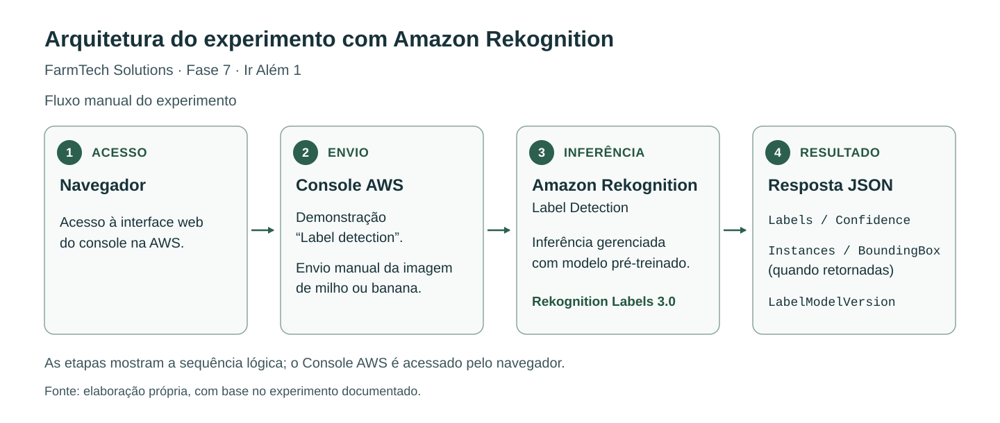
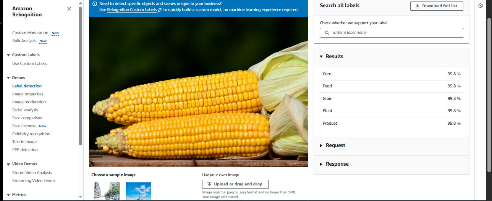
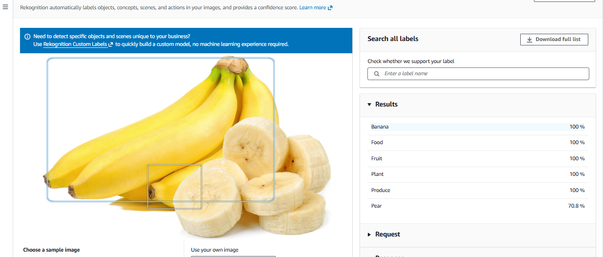

# FarmTech Solutions — Fase 7 | Ir Além 1 — Amazon Rekognition

Atividade acadêmica da **FIAP — Faculdade de Informática e Administração Paulista**. Este documento registra o experimento exploratório de reconhecimento de milho e banana com o Amazon Rekognition e sua comparação conceitual com a visão computacional da Fase 6.

[Vídeo demonstrativo — Ir Além 1: Amazon Rekognition](https://youtu.be/pzWuTnAOEr4)

## Objetivo e contexto

O objetivo do Ir Além 1 é explorar um serviço de visão computacional gerenciado na AWS, interpretar seus rótulos, níveis de confiança e localizações e discutir sua utilidade para a agricultura. A atividade complementa a FarmTech Solutions com uma análise de reconhecimento de produtos agrícolas, incluindo um caso de identificação incorreta.

O experimento documentado utilizou duas imagens, uma de milho e outra de banana, na demonstração **Label detection** do console AWS. O modelo informado no registro do experimento é **Rekognition Labels 3.0**. Trata-se do modelo geral do serviço, utilizado sem treinamento ou ajuste de pesos pelo grupo nesta atividade.

## Arquitetura efetivamente utilizada

**Navegador → console AWS → Amazon Rekognition Label Detection → resposta JSON.**



*Figura 1 — Arquitetura lógica do experimento. Fonte: elaboração própria. [Abrir a figura em SVG](arquitetura-rekognition.svg).*

O console AWS é acessado pelo navegador; esses elementos representam etapas de interação, e não duas aplicações independentes implantadas pelo grupo. A resposta JSON é a saída do processamento, consultável no console, e não um serviço adicional.

| Etapa | Papel no experimento |
| --- | --- |
| Navegador | Acesso manual à interface do console AWS. |
| Console AWS | Seleção da demonstração **Label detection** e fornecimento manual das imagens de milho e banana. |
| Amazon Rekognition Label Detection | Inferência com o modelo geral do serviço e geração de rótulos, confianças e instâncias quando disponíveis. |
| Resposta JSON | Representação estruturada dos resultados, incluindo rótulos, instâncias e versão do modelo. |

O procedimento documentado consistiu em acessar a demonstração, fornecer cada imagem e analisar os resultados apresentados. Esse uso manual corresponde ao fluxo descrito pela AWS para [detecção de objetos e cenas pelo console](https://docs.aws.amazon.com/rekognition/latest/dg/detect-labels-console.html).

**S3, Lambda, Custom Labels e integração automática com a dashboard não foram implementados neste experimento.** O banner de Custom Labels presente nas capturas é uma oferta da interface AWS e não evidencia treinamento ou uso desse recurso. Também não foi desenvolvido um cliente próprio de API ou SDK nesta atividade.

### Como interpretar a saída

A documentação de [DetectLabels](https://docs.aws.amazon.com/rekognition/latest/APIReference/API_DetectLabels.html) descreve o retorno estruturado. Os campos relevantes para esta análise são:

| Campo | Significado |
| --- | --- |
| `Labels[].Name` | Nome do rótulo atribuído à imagem, como `Corn`, `Banana` ou `Pear`. |
| `Labels[].Confidence` | Confiança do modelo no rótulo, expressa na escala de 0 a 100. |
| `Labels[].Instances` | Instâncias localizadas associadas ao rótulo, quando retornadas; reconhecer um rótulo não implica localizar todos os objetos. |
| `Labels[].Instances[].BoundingBox` | Região da imagem atribuída à instância. |
| `Labels[].Instances[].Confidence` | Confiança associada à localização da instância; é distinta da confiança do rótulo. |
| `LabelModelVersion` | Versão do modelo de detecção de rótulos utilizada na inferência. |

A distinção entre rótulo e instância segue as estruturas oficiais [Label](https://docs.aws.amazon.com/rekognition/latest/APIReference/API_Label.html) e [Instance](https://docs.aws.amazon.com/rekognition/latest/APIReference/API_Instance.html). Uma caixa delimita a região de uma hipótese do modelo; sua presença não comprova que a classe atribuída esteja correta.

## Experimentos e resultados

Os valores detalhados abaixo são os **resultados informados nos registros das respostas fornecidas durante o experimento**, preservados nos arquivos JSON de `evidencias/`. As capturas nessa pasta exibem os percentuais arredondados, com os painéis de resposta recolhidos. Os JSONs permitem consultar os valores completos de confiança dos rótulos e das instâncias, além da versão do modelo; os percentuais da tabela estão arredondados a quatro casas decimais quando necessário.

| Imagem | Rótulo   | Confiança do rótulo | Localização                                              | Confiança da instância          |
| ------ | -------- | ------------------ | -------------------------------------------------------- | ------------------------------- |
| Milho  | `Corn`   | **99,8351%**       | Sem instâncias localizadas no resultado informado.        | Não se aplica.                  |
| Banana | `Banana` | **100%**           | Instância localizada, com caixa delimitadora.             | **99,9762%**                    |
| Banana | `Pear`   | **70,8036%**       | Identificação adicional incorreta, com caixa delimitadora. | **70,8036%** (JSON original)     |

**Modelo informado: Rekognition Labels 3.0. Esses percentuais são confianças de predições específicas, não acurácia geral do Rekognition ou da YOLO.** O valor de 100% para `Banana` não garante ausência de erros em outras imagens nem elimina o falso positivo `Pear` na mesma imagem.

### Milho

A imagem apresenta duas espigas. O serviço atribuiu o rótulo `Corn` com confiança de **99,8351%**, além de rótulos gerais visíveis no console: `Food`, `Grain`, `Plant` e `Produce`. A captura apresenta **99,8%** na lista.

O resultado informado não contém instâncias localizadas de milho, coerente com a ausência de caixas na captura. Portanto, houve reconhecimento do conteúdo da imagem, mas não há localização individual ou contagem de espigas comprovada pelo retorno. A presença visual de duas espigas não deve ser convertida em uma contagem produzida pelo serviço.

### Banana

A imagem contém bananas inteiras e em rodelas. O rótulo `Banana` recebeu confiança de **100%**, com uma instância localizada cuja confiança informada é **99,9762%**. A captura mostra uma caixa ampla sobre o cacho e os rótulos gerais `Food`, `Fruit`, `Plant` e `Produce`, também exibidos como **100%**.

O retorno também atribuiu `Pear` com confiança de **70,8036%**, exibida como **70,8%** no console, e uma caixa menor sobre uma região da banana. A localização do cacho não constitui contagem de cada banana ou rodela.

### Análise crítica da identificação incorreta de `Pear`

Não há uma pera visível na imagem analisada. Assim, `Pear` representa um **falso positivo qualitativo**: uma identificação adicional incorreta que coexistiu com o reconhecimento correto de `Banana`. O termo descreve a observação neste exemplo; não representa uma taxa de falsos positivos calculada para um conjunto de avaliação.

A caixa delimitadora mostra que o serviço associou a hipótese `Pear` a uma região da imagem, sem validar semanticamente essa hipótese. A confiança menor que a de `Banana` permite ordenar os resultados, mas não torna a identificação aceitável por si só.

Semelhanças de forma, cor ou textura e o enquadramento da região podem ser hipóteses para a confusão. O experimento não investigou essas causas nem dá acesso aos dados de treinamento do modelo; portanto, não permite estabelecer uma explicação causal.

#### Tratamento de identificações secundárias em um sistema agrícola

O Rekognition retornou `Banana` (**100%**) e `Pear` (**70,8036%**) simultaneamente, sem escolher exclusivamente entre as duas classes. Um sistema agrícola poderia tratar esses resultados por meio dos seguintes critérios:

1. **Avaliar cada rótulo individualmente**, preservando identificações potencialmente válidas mesmo quando houver outra identificação incorreta na mesma imagem.
2. **Considerar as classes agrícolas relevantes** para a finalidade da aplicação, com regras explícitas para o tratamento de rótulos fora desse escopo.
3. **Aplicar limiares de confiança definidos mediante validação experimental**, sem interpretar os escores como probabilidades de acerto calibradas.
4. **Examinar as regiões delimitadas** para identificar possíveis inconsistências entre a classe atribuída e o conteúdo da região; a existência de uma caixa não confirma a identificação.
5. **Encaminhar casos ambíguos para revisão humana**, conforme o risco associado à decisão agrícola.

Neste exemplo, `Banana` seria preservada como **identificação candidata válida**, sem que isso representasse aprovação automática para uso operacional. `Pear`, identificação adicional incorreta no experimento, seria sinalizada para revisão ou filtragem conforme regras previamente validadas, sem descartar o reconhecimento correto de `Banana`.

Restringir classes ou aplicar limiares não garante, isoladamente, a eliminação de erros nem comprova melhoria geral; um limiar também pode excluir identificações corretas. **Essas estratégias são propostas conceituais, não funcionalidades implementadas ou testadas nesta atividade.**

## Comparação conceitual com a YOLO da Fase 6

A [documentação da Fase 6](../../servicos/fase6-visao/README.md) registra a YOLOv5 customizada para banana e milho, com treinamento por transferência de aprendizado, anotações de caixas e avaliações próprias. Essa referência é consultada para comparação; os experimentos e as Entregas 1 e 2 permanecem preservados.

| Aspecto | Rekognition neste Ir Além 1 | YOLO customizada da Fase 6 |
| --- | --- | --- |
| Modelo | Modelo geral gerenciado pela AWS, versão informada Labels 3.0. | YOLOv5s ajustada com o dataset de banana e milho do projeto. |
| Preparação | Uso do modelo disponível, sem treinamento pelo grupo. | Curadoria, anotação e treinamento documentados na Fase 6. |
| Classes | Vocabulário geral, com produtos e conceitos amplos; pode retornar classes fora do interesse agrícola. | Classes configuradas no projeto: banana e milho. |
| Saída | Rótulos e confianças; instâncias e caixas quando retornadas. | Detecções com classe, confiança e caixa delimitadora. |
| Execução | Processamento gerenciado na AWS, acessado manualmente pelo console. | Pesos e ambiente de inferência sob responsabilidade do projeto. |
| Controle | Uso do modelo geral sem ajuste de seus pesos nesta atividade. | Possibilidade de ajustar dados, pesos e parâmetros do detector. |
| Evidência analisada aqui | Duas imagens e seus resultados, em análise exploratória. | Registros de treinamento, validação e teste disponíveis na documentação da Fase 6. |

### Confiança de predição e métricas de avaliação

**Confiança** é o escore atribuído pelo modelo a uma saída individual. Mesmo expresso em percentual, não equivale à proporção de acertos em uma população de imagens e não deve ser tratado como probabilidade de acerto calibrada sem verificação. Escores da YOLO e do Rekognition também não são diretamente comparáveis como medida de qualidade geral.

**Métricas de avaliação** exigem previsões comparadas com referências anotadas e um protocolo definido. Na detecção, a associação considera a classe e a sobreposição entre a caixa prevista e a caixa de referência, normalmente medida por **IoU**: área de interseção dividida pela área de união.

- **Precisão:** `TP / (TP + FP)`, proporção de detecções consideradas corretas pelo protocolo.
- **Recall:** `TP / (TP + FN)`, proporção de objetos de referência recuperados.
- **F1:** `2 × precisão × recall / (precisão + recall)`, quando o denominador é diferente de zero.
- **mAP:** média da precisão média (AP) entre classes, obtida a partir da relação entre precisão e recall; `mAP50` usa IoU de 0,50 e `mAP50-95` agrega os limiares de 0,50 a 0,95, em passos de 0,05.

`TP`, `FP` e `FN` representam verdadeiros positivos, falsos positivos e falsos negativos segundo o protocolo de associação. A [referência técnica da Ultralytics](https://docs.ultralytics.com/guides/yolo-performance-metrics/) detalha essas métricas de detecção.

Não foram calculados precisão, recall, F1, mAP ou acurácia para o Rekognition nesta atividade. Não há conjunto anotado e protocolo comum de avaliação com a YOLO, nem comprovação de que as duas imagens constituam o mesmo conjunto de teste da Fase 6. Assim, os resultados permitem discutir comportamento e facilidade de uso, mas **não demonstram superioridade de um modelo sobre o outro**. Também não foram medidos tempos de inferência ou vazão comparáveis.

## Vantagens, limitações e aplicações agrícolas

O uso pelo console simplifica a exploração inicial: o grupo pode obter resultados sem preparar um ambiente local de inferência ou treinar um modelo. A saída estruturada oferece rótulos, confiança e informações de localização, úteis para analisar casos e planejar um fluxo de revisão.

As limitações observadas são a identificação incorreta adicional de `Pear`, a ausência de localização individual do milho e a diferença entre reconhecer uma classe e contar seus objetos. O vocabulário geral pode gerar rótulos amplos ou fora do domínio de interesse. O processamento na nuvem também depende de conectividade e das condições de acesso ao serviço, enquanto o controle sobre os pesos do modelo geral é limitado.

As duas imagens não representam a diversidade de iluminação, oclusão, escala, fundo, variedade e estágio de desenvolvimento encontrada no campo. O experimento não avaliou pragas, doenças, maturação, qualidade comercial ou produtividade, e reconhecer `Corn` ou `Banana` não comprova capacidade para essas tarefas.

| Possível aplicação futura | Condição necessária antes de uso operacional |
| --- | --- |
| Triagem de fotografias de produtos agrícolas | Validar as classes de interesse em imagens representativas e prever revisão dos casos ambíguos. |
| Catalogação de registros visuais de colheita | Associar os rótulos a metadados e avaliar erros de classificação. |
| Apoio à separação de banana e milho | Comparar as alternativas em um conjunto comum anotado, com critérios de aceitação. |
| Localização ou contagem de produtos | Avaliar caixas e granularidade das instâncias; o retorno atual do milho não sustenta contagem. |

Essas aplicações são possibilidades de evolução, sem implementação ou validação neste experimento.

## Evidências preservadas

Os arquivos JSON vinculados abaixo são **registros das respostas fornecidas durante o experimento**. Sua inclusão documenta os resultados já informados e **não representa novos testes ou chamadas à AWS**.

### Evidência 1 — Milho



*Captura original: [01-rekognition-milho.png](evidencias/01-rekognition-milho.png). Mostra a demonstração Label detection, a imagem de milho e os rótulos retornados com percentuais arredondados. A seção Response está recolhida; a captura não expõe o JSON integral ou a versão do modelo.*

Registro da resposta: [03-resposta-rekognition-milho.json](evidencias/03-resposta-rekognition-milho.json), com `Corn`, sua confiança, a ausência de instâncias localizadas e `LabelModelVersion` igual a `3.0`.

### Evidência 2 — Banana



*Captura original: [02-rekognition-banana.png](evidencias/02-rekognition-banana.png). Mostra Banana com 100%, Pear com 70,8% e duas regiões delimitadas na imagem. O enquadramento não apresenta a resposta JSON expandida nem a confiança detalhada da instância Banana.*

Registro da resposta: [04-resposta-rekognition-banana.json](evidencias/04-resposta-rekognition-banana.json), com `Banana`, `Pear`, as confianças dos rótulos e das instâncias, suas caixas delimitadoras e `LabelModelVersion` igual a `3.0`.

As capturas foram mantidas sem edição. Elas documentam a interface e os resultados visíveis; a tabela de resultados detalhados utiliza também os registros JSON vinculados acima. Os arquivos PNG são capturas do console, e não um conjunto de imagens de entrada acompanhado de anotações de referência.

## Learner Lab e considerações sobre custos

O Learner Lab é um ambiente educacional: os serviços e as permissões disponíveis, o período de acesso e o orçamento de créditos devem ser conferidos nas instruções da turma. O [guia de educadores da AWS Academy](https://d1.awsstatic.com/AWS%20Academy%20Learner%20Lab%20Educator%20Guide.pdf), publicado em 2021, descreve o acesso a um conjunto restrito de serviços e o acompanhamento do consumo. Ele é uma referência geral do programa, não uma comprovação das permissões ou do saldo desta conta.

As evidências desta atividade mostram o uso de Label detection e **não registram bloqueio de acesso, esgotamento de créditos ou impedimento específico de S3, Lambda ou Custom Labels**. A ausência desses componentes na arquitetura decorre do escopo executado; não é atribuída a um bloqueio presumido do laboratório. O console utilizado estava na região `us-east-1`. Não foram verificadas as políticas IAM, o saldo ou os limites específicos da conta.

Na oferta comercial, a análise de imagens do Rekognition é tarifada por uso; `DetectLabels` integra o grupo 2 de APIs de análise, com faixas relacionadas ao volume processado. Os preços e condições aplicáveis devem ser consultados na [página oficial de preços do Amazon Rekognition](https://aws.amazon.com/rekognition/pricing/).

Não há comprovante de faturamento, extrato de consumo ou registro de créditos nesta pasta. Portanto, **o custo efetivo deste experimento não foi apurado**: não se afirma despesa, gratuidade ou elegibilidade a Free Tier. A existência de duas imagens documentadas também não comprova o número total de chamadas faturáveis. Uma estimativa futura precisaria considerar região, volume de análises e condições da conta, distinguindo estimativa de consumo efetivamente observado.

## Estudo de caso visual

O [painel acadêmico Rekognition × YOLO](estudo-de-caso-rekognition-yolo.svg) sintetiza os resultados, a comparação documental e um fluxo conceitual de apoio à decisão agrícola, não implementado.

## Organização dos arquivos

```text
ir-alem-1-rekognition/
├── README.md
├── arquitetura-rekognition.svg
├── estudo-de-caso-rekognition-yolo.svg
└── evidencias/
    ├── 01-rekognition-milho.png
    ├── 02-rekognition-banana.png
    ├── 03-resposta-rekognition-milho.json
    └── 04-resposta-rekognition-banana.json
```

Este material documenta o experimento exploratório do Ir Além 1. Não acrescenta execução de testes, treinamento, chamadas AWS ou integrações aos resultados registrados. As referências técnicas externas foram consultadas em **07/11/2026**.
