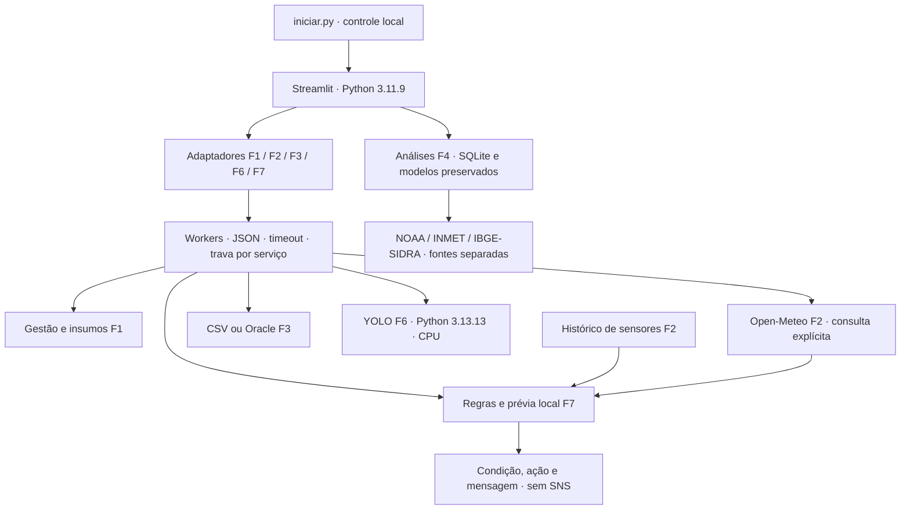
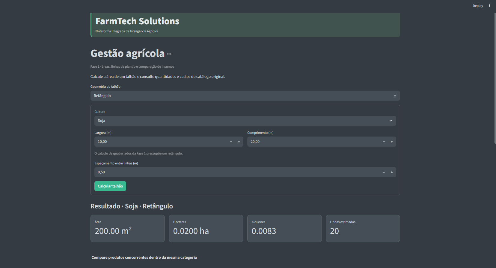
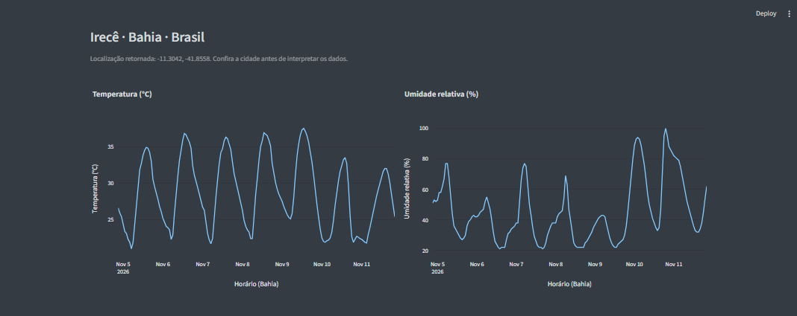
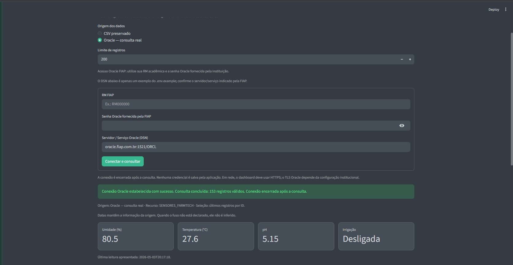
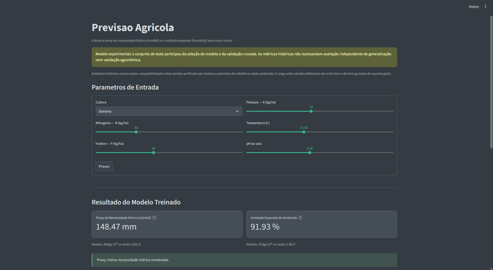
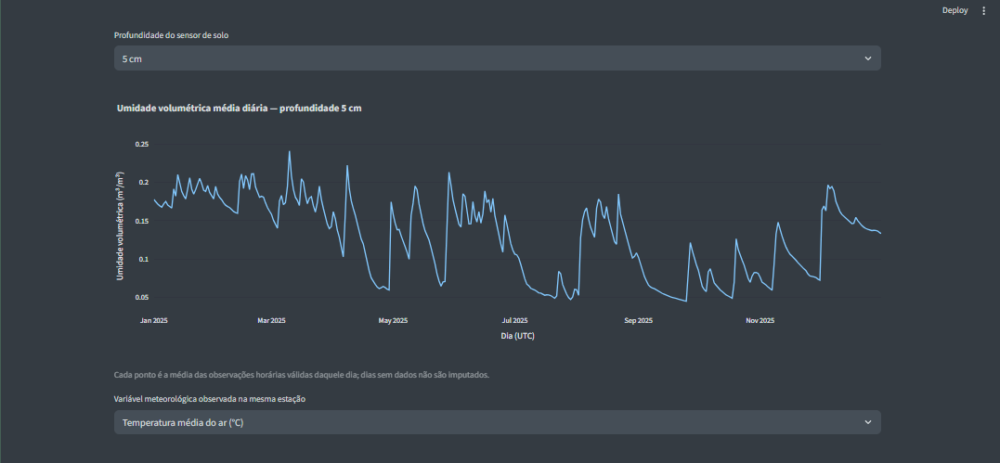
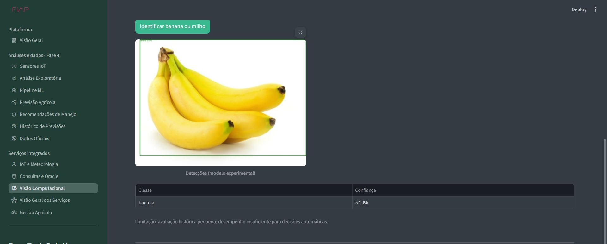
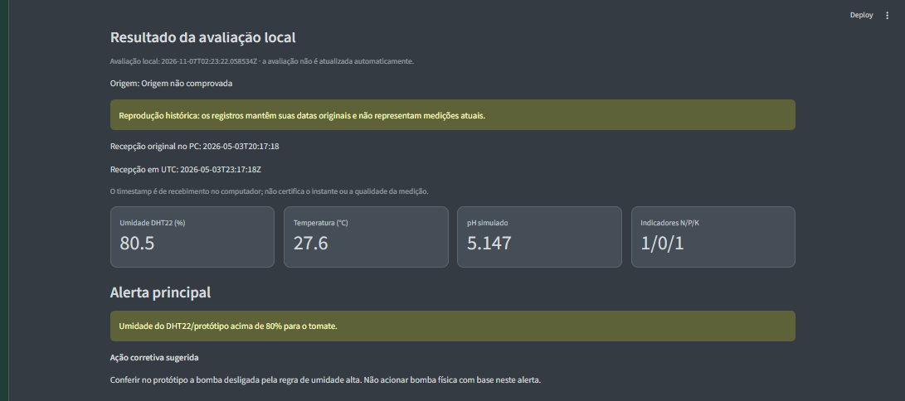
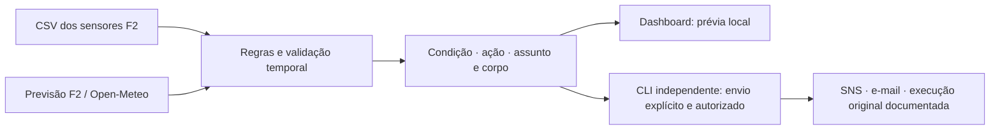

# FIAP — Faculdade de Informática e Administração Paulista

<p align="center">
  <a href="https://www.fiap.com.br/"></a>
</p>

# FarmTech Solutions — Fase 7: A Consolidação de um Sistema

**Tecnólogo em Inteligência Artificial**

| Integrantes | Registro acadêmico |
|---|---|
| Carlos Magnus Costa Amaral | RM573978 |
| Edemir Sufiatti | RM571375 |
| Georgia Mendes Rocha | RM573281 |
| Marina Leme Soares | RM570461 |

**Tutora:** Nicolly Cândida Rodrigues de Souza

**Coordenador:** André Godoi Chiovato

> **Vídeo demonstrativo — Entrega principal:** `[Inserir link do YouTube]`
>
> **Vídeo demonstrativo — Ir Além:** `[Inserir link do YouTube]`

## Sumário

- [Apresentação](#apresentação-e-resumo-executivo) e [objetivos](#problema-abordado-e-objetivos).
- [Evolução das Fases 1 a 6](#evolução-nas-fases-1-a-6).
- [Arquitetura](#arquitetura-geral) e [estrutura de diretórios](#estrutura-de-diretórios).
- [Instalação e configuração](#pré-requisitos-instalação-e-configuração) e [execução](#como-iniciar-e-utilizar-a-aplicação).
- [Dashboard integrada](#fase-7--parte-1-dashboard-final-e-serviços-integrados).
- [Indicadores, métricas e resultados](#indicadores-métricas-e-resultados-do-sistema-integrado).
- [Evidências visuais](#demonstrações-visuais-da-dashboard).
- [Parte 2 — Alertas AWS](#fase-7--parte-2-serviço-de-alertas-aws).
  - [Validação AWS — Evidências complementares](#validação-aws--evidências-complementares).
- [Ir Além 1 — Amazon Rekognition](#ir-além-1--amazon-rekognition).
- [Testes e validações](#reprodução-dos-testes-e-validações).
- [Limitações e segurança](#resultados-limitações-e-segurança).
- [Documentação complementar](#documentação-complementar-e-repositórios-originais).
- [Fontes de dados e referências](#fontes-de-dados-e-referências).
- [Histórico de lançamentos](#histórico-de-lançamentos).
- [Créditos](#créditos-e-direitos-autorais) e [licença](#licença).

## Apresentação e resumo executivo

A FarmTech Solutions reúne gestão agrícola, sensores, persistência, análise de dados, modelos preditivos e visão computacional em uma plataforma acadêmica de apoio à decisão. A Fase 7 consolida os serviços anteriores na dashboard Streamlit da Fase 4, preservando os projetos de origem, seus dados, modelos, notebooks e evidências.

A entrega compreende duas partes:

### Entrega 1 — Sistema integrado e dashboard (Parte 1 da Fase 7)

Uma entrada local, uma página inicial e treze páginas funcionais, com as análises da F4, integrações das Fases 1, 2, 3 e 6 e a avaliação local dos alertas.

### Entrega 2 — Serviço de Alertas na AWS (Parte 2 da Fase 7)

- **Responsável:** Edemir Sufiatti.
- **Código da implementação:** [servicos/fase7-alertas-aws/](servicos/fase7-alertas-aws/).
- **Documentação técnica da Entrega 02, atualizada em 08/11/2026:** [servicos/fase7-alertas-aws/README.md](servicos/fase7-alertas-aws/README.md).

Serviço independente com execução original em EC2/SNS documentada por capturas históricas. A evolução atual consome também o contrato dos sensores F2 e oferece prévias na dashboard, sem publicação SNS pela interface.

O sistema distingue dados acadêmicos, históricos de sensores, simulações, previsões externas e observações oficiais. Os resultados **não constituem validação agronômica, controle de irrigação em produção ou certificação dos modelos**.

## Problema abordado e objetivos

Dados e ferramentas agrícolas distribuídos entre programas, bancos e modelos dificultam a interpretação conjunta. A proposta centraliza a navegação e as análises sem apagar suas origens ou combinar fontes incompatíveis.

Os objetivos são permitir cálculos e consultas sob demanda, apresentar métricas verificáveis, preservar a rastreabilidade dos experimentos e comunicar condições que merecem atenção. Os ambientes incompatíveis permanecem separados, e a demonstração básica funciona sem credenciais AWS ou Oracle.

## Evolução nas Fases 1 a 6

| Fase | Contribuição técnica | Situação no consolidado | Documentação preservada |
|---|---|---|---|
| **1 — Gestão agrícola** | Geometria de talhões, áreas, conversões, linhas e insumos | Cálculos reutilizados na página Gestão agrícola; menus e ferramentas R preservados | [README F1](servicos/fase1-gestao/README.md) |
| **2 — IoT** | ESP32/Wokwi, irrigação didática, captura CSV, meteorologia e R | Consulta Open-Meteo, exportação e validação R explícita; histórico também alimenta Alertas | [README F2](servicos/fase2-iot/README.md) |
| **3 — Persistência** | Oracle, contrato dos sensores, consultas e indicadores | Consulta explícita a CSV ou Oracle; aplicação histórica e SQL preservados | [README F3](servicos/fase3-dashboard/README.md) |
| **4 — Análise e previsão** | Streamlit, SQLite, exploração, regressões, manejo, histórico e fontes oficiais | Núcleo da plataforma; sete páginas analíticas e integrações adicionais | [README F4](servicos/fase4-regressao/README.md) |
| **5 — ML e infraestrutura** | Rendimento agrícola, clusterização, regressões e custos AWS | Notebook, dataset e documentos históricos; **sem página integrada própria** | [README F5](servicos/fase5-ml/README.md) |
| **6 — Visão computacional** | YOLOv5 customizada para banana/milho e comparação com CNN | Upload/inferência YOLO e avaliação do teste; CNN preservada como experimento independente | [README F6](servicos/fase6-visao/README.md) |

## Arquitetura geral



Os adaptadores retornam `Result(status, message, data, source)`, distinguindo sucesso, entrada inválida, indisponibilidade e erro. Workers usam processos com argumentos fixos, sem shell, comunicação JSON, limites e exclusão mútua por fase. A separação também evita colisões entre os pacotes `src` dos serviços.

A visão executa em outro ambiente Python; R depende de instalação própria. Captura serial, Wokwi, Oracle e consultas meteorológicas não são iniciados automaticamente. O publicador SNS independente e a prévia integrada possuem fluxos distintos.

### Estrutura de diretórios

```text
.
├── README.md
├── iniciar.py                     # entrada oficial e controle do servidor
├── requirements.txt               # perfil básico da dashboard
├── requirements-oracle.txt        # driver Oracle opcional
├── assets/                        # identidade e capturas AWS tratadas
├── docs/                          # contratos, validações e evidências
│   └── evidencias/                 # capturas da dashboard
├── farmtech_integracao/            # adaptadores, contratos e apresentação
│   └── workers/                    # execução isolada dos serviços
├── scripts/                       # procedimentos explícitos de validação
├── tests/integracao/               # testes da integração
└── servicos/
    ├── fase1-gestao/
    ├── fase2-iot/
    ├── fase3-dashboard/
    ├── fase4-regressao/
    ├── fase5-ml/
    ├── fase6-visao/
    └── fase7-alertas-aws/
```

Durante o uso, `.runtime/` recebe a base reconstruída, exportações, uploads temporários, travas e logs. Ambientes e caches são locais. Os serviços mantêm seus materiais de origem; arquivos fora do caminho principal podem ser necessários à reprodução histórica.

### Tecnologias utilizadas

| Camada | Tecnologias e contexto |
|---|---|
| Interface | Python 3.11.9, Streamlit 1.54.0, Plotly 6.1.1, Pandas 2.2.3 |
| Modelos tabulares | NumPy 2.2.6, scikit-learn 1.6.1 e joblib 1.5.0 |
| Persistência | SQLite local; Oracle com driver thin opcional; CSV/JSON |
| IoT | ESP32, C++/Arduino, Wokwi, PlatformIO e PySerial nos fluxos próprios |
| Análises | R executado explicitamente; fontes Open-Meteo, NOAA/USCRN, INMET e SIDRA |
| Visão | Python 3.13.13, PyTorch 2.15.0, torchvision 0.29.2 e YOLOv5 local; TensorFlow/Keras no experimento CNN |
| Mensageria original | EC2 Linux, IAM e SNS Standard; boto3 opcional no serviço independente |

## Pré-requisitos, instalação e configuração

### Primeira execução

Este roteiro prepara a dashboard básica a partir de um clone novo. Abra o PowerShell na raiz do repositório, onde estão `iniciar.py` e `requirements.txt`; não é necessário configurar o VS Code nem utilizar um ambiente de outra pasta.

#### 1. Preparar o ambiente da dashboard básica

O perfil verificado é **Windows e Python 3.11.9**. Confirme a versão patch: `py -3.11` seleciona a família, não garante sozinho a versão exata.

```powershell
py -3.11 --version
```

Prossiga somente se a saída for `Python 3.11.9`; caso contrário, instale ou selecione essa versão antes de criar o ambiente. Crie a pasta prevista apenas se ela ainda não existir, preservando qualquer ambiente existente:

```powershell
if (-not (Test-Path -LiteralPath ".\servicos\fase4-regressao\.venv-f402")) {
    py -3.11 -m venv servicos/fase4-regressao/.venv-f402
}

$pythonDashboard = ".\servicos\fase4-regressao\.venv-f402\Scripts\python.exe"
& $pythonDashboard --version
```

Confirme também `Python 3.11.9` no executável do ambiente. Se a pasta existente estiver incompleta ou usar outra versão, preserve-a e configure um ambiente compatível por `FARMTECH_FASE4_PYTHON`, conforme [Como iniciar e utilizar a aplicação](#como-iniciar-e-utilizar-a-aplicação). A instalação das dependências é uma ação manual:

```powershell
& $pythonDashboard -m pip install pip==26.2.2 setuptools==84.1.0
& $pythonDashboard -m pip install -r requirements.txt
& $pythonDashboard -m pip check
```

O [perfil básico](requirements.txt) reutiliza os pins F4 e suas [constraints](servicos/fase4-regressao/constraints-f402.txt). Não reúne todas as bibliotecas dos serviços. Preserve scikit-learn **1.6.1**, exigido pelos carregadores dos artefatos históricos; upgrades gerais não são uma solução validada de compatibilidade.

Os manifests foram conferidos contra os ambientes existentes; os perfis básico/Oracle passaram em simulação offline de instalação. **Não foi executada instalação completa em computador limpo.** Disponibilidade de wheels e outros sistemas operacionais exigem nova verificação.

#### 2. Preparar e conferir o banco de demonstração

Na raiz, consulte as condições locais:

```powershell
python iniciar.py --status
```

Para utilizar o banco padrão, deixe `DB_PATH` sem configuração. Se `.runtime/demo/farmtech-demo.db` ainda não existir, prepare-o explicitamente e consulte novamente:

```powershell
if (-not (Test-Path -LiteralPath ".\.runtime\demo\farmtech-demo.db")) {
    python iniciar.py --preparar-demo
}
python iniciar.py --status
```

No resultado de `fase4`, confirme `status: "ok"` e as contagens iniciais: `culturas: 22`, `sensores: 1`, `leituras_sensores: 153`, `amostras_agronomicas: 2200` e `previsoes: 0`. Essas contagens descrevem a base recém-preparada; simulações e previsões posteriores podem alterá-las. As leituras iniciais vêm do CSV preservado, sem depender de iniciar uma nova simulação.

`--preparar-demo` cria somente o destino padrão e recusa qualquer arquivo já existente; não substitua nem apague uma base para repetir o roteiro. Uma `DB_PATH` explícita tem prioridade durante a execução: ela deve apontar para um banco F4 existente e compatível, pois esse comando não prepara o destino personalizado. Caminhos relativos de `DB_PATH` são resolvidos a partir de `servicos/fase4-regressao/`. Para voltar ao padrão apenas nesta sessão, use `Remove-Item Env:DB_PATH -ErrorAction SilentlyContinue` e consulte `--status` novamente.

#### 3. Abrir o menu interativo

```powershell
python iniciar.py
```

Escolha **1** para iniciar, **0** para solicitar o encerramento da dashboard e **S** para sair do menu. Os detalhes de portas, ambiente em outro worktree e inicialização direta estão em [Como iniciar e utilizar a aplicação](#como-iniciar-e-utilizar-a-aplicação).

### Oracle opcional

```powershell
& $pythonDashboard -m pip install -r requirements-oracle.txt
```

O [perfil Oracle](requirements-oracle.txt) inclui `oracledb==26.1.0`. A página recebe RM, senha e DSN por consulta; confirme os dados institucionais. A CLI utiliza `ORACLE_USER`, `ORACLE_PASS` e `ORACLE_DSN` no ambiente. Não versione seus valores. Instalar o driver não cria banco, tabela ou permissões.

Sem Oracle, selecione **CSV preservado**. Não há troca silenciosa de origem após erro.

### Visão computacional separada

```powershell
# Confirmar Python 3.13.13 antes de criar este ambiente
py -3.13 --version
py -3.13 -m venv servicos/fase6-visao/.venv-fase6
& ./servicos/fase6-visao/.venv-fase6/Scripts/python.exe -m pip install -r servicos/fase6-visao/requirements.txt
& ./servicos/fase6-visao/.venv-fase6/Scripts/python.exe -m pip check
```

Disponibilize um **checkout Git local, íntegro e confiável da YOLOv5**, na revisão `4add2aff6e3d926586a3eab4659f3b498dd444a1`, e informe seu diretório em `FARMTECH_YOLO_REPO`. Cache do Hub sem `.git` não satisfaz a verificação. A aplicação não baixa automaticamente código, modelos ou dependências.

O checkpoint é [yolov5s_custom_exp60_best.pt](servicos/fase6-visao/entrega_2/modelos/yolov5s_custom_exp60_best.pt). Dataset, avaliador e pesos selecionados estão preservados no serviço. O requirements F6 também contempla o contexto CNN/notebook e não é um lock completo das transitivas. Não o instale no ambiente da dashboard.

### Configurações locais

| Configuração | Finalidade |
|---|---|
| `FARMTECH_FASE4_PYTHON` | Executável equivalente ao Python F4 validado; padrão no ambiente `.venv-f402` do serviço |
| `FARMTECH_FASE6_PYTHON` | Executável F6; padrão `.venv-fase6/Scripts/python.exe` |
| `FARMTECH_YOLO_REPO` | Diretório do checkout YOLO validado |
| `FARMTECH_RSCRIPT` | Executável Rscript, se não encontrado automaticamente |
| `DB_PATH` | SQLite escolhido; padrão na base reconstruída da integração |

Os executáveis configurados devem usar caminhos absolutos válidos na máquina de execução. Para R, disponibilize Rscript e os pacotes da [documentação F2](servicos/fase2-iot/README.md). Captura serial exige PySerial e fonte serial/Wokwi; firmware exige seu toolchain. Esses recursos não são necessários à abertura básica.

**AWS não é pré-requisito da dashboard:** seu perfil básico não exige boto3, chaves, ARN ou acesso à nuvem. A configuração do publicador independente está no [README dos Alertas](servicos/fase7-alertas-aws/README.md).

## Como iniciar e utilizar a aplicação

Após concluir a [Primeira execução](#primeira-execução), na raiz:

```powershell
python iniciar.py
```

Sem argumentos, `python iniciar.py` abre o menu interativo, procedimento principal de uso: **1 — Iniciar** inicia a dashboard, **0 — Parar** solicita seu encerramento e **S — Sair** sai do menu. O navegador é aberto no endereço informado; o controlador procura uma porta livre entre 8501 e 8510.

O inicializador localiza automaticamente `.venv-f402` em `servicos/fase4-regressao/`. Se `FARMTECH_FASE4_PYTHON` estiver definida, esse executável tem prioridade. Antes de abrir o servidor, são conferidas a versão Python 3.11.9, a presença das dependências e a disponibilidade do banco com as colunas necessárias. Configurações incompatíveis impedem a inicialização e apresentam instruções de correção; não há instalação de dependências nem preparação de banco automática.

Selecionar um interpretador em **Python: Select Interpreter** no VS Code não configura necessariamente a variável `FARMTECH_FASE4_PYTHON`, usada pelo inicializador para localizar o Python da dashboard. Ambientes virtuais não são compartilhados automaticamente entre worktrees Git. Quando o ambiente da Fase 4 estiver em outra pasta de trabalho, informe o caminho do executável por essa variável.

No PowerShell, a partir da raiz do projeto, o exemplo abaixo utiliza o ambiente local empregado no desenvolvimento. **Esse caminho é específico dessa máquina; ajuste-o à localização do ambiente da Fase 4 no seu computador.**

```powershell
$env:FARMTECH_FASE4_PYTHON = "C:\Users\Georgia\Desktop\farmtech-envio-fase7\servicos\fase4-regressao\.venv-f402\Scripts\python.exe"

python iniciar.py
```

Essa definição vale somente para a sessão atual do terminal e para os processos iniciados a partir dele. Em um novo terminal, defina a variável novamente se precisar utilizar esse ambiente.

Como alternativa ao menu, para início direto:

```powershell
python iniciar.py --dashboard --port 8501
```

Acesse `http://127.0.0.1:8501`. Porta ocupada não é reutilizada. No modo direto, encerre com `Ctrl+C`; no menu, use **0** ou **S**. O controlador não encerra servidores de outras aplicações.

### Base reconstruída e uso offline

`--preparar-demo` cria `.runtime/demo/farmtech-demo.db` a partir dos dois CSVs F4, registra procedência/hashes e **recusa destino existente**. A carga inicial contém 22 culturas, 153 leituras registradas/simuladas e 2.200 amostras acadêmicas; não cria previsões fictícias. Previsões solicitadas depois podem ser persistidas no banco selecionado.

É uma base demonstrativa, não recuperação de histórico perdido. A preparação usa seu destino próprio; `DB_PATH` é respeitado na execução. A simulação inicia desativada e depende de controle explícito.

O carregamento das 153 leituras iniciais e a simulação são operações separadas. Na página **Sensores IoT**, **Iniciar simulação** habilita a geração de novas leituras sintéticas apenas na base de demonstração do modo integrado, após validar o banco. Use **Parar simulação** para interrompê-la. Um `DB_PATH` apontando para outro banco permite suas consultas, mas bloqueia esse controle de simulação; a ausência da base padrão recebe instruções de preparação. A simulação acrescenta registros e não é necessária para consultar o histórico inicial.

Sem rede ou credenciais, permanecem disponíveis cálculos, CSVs, modelos/fontes oficiais locais e demonstrações de alertas. A visão exige seu ambiente e checkout. Open-Meteo precisa de HTTPS; Oracle precisa de rede e autenticação. Falta de pré-condições é informada sem simular sucesso externo.

## Fase 7 — Parte 1: dashboard final e serviços integrados

A página inicial e as treze páginas são registradas pela aplicação. Os caminhos seguintes têm prefixo `servicos/fase4-regressao/src/frontend/`.

| Página | Arquivo | Funcionalidade |
|---|---|---|
| Visão Geral | `app.py` | Apresentação, navegação e contexto da base/simulação |
| Sensores IoT | `pages/1_Sensores_IoT.py` | Leituras, gráficos, histórico e controle de simulação |
| Análise Exploratória | `pages/2_Analise_Exploratoria.py` | Filtros, estatísticas, correlação e distribuições |
| Pipeline ML | `pages/3_Pipeline_ML.py` | Comparação de modelos, métricas e resíduos |
| Previsão Agrícola | `pages/4_Previsao.py` | Estimativas acadêmicas de rainfall/umidade e pH |
| Recomendações de Manejo | `pages/5_Recomendacoes.py` | Comparações didáticas de cenário e leituras |
| Histórico de Previsões | `pages/6_Historico_Previsoes.py` | Resultados persistidos, gráficos e exportação |
| Dados Oficiais | `pages/7_Dados_Oficiais.py` | NOAA/USCRN, INMET e IBGE/SIDRA |
| Visão Geral dos Serviços | `pages/8_Servicos_Integrados.py` | Cinco serviços, pré-condições locais e contagens |
| Gestão Agrícola | `pages/9_Gestao_Agricola.py` | Geometria e insumos F1 |
| IoT e Meteorologia | `pages/10_IoT_Meteorologia.py` | Open-Meteo, CSV e validação R F2 |
| Consultas e Oracle | `pages/11_Oracle_Consultas.py` | Consulta CSV ou Oracle F3 |
| Visão Computacional | `pages/12_Visao_Computacional.py` | Upload/inferência YOLO e avaliação do teste F6 |
| Alertas — Fase 7 | `pages/13_Alertas_Fase7.py` | Avaliação de sensores/meteorologia e prévia sem SNS |

Para demonstrar: prepare a base, calcule um talhão, consulte o CSV F3, explore os modelos F4, analise uma imagem com F6 e avalie o histórico na página Alertas. Solicite meteorologia, Oracle e R quando suas pré-condições estiverem disponíveis.

## Indicadores, métricas e resultados do sistema integrado

Os valores são exemplos verificáveis de fontes preservadas e capturas identificadas. Contagens, filtros, tempos e previsões variam conforme a execução. **Indicador operacional, previsão meteorológica e métrica de IA não são medidas equivalentes.**

### Indicadores operacionais e cenários

| Serviço / página | Valores representativos | Contexto e fonte |
|---|---|---|
| Visão Geral / Serviços | **Cinco serviços** na página 8; base inicial com **22 culturas, 153 leituras e 2.200 amostras**, sem previsões artificiais | [Preparação da base](farmtech_integracao/workers/fase4_worker.py). Contagens mudam com o uso; prontidão local não comprova acesso externo |
| Gestão F1 | Soja, retângulo **10 × 20 m**, espaçamento **0,50 m**: **200 m²**, **0,0200 ha**, **0,0083 alqueire**, **20 linhas** | [Captura F1](docs/evidencias/fase1_gestao_geral.png). Área = largura × comprimento; ha = m²/10.000; alqueire preservado = 24.200 m². Custos/quantidades usam catálogo ilustrativo |
| Meteorologia F2 | Temperatura **°C**, umidade do ar **%**, precipitação **mm** e vento **m/s**, em série horária para **Irecê, 05–11/11/2026** | [Captura meteorológica](docs/evidencias/fase2_meteorologia_temperatura_umidade.png). Valores dependem da cidade e consulta; não são medições dos sensores locais |
| Validação R F2 | **153 registros históricos analisados**, **três registros sintéticos integrados** | [Captura R](docs/evidencias/fase2_r_integracao_validada.png). Demonstração temporalmente compatível, separada do histórico de maio e da previsão real de novembro |
| Consultas F3 | **153 registros**; última leitura **03/05/2026 20:17:18**: **80,5%**, **27,6 °C**, **pH 5,15** na tela, bomba desligada | [CSV F3](docs/evidencias/fase3_csv_consulta_geral.png). Sem fuso declarado, não se presume UTC. A [captura Oracle](docs/evidencias/fase3_oracle_consulta_real.png) registra consulta de 153 linhas naquela sessão |
| Sensores F4 | Em **04/11/2026, 23:57:30, Bahia**: **82,7%**, **37,3 °C**, **pH simulado 10,500**, **LDR 1830**, bomba desligada | [Leituras F4](docs/evidencias/fase4_iot_leituras.png). Registros/simulações acadêmicas, não comprovação de medição física atual |
| Exploração F4 | **100 amostras por cultura**. Filtro banana/apple/coconut/cotton: **400 amostras**, médias **25,35 °C**, **86,84%**, **pH 6,20**, **rainfall 118,34 mm** | [Estatística do filtro](docs/evidencias/fase4_analise_exploratoria_estatistica_e_contagem.png). Médias do recorte, não da base inteira |
| Previsão F4 | Banana; N/P/K **38/60/93 kg/ha**, **22,5 °C**, pH **6,3** → **rainfall 148,47 mm**, **umidade 91,93%** | [Cenário da captura](docs/evidencias/fase4_previsao_parametros_e_resultados.png). Proxy acadêmico, sem horizonte meteorológico datado ou volume operacional de irrigação |
| Estimativa de pH F4 | Cenário distinto: banana; N/P/K **60/55/44 kg/ha**, **25 °C**, umidade **70%**, rainfall **100 mm** → **pH 5,900** | [Captura pH](docs/evidencias/fase4_previsao_estimativa_ph.png). O pH não é entrada desse modelo |
| Manejo F4 | Umidade **58,3%** versus limite **60%**: déficit **1,7 p.p.**; pH **7,798** versus faixa apple **5,5–6,5**: excesso **1,298** | [Recomendações](docs/evidencias/fase4_recomendacoes_manejo.png). Referências didáticas; não calculam dose, duração ou volume |
| Histórico F4 | Em **05/11/2026**: **30 previsões**, **três tipos** e **um nome de algoritmo, Ridge** | [Histórico](docs/evidencias/fase4_historico_previsoes_grafico_umidade.png). Um nome não significa um único arquivo para todos os alvos. Consulta até 500 registros; total dinâmico |
| NOAA/USCRN e INMET | NOAA: **8.756 observações horárias**, GA Newton 11 SW, série 2025; solo em **m³/m³**, profundidades **5/10/20/50/100 cm**. INMET: **8.713 observações horárias**, A701 São Paulo–Mirante, **2025** | [CSVs/metadados](servicos/fase4-regressao/src/dados/official/); [NOAA](docs/evidencias/fase7_dados_oficiais_uscrn_umidade_solo.png) e [INMET](docs/evidencias/fase7_dados_oficiais_inmet_temperatura.png). Gráficos diários: médias das horas válidas e soma da precipitação, sem imputação de ausências |
| IBGE/SIDRA | **180 registros nacionais**, **36 anos × cinco culturas**, **1990–2025**; recorte municipal 2025 com **27.820 linhas**, não municípios distintos. Milho **6.376 kg/ha** e soja **3.470 kg/ha**, Brasil/2025 | [Série nacional](servicos/fase4-regressao/src/dados/official/sidra1612_rendimento_brasil.csv). Teste temporal 2021–2025 teve R² negativo nas cinco culturas; mantém-se a consulta histórica, **sem previsão de rendimento disponibilizada** |
| Alertas F7 | Histórico F2: **153 registros de 03/05/2026**. Última recepção **20:17:18**, declarada em −03:00 → **23:17:18 UTC**. **80,5%**, **27,6 °C**, pH simulado **5,147**, N/P/K **1/0/1**, bomba **0** | [Avaliação IoT](docs/evidencias/fase7-alertas-02-avaliacao-iot.png). **Três condições**: umidade alta principal, pH fora da faixa e P ausente. Origem física/simulada não comprovada; não é medição atual |

As fontes tabulares estão em [dados F4](servicos/fase4-regressao/src/dados/), [histórico F3](servicos/fase3-dashboard/src/dados/historico_irrigacao.csv) e [histórico F2](servicos/fase2-iot/dados/historico_irrigacao.csv). DHT22 mede umidade do ar; pH derivado do LDR e N/P/K dos botões são representações didáticas, não análises laboratoriais. Fontes oficiais mantêm suas localidades e unidades próprias.

### Modelos de regressão F4

| Modelo / alvo | MAE | RMSE | R² no teste | R² na CV |
|---|---:|---:|---:|---:|
| Ridge — rainfall | 14,3467 mm | 23,1551 mm | 0,8219 | 0,8515 ± 0,0180 |
| Ridge — humidity | 3,0978 p.p. | 4,5398 p.p. | 0,9617 | 0,9659 ± 0,0083 |
| Ridge — pH | 0,4279 unidades de pH | 0,6021 unidades de pH | 0,3291 | 0,3574 |

Fontes: [métricas históricas](servicos/fase4-regressao/src/ml/models/metricas.json), [métricas pH](servicos/fase4-regressao/src/ml/models/metricas_ph.json) e [metadados pH](servicos/fase4-regressao/src/ml/models/modelo_ph_metadata.json). São **2.200 amostras**, divididas em **1.760 de treino e 440 de teste**, com cinco dobras de CV.

**MAE** é a média do erro absoluto; **RMSE** é a raiz da média dos erros quadráticos, penalizando mais erros grandes. Ambos conservam a unidade do alvo. **R²** compara o resultado com a referência baseada na média: pode ser negativo e não é percentual de acurácia. **CV** significa validação cruzada; `±` indica o desvio entre dobras quando registrado.

Nos modelos históricos rainfall/humidity, o teste participou da seleção e foi incluído na CV: os números preservados **não constituem avaliação independente de generalização**. O modelo pH tem protocolo separado, com seleção na CV do treino e teste reservado; seu resultado continua experimental e praticamente iguala a referência de média de pH por cultura. Rainfall é variável acadêmica usada como proxy, sem validação de necessidade hídrica real.

### Visão computacional: detecção e classificação

O dataset F6 preserva **64 imagens de treino, oito de validação e oito de teste**, para banana e milho. A avaliação integrada YOLO usa CPU, imagem 640, confiança mínima **0,25** e IoU de associação **0,50**.

| Classe — YOLO customizada | TP | FP | FN | Precisão | Recall | F1 |
|---|---:|---:|---:|---:|---:|---:|
| Banana | 2 | 1 | 7 | 66,67% | 22,22% | 33,33% |
| Milho | 4 | 4 | 3 | 50,00% | 57,14% | 53,33% |

A [captura da avaliação](docs/evidencias/fase6_yolo_metricas.png) apresenta **oito imagens e 256,86 ms/imagem** nessa execução. Precisão = TP/(TP+FP); recall = TP/(TP+FN); F1 é a média harmônica entre ambos. As contagens são de objetos associados aos rótulos, não de imagens corretas. **Não são mAP**; confiança de uma detecção também não é acurácia geral.

A CNN classifica a imagem inteira. A [validação independente de 03/11/2026](servicos/fase6-visao/CHANGELOG.md#2026-11-03--validação-funcional-dos-modelos-preservados) registra **seis acertos em oito imagens, acurácia de 75% e 17,33 ms/imagem**. Não é opção da página integrada. Classificação e detecção têm tarefas e medições diferentes; esses tempos não formam benchmark uniforme.

O [complemento de 06/11/2026](docs/VALIDACAO_COMPLEMENTAR_CPP_YOLO.md) documenta duas inferências reais pelo upload: uma imagem de banana também produziu falso positivo de milho. Carregamento e comunicação funcionaram, mas a qualidade preditiva permaneceu limitada. Pesos e limiares não foram alterados para melhorar a demonstração.

### Resultados históricos F5

O [experimento F5](servicos/fase5-ml/README.md) preserva **156 registros, quatro culturas e 39 cenários climáticos**. Com `GroupKFold` de cinco dobras por cenário, a Random Forest obteve **R² médio ≈ 0,9884**, próximo do baseline por cultura **≈ 0,9872**. O melhor R² usando somente clima ficou em **≈ 0,0107**. A cultura domina esse conjunto; não há ganho climático robusto ou generalização em produção comprovados. Esses modelos não alimentam página própria da dashboard.

## Demonstrações visuais da dashboard

As capturas registram sessões específicas. Filtros, dados e disponibilidade podem mudar. Imagens com prefixo `fase7_dados_oficiais_` pertencem à página Dados Oficiais da F4 na plataforma consolidada, não ao SNS.

### Acervo completo de evidências

As imagens incorporadas neste README são uma seleção representativa. Os diretórios abaixo reúnem as demais evidências da dashboard e da implementação AWS histórica:

- [Capturas da dashboard integrada](docs/evidencias/).
- [Capturas históricas tratadas da infraestrutura e mensageria AWS](assets/aws-notifications/).

### Serviços e gestão agrícola


*Registro anterior à inclusão de Alertas, com quatro serviços. A página atual oferece cinco; as capturas F7 abaixo mostram a nova entrada.*



*Talhão de 200 m², conversões e 20 linhas. A [captura complementar](docs/evidencias/fase1_gestao_grafico_e_tabela.png) mostra a comparação de insumos do catálogo ilustrativo.*

### Meteorologia e consultas



*Open-Meteo horária, com local e unidades. A [validação R](docs/evidencias/fase2_r_integracao_validada.png) distingue histórico original e integração sintética.*



*Registro de conexão, consulta de 153 linhas e encerramento naquela sessão. O [modo CSV](docs/evidencias/fase3_csv_consulta_geral.png) funciona sem credenciais.*

### Análise e previsão


*Comparação de algoritmos e erros com as ressalvas do protocolo histórico.*



*Cenário banana: rainfall como proxy e umidade estimada. A [estimativa de pH](docs/evidencias/fase4_previsao_estimativa_ph.png) usa outro modelo e outras entradas.*



*Observações oficiais por profundidade e localidade, em m³/m³; não são leituras ESP32 ou previsões F4.*

### Visão computacional



*Resultado experimental do upload. Consulte também [milho](docs/evidencias/fase6_yolo_milho.png) e [métricas do teste](docs/evidencias/fase6_yolo_metricas.png); detecções isoladas não estabelecem acurácia geral.*

### Alertas locais



*Recepção de maio/2026, histórica e de origem não comprovada, com umidade alta principal. A [configuração](docs/evidencias/fase7-alertas-01-configuracao.png) explicita o fuso e a reprodução histórica.*


*pH simulado fora da faixa e P ausente como condições secundárias. A prévia preserva os selos de histórico/origem; a captura é um recorte e não representa envio.*

## Fase 7 — Parte 2: serviço de alertas AWS

### Objetivo e contextos de execução

O serviço transforma dados em condições de atenção e orientações ao funcionário. A entrada IoT reutiliza o contrato CSV dos sensores F2. A Open-Meteo é uma fonte meteorológica externa complementar. A comprovação do envio com as fontes exigidas pelo requisito acadêmico está centralizada em [Validação AWS — Evidências complementares](#validação-aws--evidências-complementares).

| Contexto | Funcionamento comprovado | Limite |
|---|---|---|
| **Implementação original** | Execução em EC2 e publicação/recebimento de e-mail SNS, documentados em **05/11/2026**, com previsão meteorológica | Não demonstra implantação das correções posteriores; veja a [validação complementar](#validação-aws--evidências-complementares) |
| **Integração atual** | CSV F2, cenários sintéticos e meteorologia são avaliados localmente; condição, ação, assunto e corpo aparecem na página 13 | A dashboard não possui envio real ao SNS |
| **Serviço independente atual** | CLI mantém publicação opcional, somente com `--enviar`, configuração válida e infraestrutura autorizada | Testes locais usam mocks; a versão corrigida não foi validada novamente na AWS |



A infraestrutura original documentada utiliza **Amazon Linux 2023, EC2 t3.micro, EBS gp3 de 8 GiB, região sa-east-1 e SNS Standard**, com IAM no contexto da execução EC2. O estado atual dos recursos remotos não foi consultado; capturas históricas não certificam configuração ou disponibilidade atuais.

### Validação AWS — Evidências complementares

**STATUS: PENDENTE DE COMPROVAÇÃO DOCUMENTAL**

**Responsável:** Edemir Sufiatti.

O envio de notificações pelo Amazon SNS foi comprovado na execução original, utilizando dados meteorológicos.

A comprovação específica do envio utilizando dados dos sensores das Fases 1 ou 2, ou resultados da visão computacional da Fase 6, aguarda confirmação e documentação complementar do responsável.

**Campos reservados para atualização:**

- Fonte dos dados utilizada:
- Código responsável pelo processamento:
- Registro da execução na AWS:
- Evidência do envio e recebimento da notificação:
- Ação corretiva apresentada:
- Data da validação:

### Regras e ações corretivas

Os critérios são didáticos, sem calibração agronômica. O serviço informa: não envia comandos ao firmware nem aciona bomba física.

| Fonte | Condição | Ação apresentada |
|---|---|---|
| IoT F2 | Umidade <45% | Conferir no protótipo a irrigação prevista pela regra de umidade baixa; não acionar bomba física com base no alerta |
| IoT F2 | Umidade >80% | Conferir no protótipo a bomba desligada pela regra de umidade alta |
| IoT F2 | pH corrigido fora de [6,0; 6,8] | Conferir a simulação do LDR e o pH corrigido |
| IoT F2 | Algum N/P/K igual a zero | Conferir os botões de presença; não representam concentrações de nutrientes |
| Meteorologia | Chuva horária ≥1 mm na janela | Manter a bomba de irrigação desligada |
| Meteorologia | Umidade do ar <45%, sem chuva prioritária | **Verificar a umidade do solo e as necessidades da cultura antes de decidir pelo acionamento da irrigação.** |
| Meteorologia | Umidade do ar >80%, sem condições prioritárias | Manter a bomba de irrigação desligada |

Nos sensores, a prioridade é umidade, depois pH, depois N/P/K. Todas as condições coexistentes são apresentadas, com um único alerta principal. Na meteorologia, chuva precede umidade baixa e alta. A janela considera **agora inclusive até 12 horas exclusive, em UTC**; chuva é horária, não soma da janela. Valores iguais a 45% ou 80% não disparam alerta de umidade.

O CSV preserva os onze campos `ts_iso,t_rel_ms,umidade,temp_c,ldr,ph_base,ph_corr,N,P,K,bomba_fw`. O timestamp é de recepção no computador, sem certificar instante/qualidade da aquisição. Sem offset, exige fuso informado. Registros recentes admitem até **cinco minutos**; antigos exigem reprodução histórica e futuros são recusados. Origem declarada não comprova medição física.

A CLI controla repetição por **seis horas por tipo e local**, incluindo dispositivo/origem para IoT. Dry-run não altera esse estado. Na página, mudar fonte ou cenário invalida a avaliação anterior e exige novo clique, sem rede automática. Consulta à fonte, avaliação local e evento previsto possuem horários separados; metadados ausentes aparecem como indisponíveis.

### Evidências da implementação original


*Amazon Linux 2023, t3.micro e volume de 8 GiB na configuração original; não representa inspeção atual.*


*Formulário do tópico SNS. O recebimento abaixo complementa a evidência de funcionamento histórico.*


*Aviso original: umidade do ar prevista de 34%, evento de 05/11/2026 às 14:00 UTC. A orientação direta de irrigação visível é histórica: foi revisada no código local para exigir avaliação do solo. Não há evidência de implantação posterior dessa correção na AWS.*

### Demonstração segura

Na página **Alertas — Fase 7**, escolha demonstração sintética ou CSV, confira origem/fuso e clique em avaliar. Para o histórico de maio, mantenha reprodução histórica. Upload CSV admite até **1 MiB** e exige esquema/conteúdo válidos. Meteorologia depende de consulta explícita ou previsão já consultada.

A CLI também permite demonstração offline, sem boto3 ou credenciais:

```powershell
$pythonDashboard = ".\servicos\fase4-regressao\.venv-f402\Scripts\python.exe"

# Novo CSV marcado como sintético
$csv = & $pythonDashboard -B servicos/fase7-alertas-aws/gerar_exemplo_iot.py --tipo umidade_baixa
& $pythonDashboard -B servicos/fase7-alertas-aws/monitorar.py --iot-csv "$csv"

# Meteorologia sintética, com horário válido para avaliação
$exemplo = & $pythonDashboard -B servicos/fase7-alertas-aws/gerar_exemplo.py --tipo chuva
& $pythonDashboard -B servicos/fase7-alertas-aws/monitorar.py --arquivo "$exemplo"
```

Os comandos não usam `--enviar` e não publicam. Os geradores recusam sobrescrita e identificam dados sintéticos. O JSON histórico pode estar fora da janela e não deve receber datas fictícias para aparentar atualidade. Configuração, exceções e envio independente estão no [README do serviço AWS](servicos/fase7-alertas-aws/README.md).

## Ir Além 1 — Amazon Rekognition

Atividade exploratória com imagens de milho e banana utilizando **Amazon Rekognition Label Detection**, com análise dos resultados e das identificações secundárias incorretas. Inclui comparação conceitual com a YOLO utilizada na Fase 6 e um estudo de caso com proposta conceitual de tratamento das detecções em aplicações agrícolas.

[**Acessar documentação completa do Ir Além 1**](IR-ALEM/ir-alem-1-rekognition/README.md)

**Vídeo demonstrativo:** pendente de gravação e publicação no YouTube como não listado, com duração máxima de quatro minutos.

## Reprodução dos testes e validações

Use o ambiente da dashboard, a partir da raiz. SNS é substituído por mocks e não exige credenciais. A suíte completa do serviço também usa Git para consultar o objeto local `d9dabed`.

```powershell
$pythonDashboard = ".\servicos\fase4-regressao\.venv-f402\Scripts\python.exe"

# Adaptador e worker dos alertas
& $pythonDashboard -X utf8 -B -m unittest discover -s tests/integracao -p test_fase7.py -v

# Apresentação, condições simultâneas, estado e horários
& $pythonDashboard -X utf8 -B -m unittest discover -s tests/integracao -p test_alertas_apresentacao.py -v

# Regras, mensagens, registros e SNS simulado
& $pythonDashboard -X utf8 -B -m unittest discover -s servicos/fase7-alertas-aws -p "test_*.py" -v

# HTTP local; encerra a instância de validação
& $pythonDashboard -X utf8 -B scripts/validar_dashboard_local.py
```

Para reproduzir os testes focados de inicialização, banco e simulação, no mesmo ambiente:

```powershell
& $pythonDashboard -X utf8 -B -m unittest discover -s tests/integracao -p test_launcher.py -v
& $pythonDashboard -X utf8 -B -m unittest discover -s tests/integracao -p test_first_run.py -v
& $pythonDashboard -X utf8 -B -m unittest discover -s tests/integracao -p test_database_preflight.py -v
& $pythonDashboard -X utf8 -B -m unittest discover -s tests/integracao -p test_demo_integrity.py -k reconstructed_database -k publication_never -k missing_and_invalid -k demo_command -k integrated_configuration -v
& $pythonDashboard -X utf8 -B -m unittest discover -s servicos/fase4-regressao/tests -p test_sensor_simulation.py -v
& $pythonDashboard -X utf8 -B -m unittest discover -s tests/integracao -p test_dashboard.py -k all_fourteen -v

# Os testes históricos do scheduler usam a raiz do serviço F4.
$pythonDashboard = (Resolve-Path $pythonDashboard).Path
Push-Location servicos/fase4-regressao
try {
    & $pythonDashboard -X utf8 -B -m unittest discover -s tests -p 'test_scheduler*.py' -v
} finally {
    Pop-Location
}
```

A validação local desta correção utilizou o ambiente F4 já existente, com **50 testes focados aprovados**. A preparação em banco temporário conferiu as 153 leituras contra o CSV, 22 culturas e 2.200 amostras. O menu iniciou um servidor real, que respondeu HTTP 200 em `/_stcore/health`, e a opção 0 o encerrou. No AppTest do Streamlit, as 14 telas foram renderizadas; na página Sensores IoT, o job real do scheduler acrescentou uma leitura sintética (153 → 154) e o controle de parada o encerrou. Também foram exercitados os casos de base ausente e banco personalizado, sem gravar no banco do projeto. **Isso não equivale a uma instalação ou primeira execução em máquina limpa nem a uma inspeção visual em navegador real.**

Esses comandos selecionam as regressões desta correção. A verificação integral do manifesto histórico de arquivos já apresentava hashes divergentes e dois pesos YOLO ausentes; esses materiais e seus resultados não foram alterados. Portanto, não se declara aprovação de toda a suíte histórica.

Os registros distinguem execuções reais, mocks e rodadas sobrepostas; seus totais não devem ser somados:

| Registro | Resultado documentado | Alcance |
|---|---|---|
| [Integração de 03/11/2026](docs/VALIDACAO.md) | 230 aprovações e nove casos C++ inicialmente ignorados | Integração, F1, F2 e seleção F4 sem treino; verificações externas predominantemente simuladas |
| [Auditoria de 06/11/2026](docs/AUDITORIA_LOTE1.md) | 243 testes Python e 16 grupos R aprovados | Consolidação posterior, com escopo próprio |
| [Complemento C++/YOLO](docs/VALIDACAO_COMPLEMENTAR_CPP_YOLO.md) | **Nove testes C++ aprovados**, 13 testes específicos F6 e duas inferências reais pelo upload | C++ exercita funções no host, não GPIO/hardware; inferência sem retreinamento |
| Alertas locais | Testes de CSV/demonstrações, condições simultâneas, mensagens, seleção, horários e bloqueio SNS | [Adaptador](tests/integracao/test_fase7.py), [apresentação](tests/integracao/test_alertas_apresentacao.py) e [isolamento](tests/integracao/test_fase7_isolamento_seguranca.py); não demonstram novo envio AWS |

Os documentos indicam comandos adicionais e limites. Avaliação YOLO real e análises R são ações separadas das suítes com mocks. Os resultados históricos não foram recalculados para esta apresentação.

## Resultados, limitações e segurança

- A navegação mantém os serviços preservados sem iniciar automaticamente captura, treinamento, consulta remota ou inferência. As páginas F4 conservam efeitos explícitos, inclusive persistência de previsões e simulação controlada.
- A aplicação escuta em **loopback** e não implementa autenticação geral. Exposição em rede exige autenticação, autorização e HTTPS antes do uso externo. Autenticação Oracle é por consulta.
- Não versione credenciais nem exponha senhas, tokens ou URLs de assinatura. As capturas AWS selecionadas possuem tratamento dos dados sensíveis. IAM e acesso SSH devem ser revisados pelo responsável antes de reativar recursos.
- Uploads/workers têm limites e validações. Visão aceita JPG/PNG de até **5 MiB**, com limite de **4096 pixels por dimensão** no worker. Código e pesos locais devem ser confiáveis; isolamento de processo não é sandbox universal.
- Há viés no protocolo histórico F4, teste visual pequeno e falsos positivos YOLO. Os modelos e as recomendações não autorizam atuação física automática.
- Fontes oficiais mantêm locais, períodos e unidades próprios; não validam automaticamente sensores simulados ou recomendações.
- A execução AWS original é histórica. Não foram demonstrados deploy das correções posteriores ou funcionamento remoto atual. A comprovação do envio com sensores ou visão computacional está descrita em [Validação AWS — Evidências complementares](#validação-aws--evidências-complementares). Recursos podem gerar custos e exigem gestão pelo responsável.

## Documentação complementar e repositórios originais

| Documento | Conteúdo |
|---|---|
| [Arquitetura](docs/ARQUITETURA.md) | Contratos, workers, persistência e proveniência |
| [Serviços](docs/SERVICOS.md) | APIs e operações das integrações |
| [Validação inicial](docs/VALIDACAO.md) | Execuções e limitações da integração |
| [Auditoria consolidada](docs/AUDITORIA_LOTE1.md) | Correções e verificações posteriores |
| [Complemento C++/YOLO](docs/VALIDACAO_COMPLEMENTAR_CPP_YOLO.md) | Compilação host e inferências reais |
| [Alertas AWS](servicos/fase7-alertas-aws/README.md) | Contrato IoT, regras, mensagens e execução original |
| [Relatório F4](servicos/fase4-regressao/document/relatorio.md) | Modelos, fontes oficiais e banco |
| [Rastreabilidade F2](servicos/fase2-iot/document/RASTREABILIDADE_F2.md) | Contrato dos sensores e materiais preservados |

Documentos anteriores registram o estado de suas rodadas: trechos sobre ausência de R/Oracle, upload ou página 13 não substituem a descrição atual. O enunciado integral F7 não está incluído nesta cópia; os documentos preservam a síntese dos requisitos utilizada pelo projeto.

| Fase | Repositório de origem |
|---|---|
| 1 | [EdeSufiatti/farmtech](https://github.com/EdeSufiatti/farmtech) |
| 2 | [EdeSufiatti/EdeSufiatti-FIAP_IA_FASE2_CAP1](https://github.com/EdeSufiatti/EdeSufiatti-FIAP_IA_FASE2_CAP1) |
| 3 | [EdeSufiatti/FASE3_AT1_Farmtech_dashboard](https://github.com/EdeSufiatti/FASE3_AT1_Farmtech_dashboard) |
| 4 | [jojocamdb/FarmTech-Solutions-Fase4](https://github.com/jojocamdb/FarmTech-Solutions-Fase4) |
| 5 | [jojocamdb/fiap-fase5-farmtech-ml](https://github.com/jojocamdb/fiap-fase5-farmtech-ml) |
| 6 | [EdeSufiatti/farmtech_neural_vision](https://github.com/EdeSufiatti/farmtech_neural_vision) |

## Fontes de dados e referências

As fontes abaixo distinguem observações oficiais, previsões de APIs, datasets públicos, históricos acadêmicos e dados simulados ou sintéticos. Os links locais identificam os materiais usados nos experimentos; as referências externas identificam sua origem quando documentada. Uma cópia preservada ou seu hash não comprovam, por si só, autoria, aquisição física ou licença de redistribuição.

| Fonte ou conjunto de dados | Dados utilizados e finalidade | Origem e período, quando identificáveis | Link da fonte original ou caminho do arquivo preservado |
|---|---|---|---|
| **Catálogo acadêmico — insumos F1** | Produtos, doses, unidades e preços utilizados nos cálculos ilustrativos de insumos e custos | Vetor estático preservado no projeto. Fonte comercial, data de cotação e validação agronômica das doses não documentadas | [Catálogo em código](servicos/fase1-gestao/src/vetor_produtos.py) |
| **Histórico do projeto — talhões F1** | Cadastros de áreas/culturas e exportações dos cálculos por talhão e produto | Entradas e resultados da aplicação; sem período, localidade ou levantamento de campo comprovados | [Dados da fazenda](servicos/fase1-gestao/config/dados_fazenda.csv) e [insumos por talhão](servicos/fase1-gestao/config/insumos_por_talhao.csv) |
| **Histórico do projeto — sensores F2, reutilizado em F3/F4/F7** | Umidade, temperatura, LDR, pH didático, indicadores N/P/K e bomba; consultas, análises e reprodução histórica de alertas | **153 leituras de 03/05/2026, 20:03:40–20:17:18**, sem offset no arquivo. Contrato ESP32/Wokwi; o CSV não comprova uso de placa física ou simulador. `ts_iso` registra recepção no computador | [Histórico F2](servicos/fase2-iot/dados/historico_irrigacao.csv), [cópia F3](servicos/fase3-dashboard/src/dados/historico_irrigacao.csv), [cópia F4](servicos/fase4-regressao/src/dados/historico_irrigacao.csv) e [capturador serial](servicos/fase2-iot/scripts/serial_grava_csv.py) |
| **API — Open-Meteo** | Geocodificação por cidade e previsão horária de temperatura, umidade relativa do ar, precipitação e vento; meteorologia F2 e alertas F7 | Previsão externa por coordenadas, com período dependente da resposta da consulta. A integração registra o instante de consulta em UTC; não é aquisição de sensores locais | [Documentação da API](https://open-meteo.com/en/docs), [cliente F2](servicos/fase2-iot/scripts/weather_forecast.py) e [metadados da consulta no worker](farmtech_integracao/workers/fase2_worker.py) |
| **Dataset acadêmico — Cap10, F3/F4** | **2.200 amostras e 22 culturas**, com N, P, K, temperatura, umidade, pH, rainfall e cultura; exploração e modelos de regressão F4 | O código declara fornecimento pela **FIAP**, com uso anterior na F3. **Autoria externa original, URL de aquisição, período e localidade não comprovados**; não se atribui uma fonte pública por semelhança do conteúdo | [CSV F4](servicos/fase4-regressao/src/dados/Atividade_Cap10_produtos_agricolas.csv), [CSV F3](servicos/fase3-dashboard/src/dados/Atividade_Cap10_produtos_agricolas.csv) e [declaração no importador](servicos/fase4-regressao/scripts/init_db.py) |
| **Dados oficiais — NOAA/NCEI, USCRN** | Meteorologia e umidade volumétrica do solo em cinco profundidades, em m³/m³; consulta de observações reais na página Dados Oficiais | Estação **GA Newton 11 SW**, Georgia/EUA, **WBAN 63829**; série horária de **2025**. A cópia normalizada vai de 01/01/2025 01:00 UTC a 01/01/2026 00:00 UTC | [Arquivo oficial hourly02](https://www.ncei.noaa.gov/pub/data/uscrn/products/hourly02/2025/CRNH0203-2025-GA_Newton_11_SW.txt), [CSV local](servicos/fase4-regressao/src/dados/official/noaa_uscrn_ga_newton_2025.csv) e [metadados](servicos/fase4-regressao/src/dados/official/noaa_uscrn_ga_newton_2025_metadata.json) |
| **Dados oficiais — INMET** | Temperatura e umidade relativa do ar, com precipitação; observações meteorológicas exibidas separadamente dos sensores | Estação **A701 — São Paulo/Mirante, SP**; série horária de **2025**, selecionada do arquivo anual oficial | [ZIP oficial de 2025](https://portal.inmet.gov.br/uploads/dadoshistoricos/2025.zip), [CSV local](servicos/fase4-regressao/src/dados/official/inmet_sp_a701_2025.csv) e [metadados com o nome do arquivo da estação](servicos/fase4-regressao/src/dados/official/inmet_sp_a701_2025_metadata.json) |
| **Dados oficiais — IBGE/SIDRA** | Rendimento médio da produção, em **kg/ha**, para arroz, feijão, milho, soja e cana; consulta histórica e avaliação temporal de produtividade | **Tabela 1612, variável 112, classificação c81**. Séries nacionais de **1990–2025** e recortes municipais preservados de **2023 e 2025**; estatísticas agregadas, sem identificação de uma propriedade FarmTech | [Tabela oficial](https://sidra.ibge.gov.br/tabela/1612), [CSV nacional](servicos/fase4-regressao/src/dados/official/sidra1612_rendimento_brasil.csv), [metadados nacionais](servicos/fase4-regressao/src/dados/official/sidra1612_metadata.json) e [municipais 2023](servicos/fase4-regressao/src/dados/official/sidra1612_metadata_municipios_2023.json)/[2025](servicos/fase4-regressao/src/dados/official/sidra1612_metadata_municipios_2025.json) |
| **Dataset acadêmico — crop_yield, F5** | **156 registros, seis colunas, quatro culturas e 39 cenários climáticos**; regressões e clusterização históricas | Origem primária externa e URL não comprovadas; sem datas ou localização. As unidades originais e a escala de `Yield` têm ressalvas documentadas; a conversão de apresentação não comprova a unidade de origem | [CSV preservado](servicos/fase5-ml/src/crop_yield.csv), [notebook histórico](servicos/fase5-ml/src/JocastaBortolacci_rm564730_pbl_fase4.ipynb) e [contexto metodológico F5](servicos/fase5-ml/README.md) |
| **Dataset público — banana, F6** | **40 imagens** da classe banana para os experimentos de detecção YOLO e classificação CNN | Kaggle, **Fruits Dataset (Images)**, identificador `shreyapmaher/fruits-dataset-images`, pasta `images/banana fruit`. Versão/snapshot e data de download não identificados | [Dataset original](https://www.kaggle.com/datasets/shreyapmaher/fruits-dataset-images), [imagens e rótulos preservados](servicos/fase6-visao/dataset/) e [registro de curadoria](servicos/fase6-visao/README.md#fontes-das-imagens) |
| **Imagens públicas com curadoria — milho, F6** | **40 fotografias** selecionadas manualmente para a classe milho, com anotações de detecção do projeto | Plataformas **Pixabay e Pexels**. URLs individuais das fotografias finais não estão preservadas; datas de aquisição e atribuições por imagem não foram identificadas nos materiais consultados | [Pixabay](https://pixabay.com/), [Pexels](https://www.pexels.com/), [acervo local](servicos/fase6-visao/dataset/) e [limites da curadoria](servicos/fase6-visao/README.md#fontes-das-imagens) |
| **Dados simulados — sensores F4** | Leituras geradas por distribuições e indicadores aleatórios, persistidas quando a simulação é ativada; demonstração da dashboard | Geração local pelo scheduler, conforme os parâmetros do código e o momento de execução. Não são medições físicas nem novas amostras do dataset Cap10 | [Gerador da simulação](servicos/fase4-regressao/src/frontend/scheduler.py) |
| **Dados sintéticos — exemplos F7** | CSV IoT e JSON meteorológico de cenários controlados para avaliar regras e prévias locais | Geração em Python com timestamps relativos à execução e identificação sintética. Não representam captura ESP32/Wokwi, consulta real Open-Meteo ou comprovação de envio SNS | [Gerador IoT](servicos/fase7-alertas-aws/gerar_exemplo_iot.py) e [gerador meteorológico](servicos/fase7-alertas-aws/gerar_exemplo.py) |

Na F6, as 80 imagens locais formam as mesmas partições de **64 para treino, oito para validação e oito para teste** nos experimentos YOLO/CNN; as caixas foram anotadas no MakeSense.ai e exportadas no formato YOLO. A curadoria e suas limitações estão no [README F6](servicos/fase6-visao/README.md#dataset-e-curadoria). O pré-treinamento COCO dos pesos YOLO padrão é uma referência externa da comparação, não a origem das imagens locais de banana e milho.

O [relatório F4](servicos/fase4-regressao/document/relatorio.md) detalha importação, normalização e limites das fontes oficiais. NOAA e INMET representam estações externas, e SIDRA contém estatísticas agregadas; seus períodos e unidades não devem ser fundidos com os sensores do protótipo. As lacunas de procedência acima permanecem explícitas, sem atribuição de fontes ou licenças não comprovadas.

## Histórico de lançamentos

As versões abaixo são declarações dos projetos de origem. Datas de auditoria e consolidações não representam automaticamente tags ou GitHub Releases.

| Período / registro | Evolução documentada | Fonte |
|---|---|---|
| 18/03/2026 — F1 | Desenvolvimento original da gestão agrícola | [README F1](servicos/fase1-gestao/README.md) |
| Abril/2026 — F2 | Versões declaradas **0.1.0–0.1.4**: ESP32, captura, previsão e análises. Fontes divergem entre 12 e 13/04 para 0.1.4 | [CHANGELOG F2](servicos/fase2-iot/CHANGELOG.md) |
| 02–05/05/2026 — F3 | Linha documentada **1.0.0–1.0.21**, persistência, consultas e indicadores | [Histórico F3](servicos/fase3-dashboard/README.md) |
| 11 e 15/06/2026 — F4 | Versões declaradas **1.0.0 e 1.1.0**, SQLite, modelos, dashboard e menu/CLI | [Histórico F4](servicos/fase4-regressao/README.md) |
| 30/08–06/09/2026 — F5 | Versões documentadas **0.5.0–1.1.0**, análises, revisão metodológica e custos AWS | [Histórico F5](servicos/fase5-ml/README.md) |
| 02–07/10/2026 — F6 | Dataset, experimentos YOLO de 30/60 épocas e execução Colab | [Histórico F6](servicos/fase6-visao/README.md) |
| Outubro–01/11/2026 | Correções e rastreabilidade de cálculos, contratos temporais, persistência e configuração | [F1](servicos/fase1-gestao/CHANGELOG.md), [F2](servicos/fase2-iot/CHANGELOG.md), [F4](servicos/fase4-regressao/README.md) |
| 02–03/11/2026 — F6 | Complementação YOLO/CNN e validação dos modelos preservados | [CHANGELOG F6](servicos/fase6-visao/CHANGELOG.md) |
| 03–06/11/2026 — Integração | Registros de validação, consolidação Git `d9dabed` e complemento C++/YOLO | [Validação](docs/VALIDACAO.md) e [complemento](docs/VALIDACAO_COMPLEMENTAR_CPP_YOLO.md) |
| Novembro/2026 — F7 | Integração dos serviços, alertas locais, segurança, dependências e documentação final | [Auditoria](docs/AUDITORIA_LOTE1.md), [Alertas](servicos/fase7-alertas-aws/README.md) e este README |

O estágio consolidado de novembro de 2026 não recebe número de versão, tag ou release não documentado. Datas de validação e de commit são eventos distintos.

## Créditos e direitos autorais

A consolidação preserva o trabalho e os créditos anteriores. Além dos integrantes atuais, a autoria histórica inclui **Daniel Abreu dos Santos — RM570844** e **Jocasta de Kacia Bortolacci — RM564730**, conforme os READMEs das respectivas fases. A reorganização documental não substitui sua autoria.

Agradecimentos à FIAP, à tutoria e à coordenação identificadas no início. Bibliotecas, plataformas, fontes de dados, imagens e modelos de terceiros mantêm suas atribuições.

## Licença

O [modelo institucional FIAP](https://github.com/agodoi/template) e sua variante [templateFiapVfinal](https://github.com/agodoi/templateFiapVfinal) preservam a atribuição à [FIAP](https://www.fiap.com.br/) sob [Creative Commons Attribution 4.0 International — CC BY 4.0](https://creativecommons.org/licenses/by/4.0/).

O serviço F4 contém declaração própria de **CC BY 4.0**, copyright © 2026 Equipe FarmTech Solutions — FIAP, em seu [arquivo de licença](servicos/fase4-regressao/LICENSE). Essa declaração e a licença institucional **não são estendidas automaticamente ao repositório inteiro**. Código e documentação autorais das demais fases preservam titulares, créditos e condições de origem; esta reescrita não escolhe nova licença para esses materiais.

Bibliotecas, implementações YOLO/Ultralytics, componentes TensorFlow/Keras e pesos externos permanecem sujeitos às respectivas licenças. Os checkpoints treinados não recebem, por este README, autorização irrestrita de redistribuição.

As imagens de banana provêm do [Fruits Dataset (Images)](https://www.kaggle.com/datasets/shreyapmaher/fruits-dataset-images); as de milho foram obtidas no [Pixabay](https://pixabay.com/) e [Pexels](https://www.pexels.com/). Aplicam-se as condições das plataformas e fontes. Dados [NOAA/NCEI](https://www.ncei.noaa.gov/), [INMET](https://portal.inmet.gov.br/) e [IBGE/SIDRA](https://sidra.ibge.gov.br/) mantêm proveniência e condições próprias, identificadas nos metadados.

A finalidade acadêmica e a presença de arquivos no repositório não equivalem à concessão de uma licença única para todos os componentes.
