# FIAP — FarmTech Solutions · Fase 7 · Parte 2

<p align="center">
<a href="https://www.fiap.com.br/"></a>
</p>

<br>

# Alertas AWS — sensores da Fase 2 → Amazon SNS → e-mail

**Módulo:** `servicos/fase7-alertas-aws/`  
**Região AWS:** `sa-east-1` (América do Sul - São Paulo)  
**Conta AWS:** `906011060588`  
**Validação documentada:** 08/11/2026 (horário de Brasília, UTC-3)

### Integrantes

- Edemir Sufiatti - RM571375
- Carlos Magnus Costa Amaral - RM573978
- Georgia Mendes Rocha - RM573281
- Marina Leme Soares - RM570461

### Professores

**Tutora**

- Nicolly Cândida Rodrigues de Souza

**Coordenador**

- André Godoi Chiovato

---

## Resumo

Neste README eu documento como montei e validei o serviço de alertas da Parte 2. Em 08/11/2026 executei o ciclo completo:

**ESP32 simulado no Wokwi (Fase 2) → CSV do coletor serial → EC2 `farmtech-alertas` → tópico Amazon SNS → e-mail recebido no Gmail.**

A leitura que publiquei veio de uma simulação real do firmware no Wokwi, não de um CSV sintético. A umidade simulada de **39,5%** ficou abaixo do limite didático de 45% e gerou o alerta `iot_umidade_baixa`. O SNS retornou o `MessageId` `0fc7e8a7-03b2-5e11-82ec-8bcde1c7af3a`, e recebi o e-mail com os dados da leitura e a ação recomendada.

O que isso comprova: a integração do sensor simulado com uma mensageria AWS real e a entrega do e-mail. Não comprova medição física em campo nem recomendação agronômica.

---

## Objetivo e requisito atendido

A Parte 2 pede um serviço de mensageria na AWS, baseado nos sensores das Fases 1/2 ou na visão computacional da Fase 6, que avise os funcionários e sugira uma ação corretiva. Eu usei os **sensores da Fase 2**, lidos pela opção `--iot-csv`.

A previsão do tempo Open-Meteo (`--cidade`) continua no serviço como **fonte complementar**. Sozinha ela não comprova o requisito, por isso não a uso como evidência principal desta entrega.

## Arquitetura

```text
Wokwi (ESP32 + firmware F2) ──serial RFC2217──► coletor serial_grava_csv.py (Windows)
                                                         │  CSV
                                                         ▼  scp
                                  EC2 farmtech-alertas (Amazon Linux 2023, python3.11)
                                     monitorar.py ─ sensores.py ─ mensagem.py
                                                         │  --enviar (role IAM)
                                                         ▼
                               SNS Standard: farmtech-alertas-funcionarios
                                                         │
                                                         ▼
                                  Assinatura de e-mail confirmada (Gmail)
```

- **Sem `--enviar`:** o monitor só imprime o assunto e o corpo (dry-run). Nada é publicado.
- **Com `--enviar`:** publica no tópico usando a role IAM da instância, sem access key no projeto.
- O serviço envia orientação ao funcionário. **Ele não comanda a bomba nem o firmware.**

## Recursos AWS usados

| Recurso | Valor |
|---|---|
| Tópico SNS (Standard) | `farmtech-alertas-funcionarios` |
| ARN | `arn:aws:sns:sa-east-1:906011060588:farmtech-alertas-funcionarios` |
| Assinatura | E-mail no Gmail, status **Confirmada** |
| EC2 | `farmtech-alertas` · `i-049d8140797bf7c73` · `t3.micro` · Amazon Linux 2023 |
| IAM role | `farmtech-alertas`, associada à instância |
| Security group | `launch-wizard-1` (`sg-09975e1b6c4e08e5a`), SSH restrito ao meu IP `/32` |

Observações:

- Os recursos já existiam, criados na etapa anterior do projeto. Em 08/11 eu os reutilizei.
- O IP público da EC2 **muda** quando a instância é parada e iniciada. Nesta validação ele era `56.125.182.216`. Antes de usar os comandos, confira o IP atual no console.
- Não revisei o conteúdo da política IAM nesta validação. A publicação bem-sucedida mostra que a role tinha permissão efetiva de `sns:Publish` no tópico. A recomendação continua sendo o menor privilégio: apenas `sns:Publish` neste ARN.
- O registro antigo indica EBS `gp3` de 8 GiB. Não revalidei esse volume em 08/11, e a aderência aos 50 GB citados na Fase 5 não está comprovada aqui.

---

## Contrato dos sensores (Fase 2)

O firmware emite linhas `CSV_HDR`/`CSV_ROW`. O coletor `servicos/fase2-iot/scripts/serial_grava_csv.py` grava o CSV e acrescenta o horário de recepção no PC:

```text
ts_iso,t_rel_ms,umidade,temp_c,ldr,ph_base,ph_corr,N,P,K,bomba_fw
```

| Campo | Significado |
|---|---|
| `ts_iso` | Horário de recepção no PC, **local e sem offset**; por isso informo `--fuso-iot=-03:00` |
| `t_rel_ms` | Milissegundos desde o boot do firmware; reinicia com o dispositivo |
| `umidade` | Umidade do DHT22 em %, usada como proxy didático de umidade do solo |
| `temp_c` | Temperatura; registrada, sem regra de alerta |
| `ldr`, `ph_base`, `ph_corr` | ADC do LDR e pH **simulado**; o pH corrigido já inclui os ajustes NPK |
| `N`, `P`, `K` | Botões 0/1, não concentrações químicas |
| `bomba_fw` | Estado da bomba (0/1) registrado pelo firmware |

O CSV não informa local, dispositivo ou origem. Por isso declaro esses dados com `--local-iot`, `--dispositivo-iot` e `--origem-iot`. São declarações do operador, não provas independentes.

### Regras didáticas (prioridade de cima para baixo)

| Condição na leitura mais recente | Alerta | Estado esperado no protótipo |
|---|---|---|
| Umidade < 45% | `iot_umidade_baixa` | Bomba ligada |
| Umidade > 80% | `iot_umidade_alta` | Bomba desligada |
| Umidade em [45, 80] e pH corrigido fora de [6,0; 6,8] | `iot_ph_fora_faixa` | Bomba ligada |
| Umidade em [45, 80], pH na faixa e algum N/P/K = 0 | `iot_npk_ausente` | Bomba ligada |
| Demais casos | Sem alerta | Bomba desligada |

Os limites reproduzem o protótipo da Fase 2 e **não têm validação agronômica**. Quando várias condições coexistem, o assunto usa a de maior prioridade e o corpo cita as demais.

### Proteções do serviço

- **Janela de cinco minutos:** só publico uma leitura recebida há no máximo 300 s. Uma leitura mais antiga é recusada; nesse caso eu faço nova captura. **Nunca altero timestamps** nem uso a data de modificação do arquivo.
- **Somente dry-run:** exemplos sintéticos (`--origem-iot exemplo` ou arquivo com marcador sintético), origem `desconhecida`, `--historico-iot` e `--arquivo` (previsão offline) não publicam.
- **Origem Wokwi:** exige local e dispositivo declarados e marca **SIMULAÇÃO WOKWI** no assunto e no corpo.
- **Anti-repetição de 6 horas:** o mesmo tipo de alerta, para a mesma chave (local, dispositivo e origem), não é republicado em menos de 6 h. O controle fica em `.ultimo-alerta.json`, na pasta do serviço na EC2.
- **SNS publicou, registro falhou:** o monitor mostra o `MessageId` e termina com erro. **Não reenvio**; primeiro reconcilio o registro. Esse controle local não garante entrega exatamente uma vez, e o `MessageId` comprova a aceitação pelo SNS, não a entrega do e-mail.
- **Ambiente:** o código lê `AWS_DEFAULT_REGION` e `AWS_SNS_TOPIC_ARN` da sessão; o ARN precisa ser de um tópico Standard em `sa-east-1`. Ao reconectar por SSH, exporto as variáveis de novo.

---

## Passo a passo da validação de 08/11/2026

Nos comandos, marquei onde cada um deve ser executado:

- **Windows PowerShell** — meu computador, na raiz do projeto ou em `servicos\fase2-iot`.
- **EC2 Bash** — sessão SSH, com prompt `[ec2-user@...]`.

### 1. Conferi o tópico SNS e a assinatura

No console SNS, em `sa-east-1`, confirmei o tópico Standard `farmtech-alertas-funcionarios` e a assinatura de e-mail com status **Confirmada**.

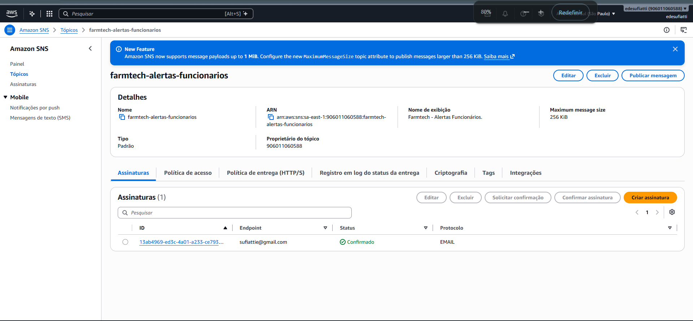

### 2. Conferi a EC2 e a role IAM

A instância `farmtech-alertas` estava parada. Antes de iniciá-la, conferi nos detalhes a role IAM `farmtech-alertas` associada.

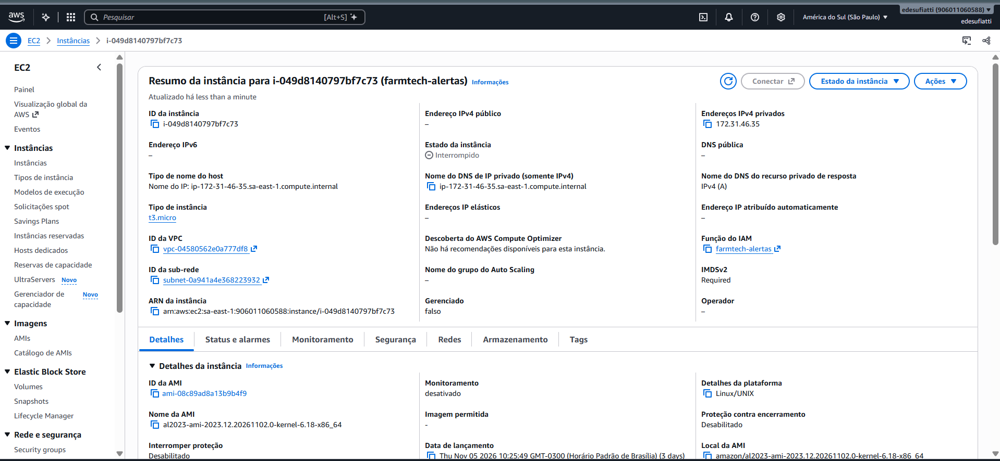

### 3. Restringi o SSH ao meu IP

A regra de entrada SSH do `launch-wizard-1` estava aberta para `0.0.0.0/0`. Troquei a origem para o meu IP `/32` e confirmei a regra na tabela.

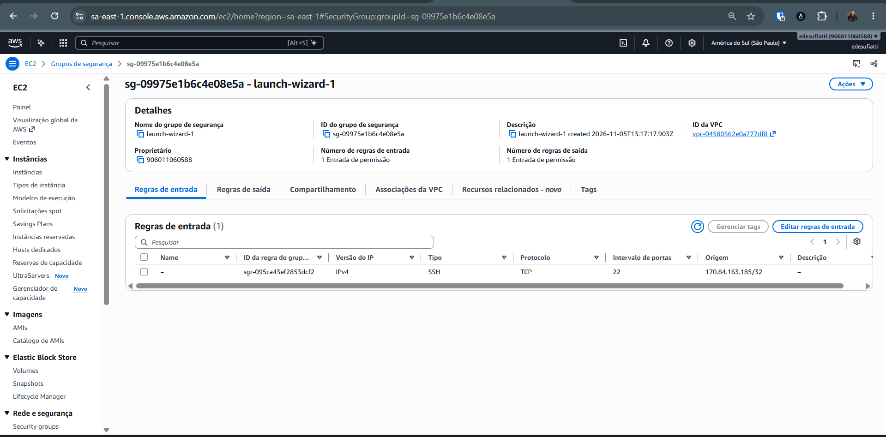

### 4. Iniciei a instância

Iniciei a EC2 e aguardei as verificações de status chegarem a **3/3 aprovadas**.

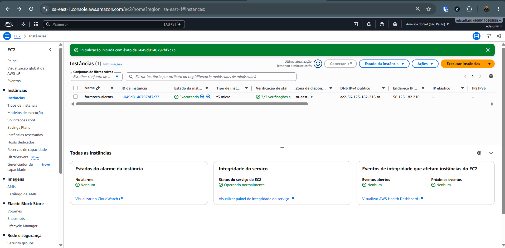

### 5. Conectei por SSH

**Windows PowerShell** (raiz do projeto):

```powershell
ssh -i .\farmtech-alertas.pem ec2-user@IP_PUBLICO_ATUAL
```

A chave `.pem` nunca vai para o Git nem é compartilhada. O ideal é mantê-la fora da pasta do projeto.

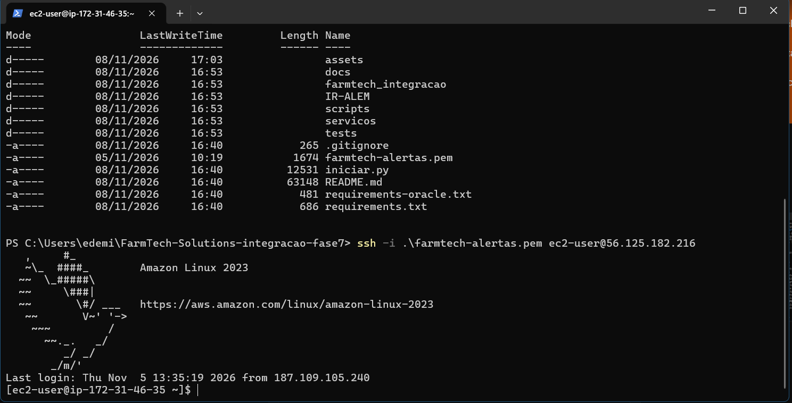

### 6. Conferi a pasta do projeto e o Python

**EC2 Bash:**

```bash
cd /home/ec2-user/FarmTech-Solutions-integracao-fase7
python3.11 --version
```

Confirmei o Python **3.11.18**. Uso `python3.11` porque o `python3` padrão do Amazon Linux 2023 não atende ao pacote de integração.

Antes do deploy, fiz backup da pasta (o `cp -a` preservou o `.ultimo-alerta.json`):

```bash
cp -a /home/ec2-user/FarmTech-Solutions-integracao-fase7 /home/ec2-user/farmtech-backup-$(date +%Y%m%d-%H%M%S)
```

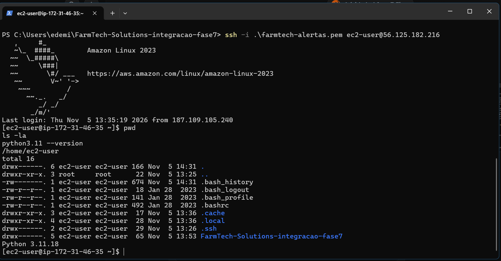

### 7. Enviei os módulos do serviço

**Windows PowerShell** (raiz do projeto) — copiei somente os seis arquivos do serviço:

```powershell
scp -i .\farmtech-alertas.pem `
  .\servicos\fase7-alertas-aws\monitorar.py `
  .\servicos\fase7-alertas-aws\sensores.py `
  .\servicos\fase7-alertas-aws\mensagem.py `
  .\servicos\fase7-alertas-aws\regras.py `
  .\servicos\fase7-alertas-aws\publicar_sns.py `
  .\servicos\fase7-alertas-aws\requirements.txt `
  ec2-user@IP_PUBLICO_ATUAL:/home/ec2-user/FarmTech-Solutions-integracao-fase7/servicos/fase7-alertas-aws/
```

Os seis chegaram com 100%. O pacote `farmtech_integracao` que já estava na EC2 foi reutilizado; não o substituí neste deploy.

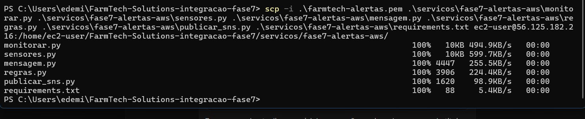

### 8. Conferi as dependências e a CLI

**EC2 Bash:**

```bash
python3.11 -m pip install --user -r servicos/fase7-alertas-aws/requirements.txt
python3.11 servicos/fase7-alertas-aws/monitorar.py --help
```

O `boto3` 1.43.124 já estava instalado, e o `--help` mostrou as opções IoT (`--iot-csv`, `--origem-iot`, `--fuso-iot`, `--local-iot`, `--dispositivo-iot`).

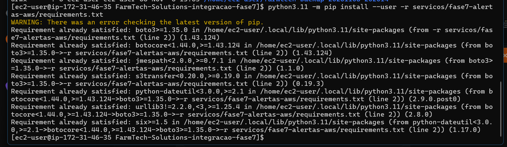

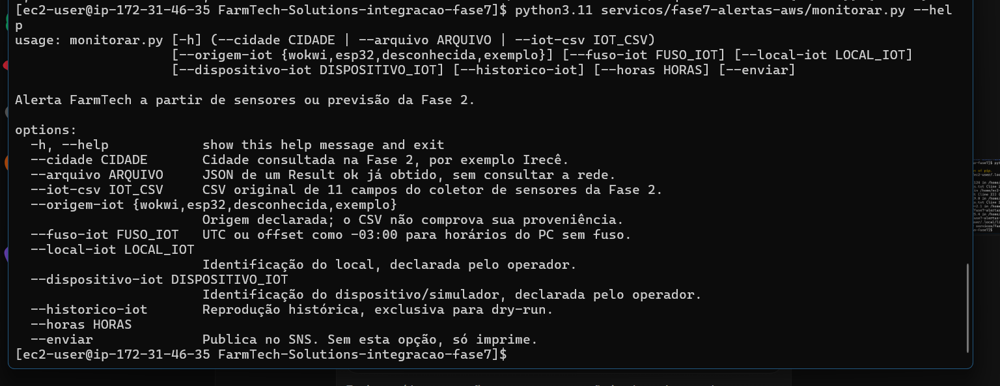

### 9. Configurei região e tópico na sessão

**EC2 Bash** (repita sempre que abrir uma nova sessão SSH):

```bash
export AWS_DEFAULT_REGION=sa-east-1
export AWS_SNS_TOPIC_ARN=arn:aws:sns:sa-east-1:906011060588:farmtech-alertas-funcionarios
printf 'Região: %s\nTópico: %s\n' "$AWS_DEFAULT_REGION" "$AWS_SNS_TOPIC_ARN"
```

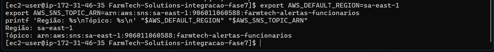

### 10. Compilei o firmware e iniciei o Wokwi

No VS Code, abri `servicos/fase2-iot` e compilei com o PlatformIO (`pio run -e esp32`, resultado **SUCCESS**). Depois executei **Wokwi: Start Simulator**, e o monitor serial mostrou as linhas `CSV_ROW`.

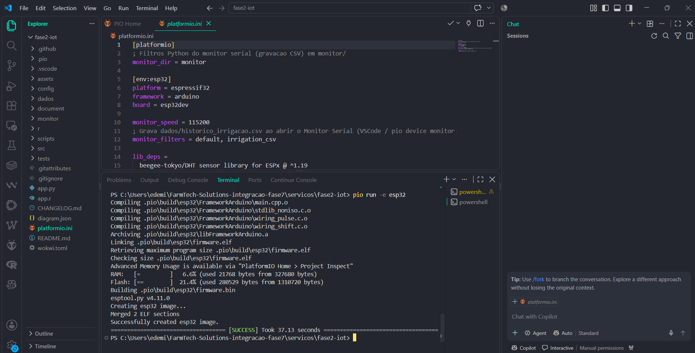

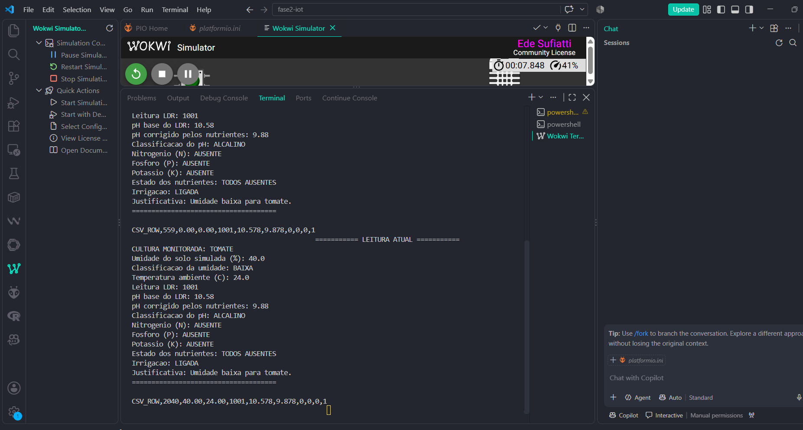

### 11. Capturei as leituras em CSV

**Windows PowerShell** (pasta `servicos\fase2-iot`, com o Wokwi rodando; PySerial 3.5 instalado):

```powershell
cd C:\Users\edemi\FarmTech-Solutions-integracao-fase7\servicos\fase2-iot
$csv = "dados/captura-alerta-aws-$(Get-Date -Format yyyyMMdd-HHmmss).csv"
python scripts/serial_grava_csv.py --port rfc2217://127.0.0.1:4000 --baud 115200 --out "$csv"
```

Cada captura gera um arquivo novo; não uso `--fresh` nem altero capturas anteriores.

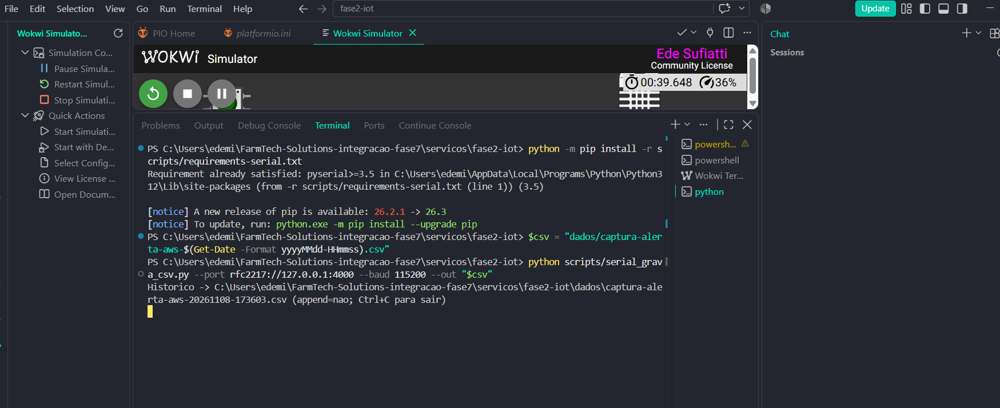

Em outro PowerShell, conferi se o arquivo já tinha leituras, não só o cabeçalho:

```powershell
Get-Date -Format o
Get-Content "C:\Users\edemi\FarmTech-Solutions-integracao-fase7\servicos\fase2-iot\dados\<arquivo>.csv" -Tail 5
```

O Wokwi rodou abaixo da velocidade real (cerca de 36%), então o intervalo entre leituras pode passar de 30 segundos no relógio. Se aparecer só o cabeçalho, basta aguardar ou reiniciar a simulação; isso não indica falha do sensor.

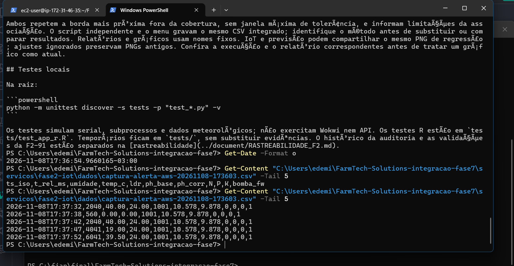

### 12. Transferi a captura e fiz o dry-run

Encerrei o coletor com **Ctrl+C** (o simulador pode continuar) e transferi o CSV.

**Windows PowerShell** (raiz do projeto):

```powershell
scp -i .\farmtech-alertas.pem .\servicos\fase2-iot\dados\<arquivo>.csv ec2-user@IP_PUBLICO_ATUAL:/home/ec2-user/FarmTech-Solutions-integracao-fase7/captura-iot.csv
```

**EC2 Bash** — dry-run, sem enviar:

```bash
python3.11 servicos/fase7-alertas-aws/monitorar.py --iot-csv captura-iot.csv --origem-iot wokwi --fuso-iot=-03:00 --local-iot "Bancada didatica FarmTech" --dispositivo-iot "wokwi-esp32-a"
```

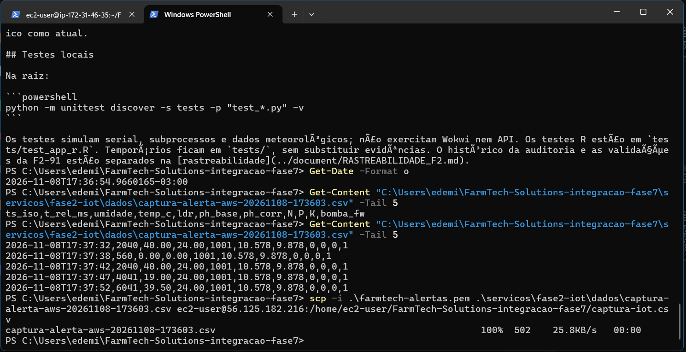

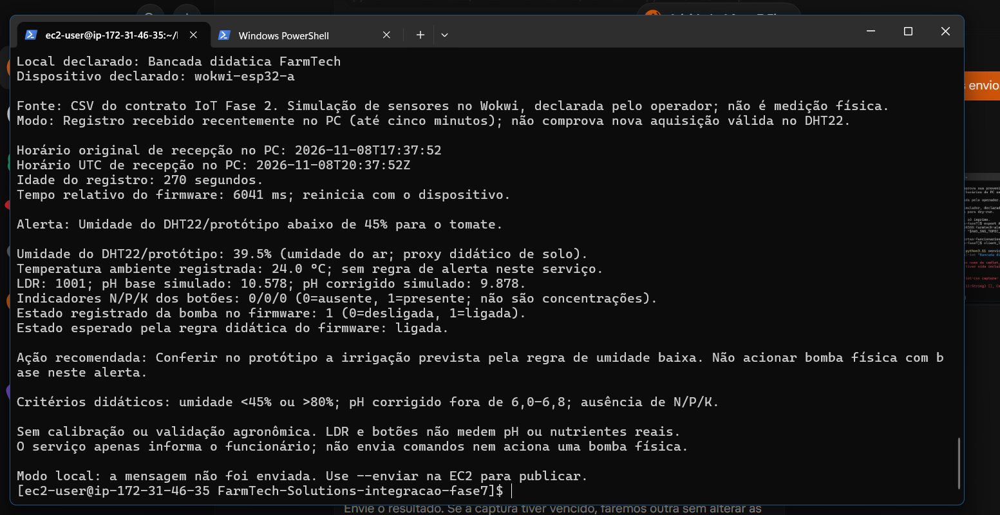

As imagens 17 a 19 são da **primeira captura** (`captura-alerta-aws-20261108-173603.csv`). O dry-run identificou a simulação Wokwi e a umidade de 39,5%, mas a leitura já tinha 270 s, perto do limite de 300 s. Por isso não publiquei com ela.

### 13. Renovei a captura e publiquei

Repeti os passos 11 e 12 com uma **segunda captura**, `captura-alerta-aws-20261108-174228.csv`. A última leitura foi recebida às **17:45:03 (Brasília)** = 20:45:03 UTC. O dry-run dessa captura passou com 187 s de idade, e em seguida executei o envio **uma única vez**.

**EC2 Bash:**

```bash
python3.11 servicos/fase7-alertas-aws/monitorar.py --iot-csv captura-iot.csv --origem-iot wokwi --fuso-iot=-03:00 --local-iot "Bancada didatica FarmTech" --dispositivo-iot "wokwi-esp32-a" --enviar
```

| Campo | Valor da leitura publicada |
|---|---|
| Recepção (`ts_iso`) | 08/11/2026 17:45:03 (Brasília) |
| Idade na publicação | 230 s (dentro dos 300 s) |
| `t_rel_ms` | 150005 |
| Umidade | **39,5%** (< 45%) |
| Temperatura | 24 °C |
| LDR | 1001 |
| pH base / corrigido | 10,578 / 9,878 (simulado) |
| N / P / K | 0 / 0 / 0 |
| `bomba_fw` | 1 |
| Origem / local / dispositivo | `wokwi` / Bancada didatica FarmTech / `wokwi-esp32-a` |
| Alerta principal | Umidade baixa (pH fora da faixa e NPK ausente coexistem) |
| **MessageId SNS** | `0fc7e8a7-03b2-5e11-82ec-8bcde1c7af3a` |

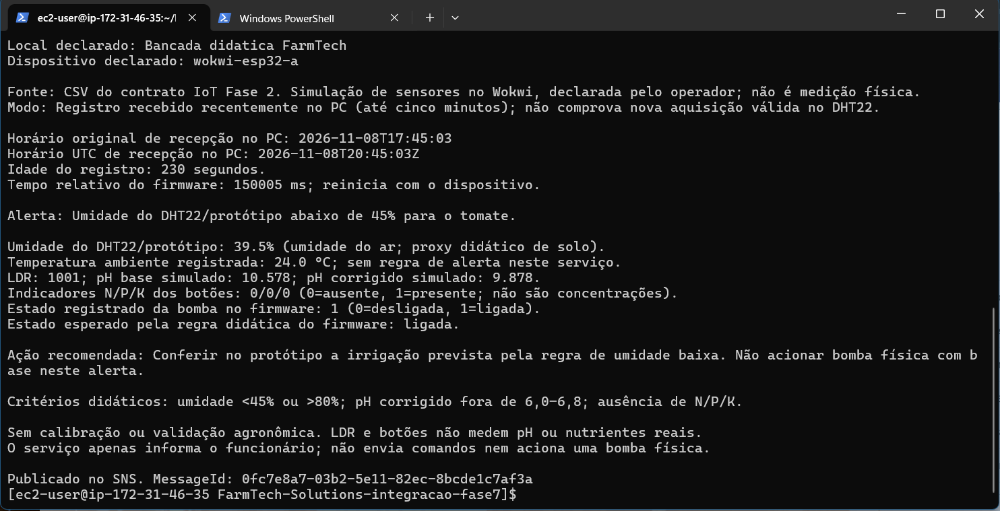

### 14. Recebi o e-mail

Às **17:48 (Brasília)** o alerta chegou ao Gmail:

- **Remetente:** Farmtech-Alertas Funcionários `<no-reply@sns.amazonaws.com>`
- **Assunto:** `FarmTech [SIMULAÇÃO WOKWI]: Umidade do DHT22/protótipo abaixo de 45% para o tomate`

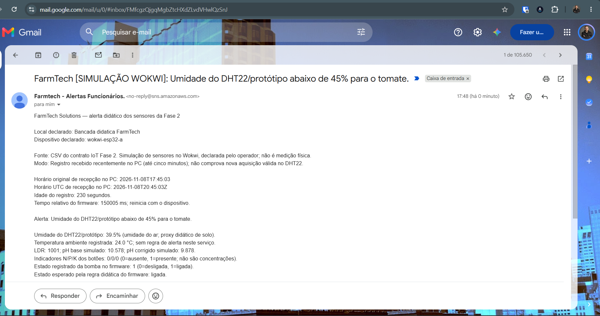

O corpo repete os dados da leitura e traz a ação corretiva:

> Conferir no protótipo a irrigação prevista pela regra de umidade baixa. Não acionar bomba física com base neste alerta.

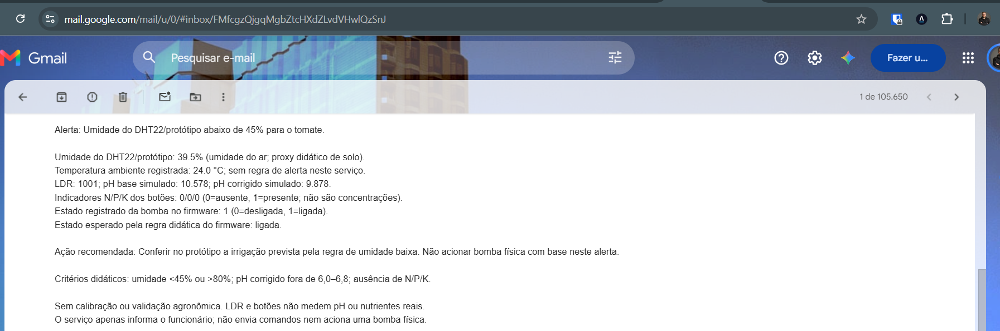

---

## Como reproduzir

1. **EC2 Bash:** conectar, entrar em `/home/ec2-user/FarmTech-Solutions-integracao-fase7` e exportar as variáveis (passo 9).
2. **Windows:** iniciar o Wokwi e o coletor com um nome de arquivo novo (passos 10 e 11).
3. **Windows PowerShell:** confirmar que o CSV tem dados, encerrar o coletor com Ctrl+C e fazer o `scp`.
4. **EC2 Bash:** rodar o dry-run e, se a leitura estiver dentro dos 5 minutos, rodar o `--enviar` uma vez.
5. Se a leitura expirar, fazer uma captura nova. Nunca editar timestamps.

### Testes e exemplos locais (sem AWS)

Na raiz do repositório, com Python 3.11+:

```powershell
# Testes do serviço (SNS simulado com mocks; não acessam a AWS)
python -B -m unittest discover -s servicos/fase7-alertas-aws -p "test_*.py" -v

# Exemplo IoT sintético, somente dry-run
$csv = python -B servicos/fase7-alertas-aws/gerar_exemplo_iot.py --tipo umidade_baixa
python -B servicos/fase7-alertas-aws/monitorar.py --iot-csv "$csv"

# Reprodução de captura antiga, somente dry-run
python -B servicos/fase7-alertas-aws/monitorar.py --iot-csv "C:\capturas\historico.csv" --fuso-iot=-03:00 --historico-iot
```

Os outros cenários IoT são `umidade_alta`, `ph_fora_faixa`, `npk_ausente` e `normal`. Esses comandos ficam documentados para uso local; não fazem parte da validação de 08/11.

### Previsão do tempo (complementar)

```powershell
python servicos/fase7-alertas-aws/monitorar.py --cidade "Irecê"
```

Consulta a Open-Meteo pela Fase 2 e avalia uma janela de 12 h: chuva ≥ 1 mm em alguma hora tem prioridade; depois, umidade do ar < 45% ou > 80%. Ela mede umidade do **ar**, não do solo, e serve só como apoio. Com `--arquivo` (JSON offline) o envio é bloqueado.

---

## Estrutura do módulo

```text
servicos/fase7-alertas-aws/
├── README.md                ← este arquivo
├── monitorar.py             ← CLI: --iot-csv / --cidade / --arquivo / --enviar
├── sensores.py              ← contrato CSV IoT, janela de 5 min e regras didáticas
├── regras.py                ← regras da previsão (chuva / umidade / 12 h)
├── mensagem.py              ← assunto e corpo do e-mail
├── publicar_sns.py          ← publish no SNS (só com --enviar)
├── gerar_exemplo.py         ← JSON sintético de previsão (dry-run)
├── gerar_exemplo_iot.py     ← CSV sintético marcado (dry-run)
├── test_*.py                ← testes locais
├── exemplo-previsao.json    ← exemplo offline de previsão
├── requirements.txt         ← boto3>=1.35.0
└── .env.example             ← modelo de região e ARN
```

As evidências ficam em `assets/aws-notifications/`. As capturas da execução anterior (05/11/2026, baseada só na previsão) estão preservadas em `assets/bkp/aws-notifications/` e não fazem parte desta evidência.

---

## Custos e limpeza

- **A EC2 continua em execução** após a validação, e o desligamento está **pendente**. Enquanto estiver *running*, ela gera custo de instância e EBS.
- **Stop** interrompe a cobrança da instância, mas o volume EBS continua sendo cobrado e o IP público muda.
- **Terminate** remove a instância. Antes, confiro se o volume está com *Delete on termination* e se não sobram volumes ou snapshots.
- O tópico SNS e a assinatura podem ser removidos após a correção.
- A chave `.pem` fica fora do Git; mantenha-a fora do checkout.

---

## Conclusão

Demonstrei o ciclo completo com dados do sistema de sensores da Fase 2: o firmware simulado no Wokwi gerou a leitura, o coletor gravou o CSV, o serviço na EC2 aplicou a regra de umidade baixa dentro da janela de cinco minutos, o Amazon SNS publicou a mensagem e o e-mail chegou ao funcionário com a ação corretiva. A origem é uma simulação, sinalizada no próprio alerta; o resultado vale como prova de integração IoT + AWS, não como medição física ou orientação agronômica.

---

## Créditos

**FIAP — Faculdade de Informática e Administração Paulista**  
FarmTech Solutions · Integração Fase 7 · Parte 2 (Alertas AWS)  
Edemir Sufiatti · RM 571375
