# FIAP — FarmTech Solutions · Fase 7 · Parte 2

<p align="center">
<a href="https://www.fiap.com.br/"></a>
</p>

<br>

# Alertas AWS — serviço de notificação por e-mail (SNS + EC2)

**Branch:** `feature/alertas-aws-edemir`  
**Correções locais e adequação IoT:** `feature/alertas-aws-correcoes-validadas`
**Módulo:** `servicos/fase7-alertas-aws/`  
**Região AWS:** `sa-east-1` (América do Sul - São Paulo)  
**Conta AWS:** `906011060588`

### Integrantes

- Edemir Sufiatti - RM571375
- Carlos Magnus Costa Amaral - RM573978
- Georgia Mendes Rocha - RM573281
- Marina Leme Soares - RM570461

### Professores

**Tutora**

- Nicolly Cândida Rodrigues de Souza

**Coordenador**

- André Godoi Chiovato

O relato histórico deste README documenta o serviço original de Edemir: EC2 + SNS, previsão Open-Meteo da Fase 2 e e-mail ao funcionário. As imagens preservam essa execução original. A adequação posterior acrescenta o contrato dos sensores da Fase 2, com validação exclusivamente local e publicação simulada nos testes; não representa uma nova execução AWS.

---

## Objetivo e adequação acadêmica

A Parte 2 exige mensageria baseada em sensores das Fases 1/2 ou resultados da visão computacional da Fase 6. **Previsão meteorológica externa, isoladamente, não comprova esse requisito.** A entrada `--iot-csv` acrescenta os dados do contrato dos sensores da Fase 2; a Open-Meteo permanece como fonte complementar independente.

Os entregáveis históricos documentados por Edemir foram:

1. Serviço na infraestrutura da Fase 5: EC2 Linux `t3.micro`, EBS `gp3` de 8 GiB, região `sa-east-1`.
2. Mensageria AWS (Amazon SNS) monitorando a previsão da Fase 2, exposta por `farmtech_integracao.fase2.forecast` (Open-Meteo), agora identificada como fonte complementar.
3. E-mail ao funcionário com o alerta e a ação corretiva (SMS fora deste corte).

Regras meteorológicas atuais em `regras.py` (janela de 12 h; chuva tem prioridade sobre umidade):

| Condição na janela | Alerta | Ação corretiva |
|---|---|---|
| Alguma hora com chuva ≥ 1 mm | Chuva prevista | Manter a bomba desligada |
| Sem essa chuva e umidade relativa do ar < 45% | Umidade baixa | Verificar a umidade do solo e as necessidades da cultura antes de decidir pelo acionamento da irrigação. |
| Sem os dois acima e umidade relativa do ar > 80% | Umidade alta | Manter a bomba desligada |
| Nenhum limiar cruzado | Sem aviso | Nada é publicado |

Os limites de 45% e 80% são estritos: os valores iguais não disparam alerta de umidade. A chuva é horária, não a soma da janela, conforme o plano do grupo. A janela padrão considera agora inclusive até 12 horas exclusive, em UTC; entradas inválidas ou fora dela são descartadas. Não é exigida cobertura completa das 12 horas.

A previsão informa umidade relativa do **ar**, não umidade do solo. Na revisão posterior, a orientação de baixa umidade do ar passou a exigir a verificação do solo e da cultura antes de decidir sobre irrigação. Os limiares, a janela e a prioridade da chuva foram preservados. O relato e as capturas históricas abaixo mantêm a ação original registrada por Edemir. O serviço envia orientação ao funcionário, sem comandar o firmware.

Anti-repetição: o mesmo tipo de alerta para a mesma cidade não é republicado em menos de **6 horas** (arquivo `.ultimo-alerta.json` na pasta do serviço). Cidades e tipos intercalados mantêm histórico recente. O registro antigo, sem cidade, é aceito conservadoramente para o mesmo tipo durante as seis horas. Registro ilegível, inválido ou com data futura impede o envio até correção.

Nos alertas IoT, a chave também inclui dispositivo e origem declarados. Os tipos `iot_*` não suprimem alertas meteorológicos e vice-versa.

---

## Arquitetura breve

```
Sensores F2 → CSV do coletor → sensores.py ────────────────┐
                                                         ▼
Open-Meteo  →  farmtech_integracao.fase2.forecast  →  monitorar.py
                                                         │
                                            regras.py ───┤
                                            mensagem.py ─┤
                                                         ▼
                                              publicar_sns.py  (--enviar)
                                                         │
                                                         ▼
                              SNS Standard: farmtech-alertas-funcionarios
                                                         │
                                                         ▼
                              E-mail Confirmado: sufiattie@gmail.com
```

- **Fonte acadêmica de sensores:** CSV do coletor Fase 2, com origem e modo explicitamente identificados.
- **Fonte complementar:** previsão horária Open-Meteo; não recebe pH/NPK nem é convertida em leitura de sensor.
- **Publicação:** só com `--enviar`, na EC2, com `AWS_SNS_TOPIC_ARN` definido e role IAM com `sns:Publish`.
- **Sem `--enviar`:** o monitor só imprime o e-mail no terminal (modo seguro para desenvolvimento local).

O modo local não importa o publicador SNS nem lê ou altera `.ultimo-alerta.json`. Com `--cidade`, ainda consulta HTTPS na Open-Meteo; o adaptador atual da Fase 2 também exporta a previsão em `.runtime/exports/fase2/previsao_tempo.csv`. Com `--arquivo`, a execução é offline e **não aceita `--enviar`**, mesmo que o JSON tenha sido obtido anteriormente.

## Entrada de sensores da Fase 2

### Contrato e proveniência

O contrato foi inspecionado em `d9dabed`, sem alterar a Fase 2. O firmware emite `CSV_HDR`/`CSV_ROW` com dez campos; o coletor `servicos/fase2-iot/scripts/serial_grava_csv.py` acrescenta o horário de recepção no PC. O serviço lê esse CSV diretamente, usando apenas a biblioteca padrão Python:

```text
ts_iso,t_rel_ms,umidade,temp_c,ldr,ph_base,ph_corr,N,P,K,bomba_fw
```

- `ts_iso`: recepção no PC, não instante certificado da medição. O coletor original grava horário local sem offset. Nessa situação, informe o fuso da captura: `--fuso-iot=-03:00`, por exemplo. Timestamps com `Z`/offset já identificam o instante; `--fuso-iot` só supre o fuso ausente. Não se presume UTC para CSV IoT.
- `t_rel_ms`: milissegundos desde a inicialização do firmware; reinicia com o dispositivo e não identifica uma sessão.
- `umidade`: umidade relativa do DHT22 em %, usada como proxy didático de solo. Não é uma medição validada de umidade do solo.
- `temp_c`: temperatura ambiente, registrada sem regra de alerta neste serviço.
- `ldr`, `ph_base`, `ph_corr`: ADC e pH **simulado**; o pH corrigido já incorpora os ajustes didáticos NPK e não é recalculado pelo serviço.
- `N/P/K`: indicadores 0/1 de botões, não concentrações químicas. `bomba_fw`: estado 0/1 registrado pelo firmware.

O CSV não informa cidade, dispositivo, origem física/simulador ou qualidade do sensor. `--local-iot`, `--dispositivo-iot` e `--origem-iot` são declarações do operador, não provas independentes. O firmware pode manter a última leitura DHT22 após uma falha; recepção recente não garante aquisição recente válida.

Referências do contrato: `d9dabed:servicos/fase2-iot/src/prog1.ino` (cabeçalho e emissão CSV), `scripts/serial_grava_csv.py` (cabeçalho e timestamp do PC), `README.md` e `src/readme.md` da Fase 2 (regras e limites didáticos).

### Regras e validade temporal

Os critérios abaixo reproduzem os limites do protótipo, **sem validação agronômica**. São avaliados na leitura com maior timestamp, com esta prioridade:

| Condição | Tipo de alerta | Estado esperado pela regra didática do firmware |
|---|---|---|
| Umidade <45% | `iot_umidade_baixa` | Bomba ligada no protótipo |
| Umidade >80% | `iot_umidade_alta` | Bomba desligada no protótipo |
| Umidade em [45%,80%] e pH corrigido fora de [6,0;6,8] | `iot_ph_fora_faixa` | Bomba ligada no protótipo |
| Umidade em [45%,80%], pH na faixa e algum N/P/K=0 | `iot_npk_ausente` | Bomba ligada no protótipo |
| Demais condições | Sem alerta | Bomba desligada no protótipo |

A mensagem informa o estado registrado e o esperado, orienta conferir o protótipo e não comanda a bomba. Não recomenda fertilização real a partir dos botões. Não se inventa chuva no CSV IoT.

O limite operacional de recepção recente é **cinco minutos**, inclusive; não é uma tolerância agronômica. Um registro mais antigo é recusado no modo recente. `--historico-iot` permite reproduzi-lo com o timestamp original e selo **HISTÓRICO**, sem publicação. Timestamps futuros são recusados em ambos os modos. Não se atualizam datas antigas, nem se usa o `mtime` do arquivo como data da leitura.

Cabeçalho, todas as linhas, faixas numéricas e flags são validados antes da seleção. O coletor grava segundos inteiros e pode receber várias leituras nesse intervalo: no timestamp mais recente, vence a última linha na ordem de append do CSV. Não se usa o maior `t_rel_ms`, pois ele pode reiniciar. Duplicatas idênticas são aceitas; valores conflitantes para o mesmo par timestamp/`t_rel_ms` são recusados. Não reordene manualmente a captura para inferir outra sequência de recepção.

Uma linha parcial durante append provoca erro, sem reutilizar um alerta antigo; repita a leitura após a gravação completar. O arquivo é somente lido, nunca convertido ou regravado.

### Modos e envio

| Origem/modo | Identificação | Política |
|---|---|---|
| `--origem-iot desconhecida` (padrão) | Origem não comprovada | Apenas dry-run |
| `--origem-iot wokwi` | Simulação Wokwi declarada; não medição física | Registro recente, local e dispositivo explícitos são exigidos para eventual envio |
| `--origem-iot esp32` | Captura ESP32 declarada; origem física não verificada | Mesmo requisito de recepção recente e identificação; pH/NPK continuam didáticos |
| `--origem-iot exemplo` ou marcador sintético | Exemplo gerado, não captura Wokwi/hardware | Apenas dry-run |
| `--historico-iot` | Reprodução histórica, qualquer origem | Apenas dry-run |

`--enviar` continua obrigatório para publicar. Exemplos gerados e históricos não são enviados, mesmo que o operador declare `esp32`. A origem Wokwi admite dados de sensores simulados pelo sistema Fase 2, conforme o requisito acadêmico, e mantém **SIMULAÇÃO WOKWI** no assunto e no corpo. Não se deve declarar um CSV inventado como captura Wokwi/ESP32; o contrato original não tem assinatura ou autenticação de proveniência.

Nenhuma publicação real foi realizada na adequação. Os testes de envio IoT substituem o publicador por mocks.

### Exemplos locais reproduzíveis

Na raiz deste worktree, gere um exemplo sintético novo e execute sem rede:

```powershell
$csv = python -B servicos/fase7-alertas-aws/gerar_exemplo_iot.py --tipo umidade_baixa
python -B servicos/fase7-alertas-aws/monitorar.py --iot-csv "$csv"
```

Os outros cenários são `umidade_alta`, `ph_fora_faixa`, `npk_ausente` e `normal`. O gerador não altera capturas: cria um novo arquivo com `open('x')`, horário UTC de 30 segundos atrás e primeira linha `# FARMTECH_EXEMPLO_IOT_SINTETICO`. O marcador é exclusivo do exemplo do serviço, antes do cabeçalho original; o CSV bruto do coletor não precisa dele. O parser força a classificação como exemplo quando o marcador existe.

Para ler uma captura Fase 2 existente, concluída ou em append, sem abrir serial nem iniciar o simulador:

```powershell
python -B servicos/fase7-alertas-aws/monitorar.py --iot-csv "C:\capturas\fase2-wokwi.csv" --origem-iot wokwi --fuso-iot=-03:00 --local-iot "Local declarado da captura" --dispositivo-iot "wokwi-esp32-a"
```

Substitua o caminho e os metadados pelos da captura. O arquivo deve ser produzido pelo coletor original da Fase 2, executado no checkout de integração; este serviço não captura serial nem instala PySerial. As instruções de captura existentes permanecem em `servicos/fase2-iot/scripts/readme.md`.

Para um histórico antigo, sem atribuir local ou origem física não comprovados:

```powershell
python -B servicos/fase7-alertas-aws/monitorar.py --iot-csv "C:\capturas\historico_irrigacao.csv" --fuso-iot=-03:00 --historico-iot
```

O histórico local inspecionado possui 153 registros de 03/05/2026 e não é distribuído na árvore Git da Fase 2 em `d9dabed`. Ele serve à reprodução histórica, sem atualização de timestamps e sem evidência de medição atual. Exemplos Python comprovam o contrato e o fluxo local; não comprovam aquisição Wokwi, física ou entrega AWS.

### Recursos reais que eu provisiontei

| Recurso | Valor |
|---|---|
| Tópico SNS (Standard) | `farmtech-alertas-funcionarios` |
| ARN | `arn:aws:sns:sa-east-1:906011060588:farmtech-alertas-funcionarios` |
| Assinatura e-mail | `sufiattie@gmail.com` — **Confirmada** (id `13ab4969-ed3c-4a01-a233-ce79392bdc96`) |
| EC2 | `t3.micro` · Amazon Linux 2023 · nome `farmtech-alertas` · `i-049d8140797bf7c73` · IP público `54.20.222.166` |
| IAM role / instance profile | `farmtech-alertas` com `sns:Publish` no ARN do tópico |

---

## Pré-requisitos

| Item | Detalhe |
|---|---|
| Conta / lab AWS | AWS Academy Learner Lab (ou conta com permissão SNS + EC2 + IAM) |
| Região | **sempre** `sa-east-1` — o código recusa ARN fora de São Paulo |
| Python local | 3.11+ recomendado (o 3.11.9 da Fase 4 atende) |
| Python na EC2 | **python3.11** (o `python3` padrão do Amazon Linux 2023 é antigo e quebra em anotações `str \| None` do pacote de integração) |
| Dependência de envio | `boto3>=1.35.0` (`requirements.txt` deste módulo) |
| Acesso HTTPS | Open-Meteo, para `--cidade` |
| Chave SSH | `.pem` da key pair `farmtech-alertas` (nunca commitada) |

Arquivo de exemplo de ambiente (não versionar segredos):

```text
AWS_DEFAULT_REGION=sa-east-1
AWS_SNS_TOPIC_ARN=arn:aws:sns:sa-east-1:906011060588:farmtech-alertas-funcionarios
```

O código lê variáveis do processo; `.env.example` não é carregado automaticamente. O ARN deve identificar tópico SNS Standard em `sa-east-1`, e `AWS_DEFAULT_REGION` deve corresponder à região do ARN. Instale somente o requirements deste serviço no ambiente destinado ao envio. O requirements da raiz é um inventário com ambientes incompatíveis entre si, não uma instalação conjunta.

---

## Passo a passo — o que eu fiz na AWS

Todas as imagens estão em `../../assets/aws-notifications/` (relativo a este README).

### 1. Selecionei a região `sa-east-1`

Antes de criar qualquer recurso, confirmei no console a região **South America (São Paulo)**. Recurso criado em N. Virginia não serve para esta entrega.


### 2. Abri o Amazon SNS e criei o tópico Standard

Busquei **Simple Notification Service**, abri **Topics → Create topic**, tipo **Standard**, nome `farmtech-alertas-funcionarios`.


Copiei o ARN:

```text
arn:aws:sns:sa-east-1:906011060588:farmtech-alertas-funcionarios
```

### 3. Criei a assinatura por e-mail e confirmei na caixa de entrada

Protocolo **Email**, endpoint `sufiattie@gmail.com`. O status começa em *Pending confirmation*; abri o e-mail de `no-reply@sns.amazonaws.com` e cliquei em **Confirm subscription**. Depois a assinatura ficou **Confirmed** (id `13ab4969-ed3c-4a01-a233-ce79392bdc96`).


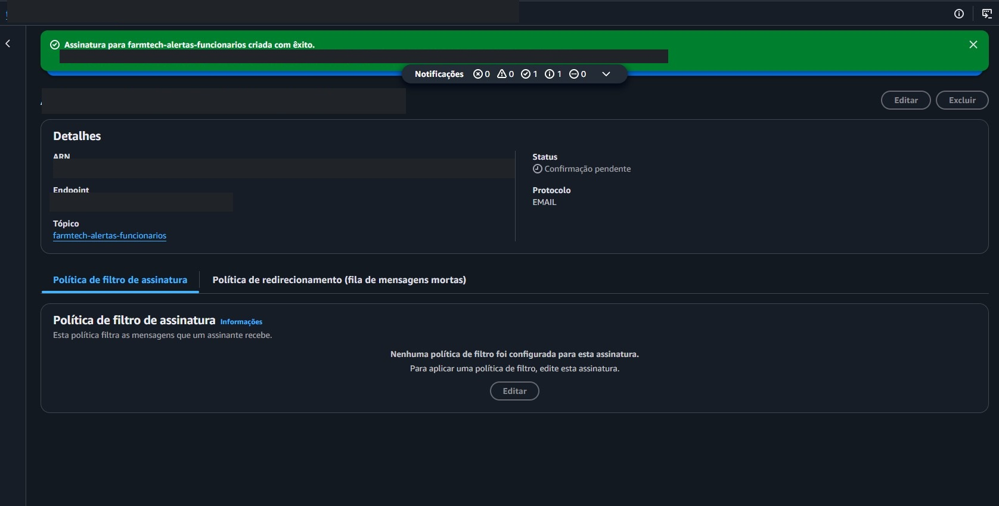

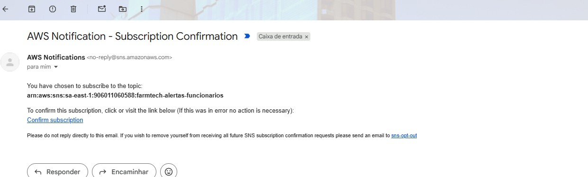

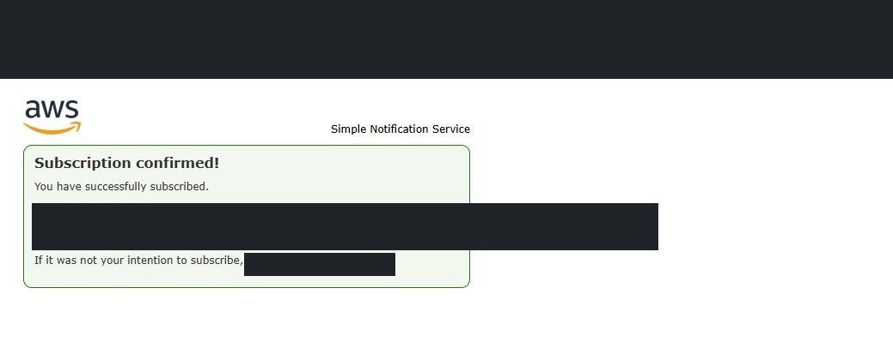

### 4. Testei a mensageria pelo portal (sem o código Python)

Publiquei uma mensagem de teste pelo console (**Publish message**) para provar o caminho SNS → e-mail antes de subir a EC2.

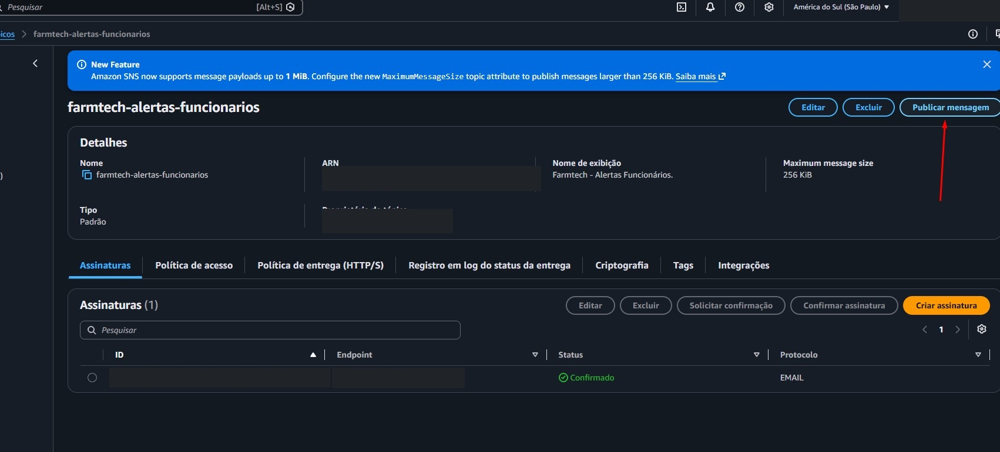

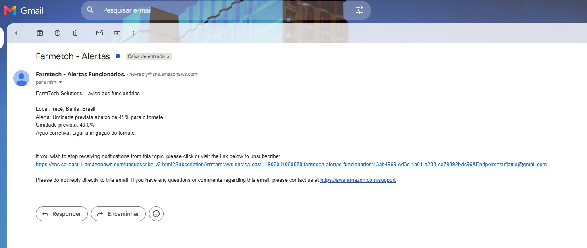

### 5. Criei a EC2 `farmtech-alertas` (padrão Fase 5)

- AMI: **Amazon Linux 2023**
- Tipo: **t3.micro**
- Nome: `farmtech-alertas`
- Key pair nova: `farmtech-alertas` (RSA, `.pem` baixado; fora do Git)
- Disco: **8 GiB gp3** (mantive o padrão da AMI nesta montagem; o enunciado da Fase 5 cita 50 GiB, mas para o monitor leve 8 GiB bastou)
- Security group: SSH apenas do meu IP


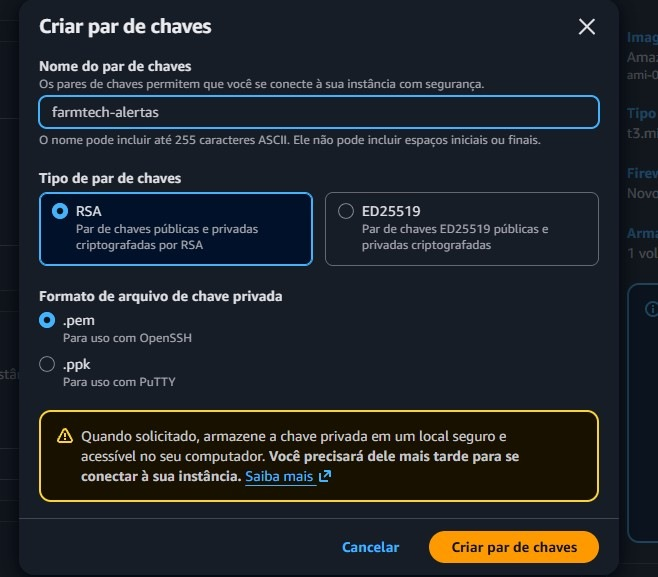

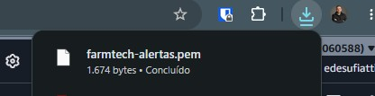


Instance id: `i-049d8140797bf7c73`.

### 6. Criei a role IAM e anexei à instância

No IAM criei o perfil/função `farmtech-alertas` com permissão mínima `sns:Publish` no ARN do tópico. Depois alterei a função IAM da EC2 para usar esse instance profile (sem gravar access key no projeto).


### 7. Conectei por SSH, instalei dependências e enviei o código

Entre na instância com a `.pem`:

```powershell
ssh -i .\farmtech-alertas.pem ec2-user@IP_PUBLICO
```

Na EC2 usei **Python 3.11** (o `python3` default quebra nas anotações `str | None` do pacote de integração). Instalei o `boto3` e fiz um deploy mínimo (código Python + pacote `farmtech_integracao` + script de previsão da F2 — **sem** `.md` auxiliares).

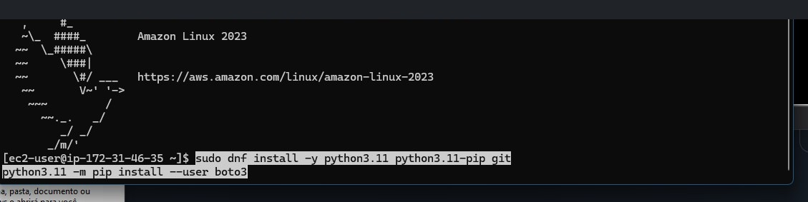


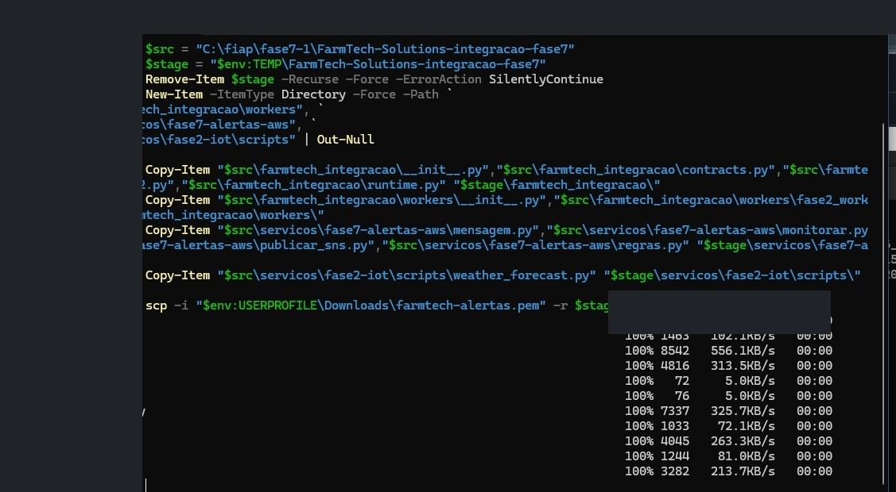

### 8. Rodei dry-run e depois `--enviar` na EC2

Exportei a região e o ARN, conferi o texto do e-mail sem publicar e, em seguida, publiquei de verdade:

```bash
export AWS_DEFAULT_REGION=sa-east-1
export AWS_SNS_TOPIC_ARN=arn:aws:sns:sa-east-1:906011060588:farmtech-alertas-funcionarios

cd /home/ec2-user/farmtech
python3.11 servicos/fase7-alertas-aws/monitorar.py --cidade "Irecê"
python3.11 servicos/fase7-alertas-aws/monitorar.py --cidade "Irecê" --enviar
```

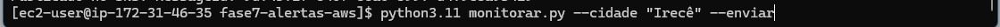


---

## Como rodar localmente

Na **raiz do repositório**, com Python 3.11+ (sem precisar de AWS):

```powershell
# Testes do serviço: meteorologia, sensores, mensagens, registros e SNS simulado
python -B -m unittest discover -s servicos/fase7-alertas-aws -p "test_*.py" -v

# Exemplo sintético com horário atual: o gerador imprime somente o caminho criado
$exemplo = python servicos/fase7-alertas-aws/gerar_exemplo.py --tipo chuva
python servicos/fase7-alertas-aws/monitorar.py --arquivo "$exemplo"

# Exemplo histórico preservado: normalmente já está fora da janela temporal
python servicos/fase7-alertas-aws/monitorar.py --arquivo servicos/fase7-alertas-aws/exemplo-previsao.json

# Dry-run consultando a Open-Meteo via Fase 2
python servicos/fase7-alertas-aws/monitorar.py --cidade "Irecê"
```

Sem `--enviar` o comando **só imprime** o assunto e o corpo. Não publica nada.

`--enviar` eu reservei para a EC2 em São Paulo, com `AWS_SNS_TOPIC_ARN` e a role IAM.

O gerador também aceita `--tipo umidade_baixa`, `umidade_alta` ou `normal`, e `--saida CAMINHO`. Os JSONs são marcados como sintéticos, usam UTC uma hora à frente e são exclusivos para dry-run. Arquivos existentes nunca são sobrescritos. O exemplo original de 04/11/2026 permanece como evidência histórica; não foi atualizado artificialmente.

Os testes SNS substituem o SDK e o cliente por mocks: não acessam a AWS e não exigem credenciais ou boto3 instalado. Isso valida o comportamento local, sem comprovar permissões IAM, conectividade ou entrega de e-mail.

A suíte completa inclui a leitura de `d9dabed:farmtech_integracao/fase2.py` com `git show`: execute-a em um checkout local com Git e esse objeto disponíveis. Uma cópia mínima de arquivos para a EC2, sem histórico Git, não atende a esse teste de comparação entre versões.

---

## Como rodar na EC2

1. SSH com a key pair `farmtech-alertas`.
2. Garantir `python3.11` e `boto3` (`pip install --user -r servicos/fase7-alertas-aws/requirements.txt`).
3. Exportar `AWS_DEFAULT_REGION` e `AWS_SNS_TOPIC_ARN`.
4. Executar a partir de `/home/ec2-user/farmtech` (raiz do projeto na instância), para o `sys.path` achar `farmtech_integracao`.

```bash
python3.11 servicos/fase7-alertas-aws/monitorar.py --cidade "Irecê"          # dry-run
python3.11 servicos/fase7-alertas-aws/monitorar.py --cidade "Irecê" --enviar # publica SNS
```

Se o SNS confirmar a mensagem e a gravação local falhar, o monitor informa o `MessageId` e termina com erro, sem reenviar automaticamente. Interrompa o agendamento e reconcilie esse identificador no registro antes de uma nova execução. O controle local não constitui garantia de entrega exatamente uma vez em execuções concorrentes ou falhas distribuídas.

---

## Evidências de funcionamento

Cenário real capturado em **05/11/2026**:

| Campo | Valor observado |
|---|---|
| Local | Irecê, BA |
| Umidade prevista | **34%** (< 45%) |
| Ação | **Ligar irrigação** |
| MessageId SNS | `9d74b71f-640f-56a0-8997-d479e8a93429` |
| Remetente do e-mail | Farmtech - Alertas / `no-reply@sns.amazonaws.com` |


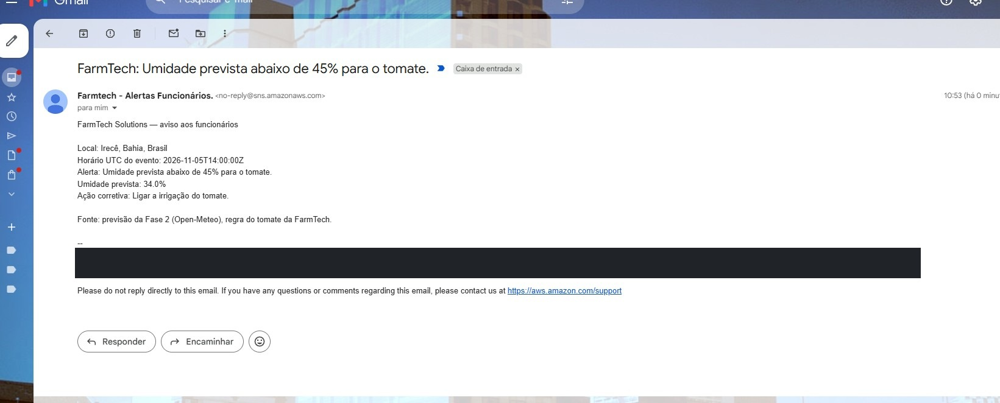

Com isso eu fechei o ciclo: previsão da Fase 2 → regra do tomate → publicação SNS → e-mail confirmado na caixa do funcionário.

---

## Estrutura de pastas / módulos

```text
servicos/fase7-alertas-aws/
├── README.md                 ← este arquivo
├── monitorar.py              ← CLI: --cidade / --arquivo / --horas / --enviar
├── regras.py                 ← limiares do tomate (chuva / umidade / janela 12 h)
├── mensagem.py               ← assunto e corpo do e-mail
├── publicar_sns.py           ← boto3 publish (só com --enviar)
├── test_regras.py            ← testes unitários das regras
├── test_monitorar.py         ← contrato F2, dry-run e controle de repetição
├── test_publicar_sns.py      ← publicação SNS com SDK simulado
├── test_gerar_exemplo.py     ← exemplos atuais e proteção contra sobrescrita
├── gerar_exemplo.py          ← cria JSON sintético atual, exclusivo para dry-run
├── sensores.py              ← contrato CSV IoT, validade e regras didáticas
├── gerar_exemplo_iot.py      ← cria CSV sintético marcado, exclusivo para dry-run
├── test_sensores.py          ← contrato, tempo, regras e desempate de recepção
├── test_fluxo_iot.py         ← mensagens, guardas, repetição e SNS IoT simulado
├── test_condicoes_mensagens.py ← condições simultâneas e parágrafos da mensagem
├── test_gerar_exemplo_iot.py ← exemplos IoT e proteção contra sobrescrita
├── exemplo-previsao.json     ← JSON de Result ok da Fase 2 para dry-run offline
├── requirements.txt          ← boto3>=1.35.0
├── .env.example              ← modelo de AWS_DEFAULT_REGION / AWS_SNS_TOPIC_ARN
└── .gitignore

assets/aws-notifications/     ← prints das evidências (referenciados acima)
farmtech_integracao/fase2.py  ← forecast → Open-Meteo (reutilizado, não alterado pelo serviço)
```

Módulos Python (resumo):

| Arquivo | Responsabilidade |
|---|---|
| `monitorar.py` | Orquestra previsão ou sensores, anti-repeat 6 h e publicação opcional |
| `regras.py` | `avaliar(hourly)` — chuva ≥ 1 mm / umidade < 45% / > 80% / janela 12 h |
| `sensores.py` | CSV IoT original, fuso, recepção recente/replay, critérios didáticos e condições coexistentes |
| `mensagem.py` | Monta assunto e corpo; IoT recebe selos de origem e histórico |
| `publicar_sns.py` | `boto3.client("sns").publish(...)`; exige ARN em `sa-east-1` |

Não alterei a dashboard da Fase 4. Este serviço é independente e vive nesta pasta.

## Revisão local posterior às evidências históricas

As capturas de 05/11/2026 e o relato de Edemir foram preservados. A revisão do código e os testes locais posteriores não representam nova execução ou validação da AWS.

- A captura `definições-de-disco.jpg` mostra SSH com origem `0.0.0.0/0`, divergindo da descrição histórica “apenas do meu IP”. O estado atual do security group não foi consultado: deve ser confirmado pelo responsável antes de qualquer operação na infraestrutura.
- A evidência registra EBS de 8 GiB; o plano do grupo cita 50 GB. A conformidade dessa decisão depende da confirmação do enunciado/ambiente, sem alteração de recurso nesta revisão.
- Não foram identificadas access keys, senhas ou conteúdo de chave privada nas configurações e capturas examinadas. Dois prints de e-mail (`mensgem-recebida.jpg` e `teste-de-alerta.jpg`) incluem links operacionais de cancelamento de assinatura. Preserve os originais; para distribuição mais ampla, prepare cópias sanitizadas. Nenhum link foi acessado.
- A compatibilidade com `d9dabed:farmtech_integracao/fase2.py` é coberta por teste do código real carregado em memória, com worker e exportação simulados. O serviço consome `location` e `hourly`; os novos metadados e CSV da integração não mudam esse consumo. Ao integrar, reutilize o pacote `farmtech_integracao` atual sem substituir sua versão pela desta branch histórica.

---

## Prévia local na dashboard — integração posterior

A página **Alertas — Fase 7** reutiliza as funções deste serviço por um worker local. Ela avalia CSV IoT, os cinco cenários sintéticos de sensores e previsões já consultadas. A consulta Open-Meteo só ocorre ao solicitar explicitamente uma nova previsão. Nenhuma ação dessa página publica no SNS, solicita credenciais AWS ou altera `.ultimo-alerta.json`.

Cada avaliação depende de uma ação explícita. Ao trocar a fonte ou os seletores, a prévia anterior é ocultada até uma nova avaliação. A interface mostra todas as condições IoT coexistentes de umidade, pH simulado e indicadores N/P/K, identificando a condição principal. Essa apresentação mantém a prioridade do alerta, as regras do protótipo e o controle de repetição do serviço independente.

Os horários meteorológicos têm significados distintos:

- **Consulta da previsão:** valor original e válido de `source.retrieved_at`, quando disponível.
- **Avaliação local:** momento em que as regras foram executadas na dashboard.
- **Evento previsto:** horário do alerta selecionado; sem alerta, esse horário permanece ausente.

Metadados ausentes ou inválidos são apresentados como não informados. A avaliação local não substitui o horário de consulta. As demonstrações sintéticas não fazem consulta externa e, portanto, não recebem um horário fictício de consulta.

O upload é limitado a 1 MiB no widget e na leitura efetiva do worker. O CSV original é preservado; o parser analisa uma cópia temporária própria. Caminhos redirecionados por symlinks/junctions são recusados, e a limpeza verifica a identidade dos temporários criados. Essas verificações não substituem as permissões do sistema operacional contra processos locais com os mesmos direitos. Os resultados são prévias didáticas, sem nova validação da infraestrutura AWS ou de medições físicas.

## Observações de custo e limpeza

Os recursos desta Parte 2 são **temporários**, só para evidência acadêmica:

- **EC2 `t3.micro` + EBS 8 GiB gp3** geram custo enquanto a instância estiver *running*.
- **SNS** (e-mail) tem custo residual baixo no free tier acadêmico, mas o tópico e a assinatura também podem ser removidos após a correção.
- Após capturar as evidências, eu **paro (`Stop`) ou termino (`Terminate`)** a EC2 `farmtech-alertas` (`i-049d8140797bf7c73`) para não deixar cobrança ociosa. O tear down pode ainda estar pendente no momento da leitura deste README — conferir no console EC2/SNS em `sa-east-1`.
- A key pair `.pem` permanece só na minha máquina local; não vai para o Git.
- Arquivos auxiliares de rascunho do portal (`PORTAL-AWS-TEMPORARIO.md`) devem ser apagados antes da entrega final, conforme o próprio plano da disciplina.

Calculadora de referência da disciplina (Fase 5): [AWS Pricing Calculator](https://calculator.aws) — a estimativa histórica da EC2+EBS (~US$ 19,86/mês) **não** inclui o SNS; o e-mail entra à parte.

---

## Créditos

**FIAP — Faculdade de Informática e Administração Paulista**  
FarmTech Solutions · Integração Fase 7 · Parte 2 (Alertas AWS)  
Edemir Sufiatti · RM 571375 · branch `feature/alertas-aws-edemir`
