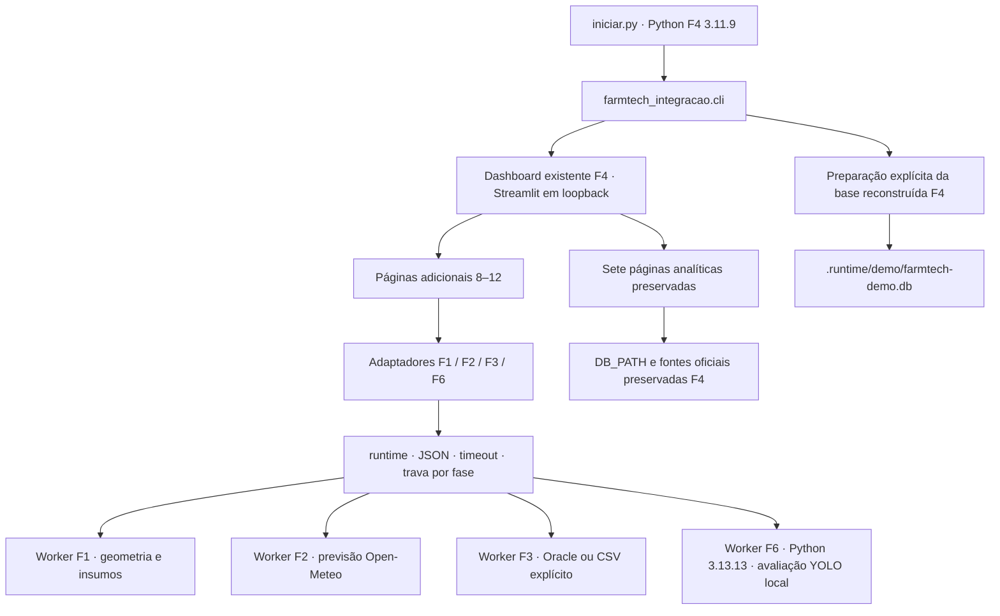

# Arquitetura da integração — Fase 7

## Aplicação preservada

A entrada integrada evolui a dashboard existente da Fase 4 em
[`servicos/fase4-regressao/src/frontend/app.py`](../servicos/fase4-regressao/src/frontend/app.py).
As sete páginas analíticas permanecem no mesmo projeto:

1. Sensores IoT.
2. Análise Exploratória.
3. Pipeline ML.
4. Previsão Agrícola.
5. Recomendações de Manejo.
6. Histórico de Previsões.
7. Dados Oficiais.

As páginas adicionais 8 a 12 apresentam a visão geral e os acessos às Fases 1, 2,
3 e 6. A Fase 5 permanece preservada em `servicos/fase5-ml`, fora do caminho
crítico desta integração. Seu notebook e sua demonstração opcional Flask/SQLite
não são iniciados pela aplicação integrada.

## Fluxo de execução



[`iniciar.py`](../iniciar.py) usa o executável indicado por
`FARMTECH_FASE4_PYTHON` ou, no Windows, o ambiente existente
`servicos/fase4-regressao/.venv-f402/Scripts/python.exe`. A CLI exige Python
**3.11.9**. Não instala dependências. A dashboard usa o endereço `127.0.0.1`,
porta padrão `8501`, com CORS e proteção XSRF habilitados.

O comando sem opção abre a dashboard. `--help`, `--status` e as demais ações
possuem caminhos próprios na [`CLI`](../farmtech_integracao/cli.py).
`--status` verifica arquivos/configurações e consulta o SQLite existente em modo
somente leitura; não testa acesso Oracle, não consulta a previsão e não executa
inferência. Um indicador local disponível não comprova funcionamento externo.

## Isolamento e contrato

Os adaptadores públicos de [`farmtech_integracao`](../farmtech_integracao/)
retornam [`Result`](../farmtech_integracao/contracts.py):

```json
{
  "status": "ok",
  "message": "Mensagem pública da operação",
  "data": {},
  "source": {}
}
```

Os estados aceitos são `ok`, `invalid`, `unavailable` e `error`. `ok` indica
conclusão da operação solicitada; `invalid`, entrada rejeitada; `unavailable`,
pré-condição ausente; `error`, falha ou limite atingido. Os campos de `data` e
`source` pertencem a cada serviço e documentam seus resultados e sua origem.
Os resultados das páginas ficam na sessão Streamlit.

[`runtime.py`](../farmtech_integracao/runtime.py) escolhe um worker por uma lista
fixa de fases, sem aceitar um comando de shell. O processo recebe JSON por
`stdin` e devolve JSON por `stdout`, com diretório de trabalho da fase. A
execução usa `-X utf8 -I -B`: UTF-8, isolamento do caminho Python e ausência de
gravação de bytecode. Os workers carregam apenas os módulos necessários por
caminhos conhecidos, evitando colisões entre os pacotes genéricos `src` das
fases.

| Operação | Ambiente | Timeout padrão |
|---|---|---|
| Cálculo F1 | Python F4 3.11.9 | 30 s |
| Previsão F2 | Python F4 3.11.9 | 40 s |
| Consulta F3 | Python F4 3.11.9, ou executável explicitamente fornecido à API Python | 30 s |
| Preparação da base F4 | Python F4 3.11.9 | 60 s |
| Avaliação F6 | Python F6 3.13.13 | 120 s |

O runtime limita a entrada JSON a 32 KiB e cada fluxo de saída a 1 MiB, valida a
resposta e encerra a árvore do processo ao atingir timeout ou limite. Aceita
timeouts positivos de até 300 s. A trava por fase em `.runtime/locks` evita
execuções simultâneas da mesma fase entre processos locais. A aquisição dessa
trava é um efeito de uma ação solicitada, não da importação do módulo.

O ambiente dos workers é reduzido a variáveis de sistema e controles de
execução. Somente o worker F3 recebe também `ORACLE_USER`, `ORACLE_PASS` e
`ORACLE_DSN`, quando presentes. Ele não carrega `.env`. Os processos filhos não
recebem `PYTHONPATH` do usuário.

## Abertura da aplicação e persistência

[`configure_dashboard()`](../farmtech_integracao/demo.py) é chamado antes dos
imports F4 relevantes. Na entrada integrada, fixa `FARMTECH_SIMULACAO=0` e usa
`DB_PATH` já configurado ou o caminho da base reconstruída. A página inicial não
treina modelos nem calcula previsões de referência. A abertura também não
inicia captura serial, R, API FastAPI F3, coletor meteorológico F3 ou YOLO.

As operações históricas das sete páginas F4 continuam sujeitas aos controles
dessas páginas. O modo integrado não transforma todo o projeto em uma aplicação
somente leitura; ações explícitas de previsão ou manutenção preservam seus
efeitos documentados na Fase 4.

`python iniciar.py --preparar-demo` prepara exclusivamente uma **base
reconstruída de demonstração** em `.runtime/demo/farmtech-demo.db`. O
[`worker F4`](../farmtech_integracao/workers/fase4_worker.py) usa os dois CSVs
preservados em `servicos/fase4-regressao/src/dados/`, prepara o banco em staging,
registra data UTC e hashes SHA-256 na tabela `integracao_proveniencia` e publica
um novo arquivo por hard link. Recusa destino existente, inclusive se ele
aparecer durante a preparação. Não substitui um banco histórico nem recupera
registros ausentes. A inspeção de status usa SQLite `mode=ro`.

## Proveniência e interpretação

| Origem | Significado no sistema integrado |
|---|---|
| F1 | Catálogo ilustrativo e funções geométricas preservadas; resultados calculados nesta sessão |
| F2 Open-Meteo | Previsão consultada sob demanda, com cidade/coordenadas e instante UTC de consulta; apresentação em America/Bahia |
| F3 CSV | Cópia local preservada de telemetria; origem selecionada explicitamente |
| F3 Oracle | Consulta real a `SENSORES_FARMTECH`, somente quando as pré-condições estão presentes e o usuário solicita |
| Base reconstruída F4 | Dados acadêmicos e leituras registradas/simuladas importados dos CSVs; não é histórico real recuperado |
| NOAA/USCRN, INMET e IBGE/SIDRA | Fontes oficiais preservadas na página Dados Oficiais, com origens, unidades, períodos e localidades próprios |
| F6 | Nova avaliação experimental de oito imagens quando executada; resultados históricos permanecem separados |

Os dados de fontes diferentes não são apresentados como uma série única. A
normalização IoT da F3 foi extraída para
[`src/utils/sensores.py`](../servicos/fase3-dashboard/src/utils/sensores.py) e
continua usada pela página histórica. Ela preenche flags N/P/K e bomba ausentes
com zero, comportamento indicado na página integrada. Os timestamps F3 mantêm a
informação da origem; o adaptador não infere um fuso ausente.

## Segurança local e limites atuais

A aplicação é local e não implementa autenticação de usuários. O bind em
loopback limita o acesso do servidor Streamlit à máquina. Credenciais Oracle
devem ser fornecidas pelo ambiente, com permissão de leitura da tabela; nomes
de usuário, DSN, senha e mensagens brutas do driver não fazem parte da resposta
pública. A consulta F3 não aceita SQL ou caminho de arquivo do usuário.

A F6 executa código e pesos locais confiáveis em processo separado. Seu
avaliador verifica revisão Git, integridade do checkpoint e entradas antes da
inferência, usa CPU, bloqueia rede e restringe subprocessos durante a avaliação.
Esses controles não constituem uma sandbox de código arbitrário; o checkout
precisa ser local, íntegro e confiável. A integração não baixa um checkout,
pesos ou dependências.

No ambiente inspecionado nesta entrega:

- O driver `oracledb` está ausente do Python F4; o CSV F3 é a alternativa local
  implementada. Nenhuma conexão Oracle real foi validada nesta integração.
- `Rscript` não foi localizado no `PATH`, e os CSVs operacionais da F2 estão
  ausentes. R e captura serial permanecem externos e desabilitados na interface.
- O checkout Git YOLOv5 fornecido pela responsável foi conferido e a avaliação
  real pelo botão integrado foi validada na revisão exigida. O caminho é
  configuração local por campo/variável de ambiente, sem caminho pessoal fixo.
- Python 3.11.9 e Python 3.13.13 são ambientes independentes; suas bibliotecas
  não são consolidadas em um único ambiente.

Os testes e as execuções efetivamente realizados são registrados em
[`VALIDACAO.md`](VALIDACAO.md). Esta descrição arquitetural não representa
validação de rede, hardware, R ou Oracle. A avaliação YOLO real possui evidência
separada em `VALIDACAO.md`.
