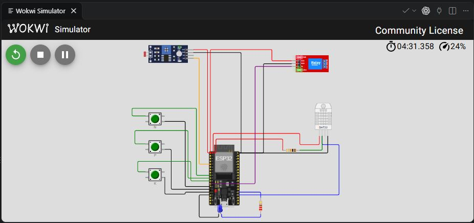

# FIAP - Faculdade de Informática e Administração Paulista

<p align="center">
<a href="https://www.fiap.com.br/"></a>
</p>

<br>

# Projeto: Sistema de Irrigação Inteligente para Tomate (Variedade Débora)

## 🚀 Resumo Executivo

Protótipo acadêmico da **FarmTech Solutions** para irrigação do tomate Débora, com ESP32, sensores simulados no Wokwi, captura serial em Python e análise de dados em R.

[Vídeo original](https://www.youtube.com/watch?v=h0m1m3kKXFw) · [**Repositório original — Fase 2**](https://github.com/EdeSufiatti/EdeSufiatti-FIAP_IA_FASE2_CAP1) — visibilidade pública verificada em 01/11/2026.

O ESP32 calcula o estado da bomba; o PC recebe as leituras em CSV. Python consulta a Open-Meteo e R compara os dados IoT com a previsão. **A previsão meteorológica participa da análise em R e não controla diretamente o firmware.**

DHT22 representa umidade do solo apenas didaticamente e LDR simula pH. O protótipo não mede nutrientes ou pH reais e não está homologado para acionar uma bomba física. Economia de água, produtividade e impacto ambiental exigem medições em campo.

Navegação: [Instalação](#-instalação-e-dependências) · [Wokwi e captura](#iniciar-o-wokwi-no-vs-code) · [Menus](#-menus-python-e-r) · [Irrigação e circuito](#-lógica-de-decisão-de-irrigação) · [Documentação](#-documentação-técnica-e-auditoria) · [Estrutura](#-estrutura-de-pastas) · [Créditos](#fiap---agrotech-solutions).

## 📦 Instalação e dependências

Execute os comandos na **raiz do módulo**, onde estão `app.py`, `app.r` e `platformio.ini`. Na estrutura da Fase 7, essa raiz corresponde a `servicos/fase2-iot/`; preserve a organização interna e os links relativos.

| Fluxo | Requisitos |
|---|---|
| Menu e previsão | Python 3; meteorologia usa a biblioteca padrão e acesso HTTPS à Open-Meteo |
| Captura serial COM/RFC2217 | PySerial no mesmo Python que executa o menu |
| Compilação e simulação | VS Code, PlatformIO, extensão Wokwi e DHTesp declarada em [platformio.ini](platformio.ini) |
| Análises | R com `Rscript` no PATH; somente pacotes base |

Instale apenas as dependências ausentes:

```powershell
python -m pip install -r scripts/requirements-serial.txt
python app.py
```

Para instalar também o CLI PlatformIO nesse Python, use `python -m pip install -r config/requirements.txt`. No VS Code, o terminal da extensão PlatformIO pode ter seu próprio ambiente. O [guia de instalação](config/SETUP_INSTRUCTIONS.md) explica instalação de R, Python e PATH no Windows; o [guia de configuração](config/readme.md) descreve dependências e instaladores opcionais.

### Iniciar o Wokwi no VS Code

1. Abra a pasta do módulo no VS Code, com as extensões PlatformIO e Wokwi disponíveis.
2. **Compile previamente o firmware pelo PlatformIO**, no ambiente **`esp32`**, usando Build ou `pio run -e esp32` no terminal da extensão.
3. Pressione **Ctrl + Shift + P** para abrir a paleta de comandos.
4. Procure e execute **Wokwi: Start Simulator**.
5. **Verifique o circuito e as mensagens no console serial** do simulador.
6. Para capturar registros em CSV, abra um terminal na raiz do módulo, execute **`python app.py`** e selecione a **opção 1**.

O comando pode iniciar a simulação sem abrir uma nova aba `diagram.json`. [wokwi.toml](wokwi.toml) aponta para o firmware compilado em `.pio/build/esp32/` e define `rfc2217ServerPort = 4000`. **Iniciar o Wokwi e visualizar seu console não gravam automaticamente o CSV no computador.**

A opção 1 do Python não compila nem inicia o simulador. Ela tenta abrir `diagram.json` pelo aplicativo associado, aguarda a porta 4000 e inicia o coletor PySerial em `rfc2217://127.0.0.1:4000`, a **115200 baud**. O destino é `dados/historico_irrigacao.csv`, em append. **Enter ou Ctrl+C** encerram a captura e retornam ao menu; não há reconexão automática.

Para placa física, upload, portas COM ou Monitor Serial interativo do PlatformIO, consulte os guias de [firmware](src/readme.md) e [scripts](scripts/readme.md). O monitor PlatformIO é uma alternativa independente; não execute dois coletores na mesma porta ou arquivo. Mantenha a porta RFC2217 restrita à máquina local.

## 📊 Menus Python e R

Inicie com `python app.py` na raiz do módulo:

| Opção Python | Ação |
|---|---|
| 1 — Simulação Wokwi + captura serial | Aguarda o simulador e acrescenta registros válidos ao CSV |
| 2 — Análises em R | Executa `Rscript app.r` no mesmo terminal e aguarda o submenu |
| 3 — Consulta de previsão do tempo | Pede a cidade, com padrão `São Paulo,BR`, consulta a Open-Meteo e salva JSON/CSV |
| 4 — Sair | Encerra o aplicativo |

O R também pode ser iniciado diretamente com `Rscript app.r`:

| Opção R | Entrada e resultado |
|---|---|
| 1 — Análise de IoT | Lê `dados/historico_irrigacao.csv`, ou `dados/captura_serial.csv` como alternativa; gera relatórios em `dados/analises/iot/` e gráficos |
| 2 — Análise de previsão | Lê `dados/previsao_tempo/previsao_tempo.csv`; gera relatórios em `dados/analises/previsao/` e gráficos |
| 3 — Integrar IoT e previsão | Lê os dois conjuntos e gera o CSV integrado e relatório em `dados/analises/integrada/` |
| 4 — Voltar | Retorna ao Python quando chamado pelo menu, ou ao terminal quando iniciado diretamente |

As opções de consulta/análise retornam ao respectivo menu após concluir ou informar erro. Gere as entradas antes de analisar; o módulo não distribui um CSV de exemplo. Os caminhos completos das saídas, comandos independentes e contratos estão no [guia de scripts](scripts/readme.md).

## ⚙️ Lógica de Decisão de Irrigação



**Figura 1 —** Circuito da FarmTech Solutions no Wokwi, com ESP32, DHT22, LDR, botões NPK, relé e LED de irrigação.

A regra implementada em [src/prog1.ino](src/prog1.ino) é:

| Condição de umidade | Bomba |
|---|---|
| Inválida, não finita ou fora de 0–100% | Desligada na função de decisão |
| Menor que 45% | Ligada |
| De 45% a 80%, inclusive | Ligada se pH corrigido estiver fora de 6,0–6,8 **ou** faltar N, P ou K |
| Maior que 80% | Desligada |

O pH base simulado é `14 − (ADC / 4095 × 14)`. A ausência de N subtrai 0,3; P e K subtraem 0,2 cada, com resultado limitado a 0–14. Botões usam **toggle** e debounce de 180 ms: cada clique alterna o estado booleano, que permanece até o próximo clique. A temperatura é registrada, mas não entra na decisão.

DHT22 é lido a cada 2 s; o firmware emite registros por alteração relevante e a cada 30 s. Pinagem, protocolo, justificativa do toggle e limites de inicialização/falha do sensor estão no [guia do firmware](src/readme.md). Esses parâmetros descrevem uma simulação, sem calibração agronômica real.

## 🔄 Dados e limites de análise

- **Serial:** o ESP32 emite `CSV_HDR`/`CSV_ROW`; o coletor acrescenta `ts_iso`, horário local de recebimento do PC sem offset. `t_rel_ms` vem de `millis()` e reinicia com o firmware. Cabeçalhos incompatíveis e linhas inválidas são recusados pelo leitor Python. Esquema, parâmetros e encerramento independente: [scripts](scripts/readme.md#captura-serial-independente).
- **Meteorologia:** novas consultas solicitam vento em **m/s** e UTC, validam os metadados e usam `Z` nos timestamps do CSV. **O JSON histórico inspecionado na origem declara km/h**; esse JSON e seus derivados não acompanham o módulo integrado. Os números antigos não devem ser reinterpretados como m/s. Novas consultas preservam a resposta no JSON; a gravação do par JSON/CSV não é transacional.
- **Tempo:** IoT sem offset usa o fuso do computador da análise, com fallback UTC; configure o fuso da captura ao usar outro computador. IoT/integração são apresentados em `America/Bahia` com offset explícito e previsão em UTC, preservando o instante.
- **Associação:** o menu R usa a previsão mais próxima, sem interpolação; o script independente interpola variáveis contínuas. Ambos podem repetir extremos fora da cobertura, sem tolerância máxima, e gravam o mesmo caminho de CSV integrado. Critérios de empate, duplicatas e limites: [guia de scripts](scripts/readme.md#análises-e-associação-temporal-em-r).
- **Saídas:** consultas e análises usam nomes fixos e podem substituir resultados. Gráficos antigos permanecem quando uma regressão é ignorada; alguns nomes são compartilhados entre análises. Preserve evidências e confira método, unidade, fuso e proveniência antes de interpretar.
- **Estatística:** regressões exigem três pares finitos e variação nas duas variáveis; ajustes inviáveis são informados sem interpretação de coeficientes. Amostras pequenas ou simuladas não demonstram causalidade ou eficiência hídrica.

## 📚 Documentação técnica e auditoria

| Documento | Conteúdo |
|---|---|
| [Requisitos e matriz de rastreabilidade](document/RASTREABILIDADE_F2.md#matriz-de-rastreabilidade-acadêmica) | Síntese autoral das exigências acadêmicas, implementação e evidências |
| [Documento técnico](document/ai_project_document_fiap.md) | Arquitetura detalhada, decisões, contexto acadêmico e contratos |
| [Configuração](config/readme.md) e [instalação/PATH](config/SETUP_INSTRUCTIONS.md) | Dependências e preparação do ambiente |
| [Scripts](scripts/readme.md) e [firmware](src/readme.md) | Coleta, comandos alternativos, análises, protocolo e pinagem |
| [Rastreabilidade](document/RASTREABILIDADE_F2.md) | Requisitos, testes, evidências e limitações por revisão |
| [Auditoria de segurança](document/AUDITORIA_SEGURANCA_F2.md) | Riscos, inventário dos gerados e critérios de preservação |
| [CHANGELOG](CHANGELOG.md) | Funcionalidades originais e correções das auditorias |

Testes manuais informados pela responsável, testes automatizados executados e validações não executadas são distinguidos na rastreabilidade. O cenário isolado de nitrogênio foi validado em modelo Python; os cenários C++ da F2-91 não foram executados por ausência de compilador host. Isso não equivale a teste direto do firmware.

A avaliação F2-91 é **apto com ressalvas para integração acadêmica dos fontes**. A confirmação da interface de escuta RFC2217 e a proveniência dos artefatos históricos permanecem entre os limites técnicos registrados na auditoria de segurança.

## 📁 Estrutura de pastas

Estrutura resumida do módulo; na Fase 7, o caminho de referência é `servicos/fase2-iot/`:

```text
fase2-iot/
├── .github/problem-report.md
├── .gitattributes
├── .gitignore
├── README.md
├── CHANGELOG.md
├── app.py
├── app.r
├── assets/                      # Logo FIAP e circuito Wokwi
├── config/                      # Guias, requisitos e instaladores
├── dados/                       # Saídas e evidências históricas
│   └── analises/
│       ├── iot/analise_historico.txt
│       ├── previsao/analise_previsao.txt
│       └── integrada/analise_integrada.txt
├── diagram.json
├── document/
│   ├── ai_project_document_fiap.md
│   ├── AUDITORIA_SEGURANCA_F2.md
│   └── RASTREABILIDADE_F2.md
├── monitor/filter_irrigation_csv.py
├── platformio.ini
├── r/                           # Scripts independentes e helper temporal
├── scripts/                     # Coletores, guia e requisitos seriais
├── src/                         # Firmware e guia técnico
├── tests/                       # Testes offline e verificador documental
└── wokwi.toml
```

Esta seleção inclui **somente três relatórios TXT históricos**, em `dados/analises/`, com conteúdo preservado. Os 19 PNGs, o JSON meteorológico e os cinco CSVs operacionais inspecionados nas auditorias permanecem na origem e não acompanham o módulo integrado. O enunciado institucional integral também permanece fora desta seleção; os requisitos estão na matriz de rastreabilidade.

Gere as entradas CSV pela captura serial e pela consulta meteorológica antes de executar as análises R. Os programas criam os diretórios de saída necessários. Novos dados, gráficos e relatórios são ignorados pelas regras Git do módulo; os três TXT históricos têm exceções específicas para sua inclusão. `.pio/`, configurações locais de `.vscode/`, ambientes e caches não integram os fontes; `.vscode/tasks.json` pode ser compartilhado, mas não é fornecido pelo módulo.

## 🗃 Histórico de versões documentadas

As identificações `0.1.0` a `0.1.4` são versões declaradas na documentação original, sem associação comprovada com tags ou releases. A redação antiga “Versão 1.2” foi normalizada para `0.1.2`; as datas declaradas de `0.1.4` diferem entre README e guia do firmware.

A consulta de 01/11/2026 encontrou os commits `b37f8f2` (20/04/2026) e `1e58f2b` (11/04/2026) nas referências locais, sem tags nesse recorte. Datas, mensagens e divergências estão no [CHANGELOG](CHANGELOG.md#proveniência-das-versões-e-do-histórico-git).

## FIAP - AgroTech Solutions

## 👨‍🎓 Integrantes:
- Edemir Sufiatti RM571375
- Daniel Abreu dos Santos RM570844
- Carlos Magnus Costa Amaral RM573978
- Georgia Mendes Rocha RM573281
- Marina Leme Soares RM570461

## 👩‍🏫 Professores:
### Tutor(a)
- Nicolly Candida Rodrigues de Souza
### Coordenador(a)
- André Godoi Chiovato

## 📋 Licenciamento e atribuições

**Modelo institucional FIAP:** a atribuição Creative Commons Attribution 4.0 abaixo pertence ao modelo de repositório, com autoria FIAP preservada.

<p xmlns:cc="http://creativecommons.org/ns#" xmlns:dct="http://purl.org/dc/terms/"><a property="dct:title" rel="cc:attributionURL" href="https://github.com/agodoi/template">MODELO GIT FIAP</a> por <a rel="cc:attributionURL dct:creator" property="cc:attributionName" href="https://fiap.com.br">Fiap</a> está licenciado sobre <a href="http://creativecommons.org/licenses/by/4.0/?ref=chooser-v1" target="_blank" rel="license noopener noreferrer" style="display:inline-block;">Attribution 4.0 International</a>.</p>

**Código e documentação da solução:** os créditos correspondem à equipe original acima; as melhorias de auditoria estão identificadas no [CHANGELOG](CHANGELOG.md). A licença do modelo não se estende automaticamente a esses materiais. A inspeção não encontrou um arquivo de licença específico para o software desenvolvido.

**Distribuição e reutilização:** cabe aos titulares definir e registrar as condições pretendidas para o software e a documentação autoral, incluindo a licença aplicável e as condições dos componentes de terceiros. Tornar um repositório público não equivale a conceder uma licença aberta de reutilização; consulte a [orientação do GitHub sobre licenciamento](https://docs.github.com/en/repositories/managing-your-repositorys-settings-and-features/customizing-your-repository/licensing-a-repository). Esta documentação não escolhe uma licença nem presume cessão ou autorização.

**Requisitos acadêmicos:** a [síntese autoral e a matriz de rastreabilidade](document/RASTREABILIDADE_F2.md#síntese-autoral-proposta-para-os-requisitos) documentam as exigências e seu atendimento. O enunciado institucional integral não integra esta distribuição; sua referência acadêmica é o portal da FIAP, e a cópia histórica permanece no projeto de origem. A licença do template não constitui autorização para reproduzir esse material.
