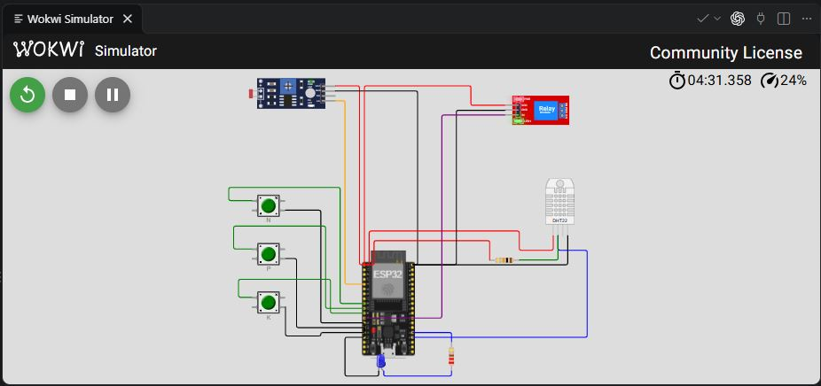

# AI Project Document - Módulo 1 - FIAP

## Nome do Grupo

**AgroTech Solutions - FIAP IA Challenge**

#### Nomes dos integrantes do grupo

- Edemir Sufiatti
- Daniel Abreu
- Carlos Magnus
- Georgia Mendes
- Marina Leme

**Tutora:** Nicolly Candida Rodrigues de Souza  
**Coordenador:** André Godoi Chiovato

> Documento técnico do projeto original, revisado pela auditoria de 01/11/2026, referente às correções de outubro/novembro de 2026. Os créditos acima foram preservados. A revisão corrigiu a descrição do funcionamento e a classificação das evidências; não atribui o desenvolvimento original à auditoria. As evidências e os testes citados correspondem à revisão auditada naquela data. Consulte a [rastreabilidade](RASTREABILIDADE_F2.md), a [auditoria de segurança](AUDITORIA_SEGURANCA_F2.md) e o [histórico de alterações](../CHANGELOG.md).

A F2-91 complementa a apresentação de horários, a associação temporal do script independente e a validação das novas respostas meteorológicas. Os contratos atuais estão descritos no pipeline abaixo; os relatos e artefatos históricos continuam identificados separadamente.

**Seleção F2-95:** este módulo reúne fontes, configuração, testes, documentação autoral, imagens de identidade/circuito e apenas três relatórios TXT históricos. Os inventários e resultados das revisões até a F2-94 descrevem o projeto de origem `farmtech-fase2`. Os outros 25 arquivos de dados da origem — 19 PNGs, um JSON e cinco CSVs — e o enunciado institucional integral foram omitidos. Os requisitos distribuídos estão na [síntese autoral](RASTREABILIDADE_F2.md#síntese-autoral-proposta-para-os-requisitos) e na matriz de rastreabilidade. Essa seleção não comprova execução de testes no módulo integrado.


## Sumário

[1. Introdução](#c1)

[2. Visão Geral do Projeto](#c2)

[3. Desenvolvimento do Projeto](#c3)

[4. Resultados e Avaliações](#c4)

[5. Conclusões e Trabalhos Futuros](#c5)

[6. Referências](#c6)

[Anexos](#c7)

<br>

# <a name="c1"></a>1. Introdução

## 1.1. Escopo do Projeto

### 1.1.1. Contexto da Inteligência Artificial

A automação e a análise de dados podem apoiar o estudo do uso de água na agricultura. Este projeto é um protótipo acadêmico de sensoriamento, controle por regras e análise estatística. Sua simulação não demonstra produtividade, economia de água ou adequação para operação em campo.

### 1.1.2. Descrição da Solução Desenvolvida

Sistema de **Irrigação Inteligente com regras condicionais** para simular o manejo do tomate variedade Débora. A solução integra:

- **Camada de Sensoriamento:** DHT22 mede umidade relativa do ar e temperatura; sua umidade representa o solo apenas didaticamente. O LDR representa pH por simulação e os botões alternam presença/ausência de NPK.
- **Camada de Processamento:** ESP32 executa regras fixas de umidade, pH corrigido e NPK.
- **Camada de Comunicação:** ESP32 transmite linhas serial prefixadas; Python ou o filtro do PlatformIO persiste o CSV no PC.
- **Camada de Análise:** Scripts Python para automação e R para estatística/visualização
- **Camada de Simulação:** Integração com Wokwi para prototipagem rápida

O firmware combina umidade, pH simulado e nutrientes. A temperatura é registrada, mas não participa da decisão. A previsão meteorológica é consultada em Python e analisada em R; não há envio de comandos meteorológicos ao firmware nem controle da bomba por R.

# <a name="c2"></a>2. Visão Geral do Projeto

## 2.1. Objetivos do Projeto

**Objetivo Principal:**  
Desenvolver um sistema de irrigação automatizado que otimize a aplicação de água em cultivos de tomate Débora através de lógica inteligente baseada em múltiplos sensores.

**Objetivos Específicos:**
1. Implementar algoritmo de decisão que processa dados de umidade, pH e nutrientes em tempo real
2. Estudar decisões de irrigação no simulador (limiares de umidade de 45% e 80%, faixa de pH de 6,0 a 6,8), sem afirmar economia ou produtividade medidas
3. Criar interface de simulação em Wokwi para prototipagem rápida e testes
4. Desenvolver pipeline de análise em Python/R para visualização de dados históricos
5. Integrar sistema de captura de dados em CSV para rastreabilidade completa
6. Proporcionar controle manual via botões para ajustes de nutrientes em tempo real

## 2.2. Público-Alvo

- **Primário:** Pequenos e médios produtores de tomate que buscam otimizar irrigação
- **Secundário:** Pesquisadores em agricultura de precisão e agritech
- **Terciário:** Estudantes de engenharia e sistemas embarcados
- **Ecosistema:** Integradores capazes de estender a solução para outras culturas

## 2.3. Metodologia

A metodologia seguiu **5 fases integradas:**

1. **Análise e Modelagem** - Estudo dos parâmetros ideais de tomate Débora e sensores disponíveis
2. **Prototipagem Rápida** - Desenvolvimento em Wokwi com simulação de sensores
3. **Implementação de Firmware** - Código C+Arduino para ESP32 com lógica de decisão
4. **Integração Multiplataforma** - Scripts Python para captura de dados e automação
5. **Análise e Validação** - Pipeline R para estatística e visualizações

Ferramentas presentes no repositório: **Git** para versionamento, **PlatformIO** para compilação e monitor serial e **Wokwi** para simulação. A auditoria de 01/11/2026 não identificou evidência suficiente para afirmar ciclos semanais ou CI/CD embarcado.

# <a name="c3"></a>3. Desenvolvimento do Projeto

## 3.1. Tecnologias Utilizadas

| Componente | Tecnologia | Versão | Função |
|-----------|-----------|--------|--------|
| **Microcontrolador** | ESP32 | - | Processamento e decisão |
| **Sensores** | DHT22, LDR, Botões GPIO | - | Aquisição de dados |
| **Atuadores** | Relé + Bomba, LED | - | Acionamento de irrigação |
| **IDE Embarcada** | PlatformIO | 6.1.0+ | Compilação e upload |
| **Framework** | Arduino Framework | Resolvido pelo PlatformIO | API de programação |
| **Simulador** | Wokwi no VS Code | Extensão instalada localmente | Prototipagem sem hardware |
| **Backend** | Python | 3.7+ | Captura de dados e automação |
| **Análise** | R / Rscript | 4.0+ | Estatística e visualização |
| **Comunicação** | Serial a 115200 baud | COM ou RFC2217 local:4000 | Transmissão de dados |
| **Versionamento** | Git/GitHub | - | Controle de versão |

## 3.2. Modelagem e Algoritmos

### 3.2.1. Modelo de Decisão de Irrigação

A lógica de decisão implementada utiliza **regras condicionais hierárquicas** combinadas com **parâmetros agrícolas**:

```
ALGORITMO: Decisão de Irrigação (Tomate Débora)

ENTRADA: umidade(%), pH, nitrogenio, fosforo, potassio, temperatura(°C)

SE umidade < 45%:
    ATIVAR_IRRIGACAO = SIM
    MOTIVO = "Umidade crítica baixa"
    
SENÃO SE umidade > 80%:
    ATIVAR_IRRIGACAO = NÃO
    MOTIVO = "Umidade excessiva (risco de apodrecimento)"
    
SENÃO:  // 45% <= umidade <= 80%
    ATIVAR_IRRIGACAO = NÃO
    SE pH < 6.0 OU pH > 6.8:
        ATIVAR_IRRIGACAO = SIM
        MOTIVO = "pH fora da faixa ideal"
    
    SE nitrogenio = 0 OU fosforo = 0 OU potassio = 0:
        ATIVAR_IRRIGACAO = SIM
        MOTIVO = "Falta de nutriente(s)"
        
SAÍDA: ATIVAR_IRRIGACAO (SIM/NÃO), MOTIVO, TEMPO_DESDE_RESET
```

### 3.2.2. Sensor Mapping e Calibração

| Componente | Pino ESP32 | Tipo / comportamento implementado |
|------------|------------|-----------------------------------|
| DHT22 | GPIO 15 | Biblioteca DHTesp; leitura a cada 2000 ms |
| LDR | GPIO 34 (ADC) | `ph_base = 14 - (valor_ADC / 4095) × 14`, limitado a 0–14 |
| Botão N | GPIO 25 | INPUT_PULLUP; toggle por borda de descida com intervalo maior que 180 ms |
| Botão P | GPIO 26 | INPUT_PULLUP; mesmo comportamento |
| Botão K | GPIO 27 | INPUT_PULLUP; mesmo comportamento |
| Relé | GPIO 14 | Ativo em LOW no código atual |
| LED de irrigação | GPIO 2 | HIGH enquanto a irrigação está ligada |

O pH corrigido subtrai 0,3 por N ausente, 0,2 por P ausente e 0,2 por K ausente, limitado a 0–14. Essa transformação é didática, não uma calibração de pH ou modelo químico validado. O código rejeita umidade não finita ou fora de 0–100 na função de decisão; os limites completos estão em [src/prog1.ino](../src/prog1.ino).

### 3.2.3. Protocolo de Comunicação

Dados transmitidos via Serial (**115200 baud**) em linhas prefixadas:

```
Cabeçalho:
CSV_HDR,t_rel_ms,umidade,temp_c,ldr,ph_base,ph_corr,N,P,K,bomba_fw

Exemplo:
CSV_ROW,45000,67.50,26.30,2048,6.998,6.998,1,1,1,1
```

O registro acima é apenas um exemplo de formato. O ESP32 informa `t_rel_ms`, não um relógio civil. O PC acrescenta `ts_iso` no momento da recepção e retira o prefixo `CSV_ROW`. O arquivo final possui `ts_iso,t_rel_ms,umidade,temp_c,ldr,ph_base,ph_corr,N,P,K,bomba_fw`. São emitidas linhas por mudança relevante e a cada 30 segundos; o CSV persiste entre sessões por append.

O menu [app.py](../app.py) usa [serial_grava_csv.py](../scripts/serial_grava_csv.py) com PySerial e `rfc2217://127.0.0.1:4000`. O [filtro do PlatformIO](../monitor/filter_irrigation_csv.py) é uma alternativa para seu monitor interativo. Execute um capturador por vez. A descrição das quatro opções Python e das quatro opções R está no [README](../README.md).

## 3.3. Testes e Evidências

### 3.3.1. Dados Utilizados

- **Origem:** Simulação Wokwi para IoT e previsão horária da Open-Meteo para meteorologia.
- **Histórico relatado à auditoria de 01/11/2026:** Análise meteorológica com 168 registros, análise IoT e integração com 5 registros. Esses números descrevem as execuções anteriores relatadas, sem estabelecer duração de operação ou volume de outras capturas.
- **Evidência inspecionada na origem em 01/11/2026:** CSVs, relatórios e gráficos em `dados/`; a presença de um artefato não comprova que ele foi regenerado durante aquela auditoria. Somente os três relatórios TXT acompanham a seleção F2-95; os arquivos de entrada e gráficos históricos permanecem na origem.
- **Validações de 01/11/2026:** Consulte a [rastreabilidade](RASTREABILIDADE_F2.md), que separa inspeção estática, testes automatizados e testes históricos.

### 3.3.2. Métricas de Avaliação

O repositório não oferece ensaio de campo, medição de vazão ou protocolo de avaliação que sustente percentuais de acurácia, economia hídrica, disponibilidade ou latência média. Esses indicadores permanecem como possíveis avaliações futuras, não resultados demonstrados. As estatísticas em R descrevem apenas o arquivo efetivamente carregado; regressões inviáveis devem ser ignoradas com justificativa.

### 3.3.3. Resultados de Testes

| Verificação histórica | Resultado relatado à auditoria de 01/11/2026 | Limite da evidência |
|-----------------------|----------------------------------|--------------------|
| Compilação ESP32 | Aprovada no PlatformIO | Compilação não repetida na auditoria de 01/11/2026 |
| Sensores, botões NPK e bomba | Diferentes cenários validados no Wokwi | Não estabelece taxa de acerto |
| Serial Wokwi → RFC2217 → Python → CSV | Aprovada em `127.0.0.1:4000` | Não demonstra ausência universal de perda |
| Open-Meteo em Irecê-BA e R | Consulta/arquivos e análise aprovados | API externa não revalidada na auditoria de 01/11/2026 |
| IoT e integração em R | Executadas com 5 registros; regressões inviáveis tratadas | Amostra pequena e possivelmente constante |

# <a name="c4"></a>4. Resultados e Avaliações

## 4.1. Análise dos Resultados

### 4.1.1. Funcionalidades e Limites

| Aspecto | Implementação observável | Limite |
|---------|-------------------------|--------|
| Decisão de irrigação | Regras em `decidirIrrigacaoTomate` | Não representa modelo agronômico validado em campo |
| Captura histórica | Serial com persistência no PC | Depende do capturador e da simulação ativos |
| Análise de IoT e meteorologia | Relatórios, CSVs e gráficos em R | Não mede economia de água ou produtividade |
| Integração temporal | Associação por horário | Não demonstra causalidade nem controla o relé |

### 4.1.2. Análise Comparativa

Não há comparação controlada com irrigação contínua, medição de litros, custos ou tempo de manutenção. A comparação possível nesta entrega é entre entradas simuladas e a regra definida no firmware. Benefícios produtivos e ambientais precisam de ensaios próprios.

### 4.1.3. Insights Importantes

1. **Simulação didática:** DHT22 e LDR não medem, respectivamente, umidade do solo e pH reais.
2. **Amostra:** Poucos registros ou dados constantes limitam regressões e interpretação estatística.
3. **Horários:** `ts_iso` é recepção no PC; atrasos e o fuso do computador afetam a associação meteorológica.
4. **Captura:** O painel serial do Wokwi, isoladamente, não escreve o histórico no PC.

## 4.2. Feedback dos Usuários

A auditoria de 01/11/2026 não localizou registros que sustentem entrevistas ou depoimentos de agrônomos, engenheiros ou produtores. As falas de versões anteriores do documento não devem ser usadas como evidência. Conforme relatado à auditoria, o projeto original já havia sido avaliado pela FIAP e a imagem do circuito estava ausente no README; a imagem está disponível em [assets/circuito_wokwi.png](../assets/circuito_wokwi.png). Não se infere nota, parecer adicional ou nova avaliação institucional.

### Melhorias Sugeridas:
1. Alertas em decisões críticas: proposta futura.
2. Dashboard em tempo real: proposta futura.
3. Suporte a múltiplas culturas: proposta futura.
4. API meteorológica: consulta e análise implementadas; controle do firmware com a previsão permanece fora do fluxo atual.

# <a name="c5"></a>5. Conclusões e Trabalhos Futuros

## 5.1. Atingimento dos Objetivos

O código implementa decisão por regras no ESP32, botões NPK, simulação Wokwi, captura serial, consulta meteorológica e análise em R. Os testes históricos informados cobrem esses fluxos nas condições relatadas. Economia de água, produtividade, operação contínua sem perdas e validação de campo não foram demonstradas. A [matriz de rastreabilidade](RASTREABILIDADE_F2.md) registra também os limites dos itens opcionais do enunciado.

## 5.2. Pontos Fortes

1. **Separação de funções:** Firmware controla o relé; PC captura dados e executa análises.
2. **Reprodução didática:** Circuito e código estão disponíveis para simulação.
3. **Persistência:** CSV permite analisar várias capturas locais.
4. **Documentação:** README, guia de instalação, firmware, rastreabilidade e segurança apresentam papéis distintos.
5. **Ferramentas:** Python, R, ESP32, PlatformIO e Wokwi compõem o fluxo implementado.

## 5.3. Pontos a Melhorar

1. **Sensores Redundantes:** Adicionar segundo DHT22 para validação cruzada
2. **ML Avançado:** Substituir regras por modelo preditivo (Random Forest/LSTM)
3. **Interface Web:** Dashboard em tempo real (HTML5 + WebSockets)
4. **Alertas:** Sistema de notificações (Telegram, e-mail, SMS)
5. **Hardware:** Testar em ambiente real (estufa/campo) com dados reais
6. **Consumo Energético:** Otimizar bateria para operação 24/7 com painel solar

## 5.4. Plano de Ações para Próximas Sprints

As sugestões abaixo são propostas, sem cronograma ou ganho quantitativo demonstrado; não representam funcionalidades implementadas pela auditoria de 01/11/2026.

| Prioridade sugerida | Ação | Evidência necessária |
|---------------------|------|---------------------|
| Alta | Validar sensores agrícolas reais e manejo em campo | Calibração e protocolo agronômico |
| Alta | Repetir captura e análises com série temporal variada | Dados identificados por sessão e critérios de avaliação |
| Média | Avaliar associação temporal com tolerância máxima | Requisito de negócio e dados de referência |
| Média | Avaliar dashboard e múltiplas culturas | Requisitos da integração da Fase 7 |
| Futura | Estudar modelos preditivos e consumo energético | Base adequada e comparação com regras atuais |

## 5.5. Recomendações

Na integração com a Fase 7, considerar os requisitos do projeto de destino e as limitações documentadas na [auditoria de segurança](AUDITORIA_SEGURANCA_F2.md). Uso real exige validação dos sensores, regras de controle, comportamento em falhas e resultados agronômicos. Na estrutura `servicos/fase2-iot/`, executar os comandos a partir dessa pasta e preservar a estrutura interna, os links relativos e os contratos de dados descritos no pipeline.

# <a name="c6"></a>6. Referências

> Bibliografia preservada do documento original. A auditoria de 01/11/2026 não consultou nem verificou as edições, os títulos ou o suporte de cada referência às afirmações agronômicas. Essas entradas não constituem evidência dos testes ou métricas do projeto. Para o comportamento implementado, prevalecem os arquivos vinculados e a rastreabilidade.

## 6.1. Referências sobre Tomate Débora

[1] **Embrapa.** "Sistema de Produção de Tomate para Agroindústria." Embrapa Hortaliças, 2010.  
[2] **Filgueira, F. A. R.** "Novo Manual de Olericultura: Agrotecnologia Moderna na Produção e Comercialização de Hortaliças." UFV, 2008.  
[3] **Taiz, L., et al.** "Fisiologia e Desenvolvimento Vegetal." 6ª edição. Artmed, 2017.

## 6.2. Referências sobre Irrigação de Precisão

[4] **Paz, V. P. da S., et al.** "Manejo de Água em Irrigação." Editora UFV, 2012.  
[5] **FAO.** "Crop Evapotranspiration - Guidelines for Computing Crop Water Requirements." Irrigation and Drainage Paper 56, 1998.  
[6] **Allen, R. G., et al.** "A Global Network of Reference Evapotranspiration Sites." Agricultural Water Management, 2011.

## 6.3. Referências sobre IoT e Sistemas Embarcados

[7] **Espressif Systems.** "ESP32 Technical Reference Manual." Versão 4.7, 2023.  
[8] **Arduino.** "Arduino Documentation and References." https://docs.arduino.cc/

## 6.4. Referências sobre Machine Learning em Agricultora

[9] **Sharma, A., et al.** "Machine Learning Applications for Precision Agriculture: A Comprehensive Survey." IEEE Transactions on Industrial Informatics, 2021.  
[10] **Liakos, K. G., et al.** "Machine Learning in Agriculture: A Review." Sensors, 2018.

## 6.5. Documentação Técnica Utilizada

[11] **DHT22 Datasheet.** "DHT22 Humidity and Temperature Sensor." Aosong, 2018.  
[12] **PlatformIO Docs.** "PlatformIO: A cross-platform, stateless build system." https://platformio.org/  
[13] **Wokwi Documentation.** "Online Arduino and ESP32 Simulator." https://wokwi.com/

## 6.6. Padrões e Boas Práticas

[14] **NIST.** "Cybersecurity Framework Version 1.1." National Institute of Standards and Technology, 2018.  
[15] **ISO 11783.** "ISO Standard for Agricultural machinery - Tractors and machinery for agriculture and forestry - Serial Control and Communications Data Network." International Organization for Standardization, 2023.

## 6.7. Artigos da Comunidade

[16] **Yilmazel, B., et al.** "Decision Support Systems for Precision Agriculture." Turkish Journal of Agriculture and Forestry, 2019.  
[17] **Lokesh, K. B., et al.** "IoT and Machine Learning Based Crop Irrigation Management." Journal of Agricultural Research, 2022.  
[18] **Repositório do Projeto.** "Código fonte e documentação completa." https://github.com/EdeSufiatti/EdeSufiatti-FIAP_IA_FASE2_CAP1

# <a name="c7"></a>Anexos

## A1. Diagramas e Fluxogramas

### A1.1. Arquitetura do Sistema Geral

```
┌─────────────────────────────────────────────────────────────┐
│                    SISTEMA INTEGRADO                        │
├─────────────────────────────────────────────────────────────┤
│                                                             │
│  ┌──────────────────┐         ┌──────────────────┐        │
│  │   CAMADA FÍSICA  │         │  CAMADA LÓGICA   │        │
│  ├──────────────────┤         ├──────────────────┤        │
│  │ DHT22 (15)      │         │ Algoritmo de     │        │
│  │ LDR (34)        │────────→│ Decisão (ESP32)  │        │
│  │ Botões (25,26,27)        │                  │──────┐ │
│  │ Relé + Bomba (14)        │ Regras condicionais      │ │
│  │ LED (2)         │         └──────────────────┘        │ │
│  └──────────────────┘                                     │ │
│                                                           │ │
│  ┌──────────────────────────────────────────────────┐    │ │
│  │    SAÍDA: LINHAS CSV_HDR / CSV_ROW             │←───┘ │
│  │ Tempo relativo, umidade, temp., pH, NPK, bomba │      │
│  └──────────────────────────────────────────────────┘      │
│                          │                                │
│           ┌──────────────┼──────────────┐                │
│           ▼              ▼              ▼                │
│      ┌─────────┐   ┌─────────┐   ┌─────────┐           │
│      │ Python  │   │    R    │   │ Wokwi   │           │
│      │ Captura │   │Análise/ │   │Simulador│           │
│      │         │   │Visualiz │   │         │           │
│      └─────────┘   └─────────┘   └─────────┘           │
│                                                          │
└──────────────────────────────────────────────────────────┘
```



Imagem inspecionada na auditoria de 01/11/2026; sua inclusão não representa uma nova execução do simulador naquela auditoria.

### A1.2. Fluxo de Decisão de Irrigação

```
                          INÍCIO
                            │
                            ▼
        ┌───────── LER SENSORES ────────┐
        │  Umidade, pH, N, P, K, Temp  │
        └───────────────────────────────┘
                            │
                            ▼
                ┌─── SE UMIDADE < 45% ───┐
                │   ATIVAR IRRIGAÇÃO      │
                └────────────────────────┘
                            │ NÃO
                            ▼
                ┌─── SE UMIDADE > 80% ───┐
                │  DESATIVAR IRRIGAÇÃO    │
                └────────────────────────┘
                            │ NÃO
                            ▼
        ┌──────── VERIFICAR pH (6.0-6.8) ──────┐
        │      OU FALTA N, P OU K?             │
        └─────────────────────────────────────┘
                   SIM ▼              ▼ NÃO
            ┌─────────────┐   ┌────────────┐
            │ ATIVAR      │   │ MANTER     │
            │ IRRIGAÇÃO   │   │ DESLIGADA  │
            └─────────────┘   └────────────┘
                   │                  │
                   └──────┬───────────┘
                          ▼
                ┌──────────────────────┐
                │ ENVIAR DADOS CSV     │
                │ + DECISÃO            │
                └──────────────────────┘
                          │
                          ▼
                        FIM
```

Uma captura adicional do menu é opcional. As opções e os comandos atuais estão documentados no [README](../README.md).

### A1.3. Pipeline de Dados

```
ESP32 (Firmware)
    │
    ├─ DHT22 →  Temperatura, Umidade
    ├─ LDR →    pH (ADC mapping)
    ├─ Botões → N, P, K flags
    │
    └─→ Algoritmo de Decisão
         │
         └─→ CSV Serial (115200 baud)
              │
              └─→ Python (pyserial)
                  │
                  └─→ dados/historico_irrigacao.csv (+ ts_iso do PC)
                      │
                      └─→ R (rscript)
                          │
                          ├─→ Estatísticas descritivas
                          ├─→ Análise de tendências
                          ├─→ Gráficos PNG
                          └─→ Relatórios TXT
```

Em paralelo: `scripts/weather_forecast.py` consulta a Open-Meteo e grava JSON/CSV para R. Novas consultas solicitam vento em m/s e UTC; respostas com registros horários têm unidade, fuso e deslocamento zero validados antes da persistência. O novo CSV explicita UTC com `Z`, enquanto o JSON conserva a resposta e seus metadados, sem conversão de unidades. Na origem, o CSV meteorológico histórico usa UTC sem sufixo e o JSON histórico declara vento em km/h; esses arquivos foram preservados sem conversão e omitidos da seleção F2-95. O módulo precisa gerar novas entradas para as análises. O menu R integra IoT e previsão sem retornar comandos ao ESP32.

**Associação temporal:** No menu `app.r`, cada leitura IoT é associada à linha meteorológica de menor distância absoluta de tempo. Em empate, prevalece a primeira linha da previsão. Não há interpolação nem tolerância máxima; fora do intervalo disponível, a borda mais próxima pode ser reutilizada. Vários registros IoT podem compartilhar a mesma previsão horária, inclusive produzindo colunas constantes. Isso não cria observações meteorológicas independentes.

O script independente `r/02_integrar_previsao.R` tem outro critério: ignora timestamps meteorológicos inválidos, ordena por instante e mantém a primeira linha do arquivo original em timestamps duplicados. Interpola linearmente as variáveis contínuas entre limites finitos; um limite ausente ou não finito produz `NA`. Categoria e metadados usam o horário mais próximo e, em empate após a ordenação, o anterior. Fora da cobertura, repete o primeiro/último valor, também sem tolerância máxima. Esses controles corrigem a antiga dependência de previsão previamente ordenada; o método continua diferente da opção 3 do menu R. Ambos gravam o mesmo CSV integrado, portanto a origem da execução deve acompanhar o resultado.

Os dois fluxos usam [r/temporal_utils.R](../r/temporal_utils.R). IoT sem sufixo mantém o fuso local do computador, com fallback UTC se indisponível; previsão sem sufixo é interpretada como UTC, inclusive no script independente após a F2-91. `Z` e offsets explícitos são respeitados por linha. Confirme o fuso usado na captura original: mudar a apresentação não corrige automaticamente um relógio ou fuso de origem incorreto.

Relatórios e CSVs processados de IoT e integração apresentam horários em `America/Bahia` com offset explícito; análises meteorológicas do menu apresentam UTC. Por exemplo, um registro capturado em Bahia às `2026-10-31T21:33:50` é apresentado como `2026-10-31T21:33:50-03:00`, mantendo o mesmo instante de `2026-11-01T00:33:50Z`. A formatação não aplica deslocamentos artificiais, não muda a associação e não regrava o histórico bruto.

## A2. Especificações Técnicas Detalhadas

### A2.1. Pinos do ESP32 (Pin Configuration)

```
╔════════════════════════════════════════════════════════════╗
║              ESP32 PIN MAPPING - PROJETO IRRIGAÇÃO          ║
╠════════════════════════════════════════════════════════════╣
║ GPIO | Função          | Tipo    | Componente              ║
╠════════════════════════════════════════════════════════════╣
║ 02   | Output LED      | GPIO    │ LED Indicador           ║
║ 14   | Output Relé     | GPIO    │ Bomba de Água           ║
║ 15   | Input DHT22     │ DHTesp  │ Sensor DHT22            ║
║ 25   | Input Botão N   │ GPIO    │ Controle Nitrogênio     ║
║ 26   | Input Botão P   │ GPIO    │ Controle Fósforo        ║
║ 27   | Input Botão K   │ GPIO    │ Controle Potássio       ║
║ 34   | Input ADC LDR   │ ADC1    │ Sensor pH (LDR)         ║
║ TX   | Serial TX       │ UART    │ Transmissão Dados       ║
║ RX   | Serial RX       │ UART    │ Recepção Dados          ║
║ GND  | Ground          │ GND     │ Referência              ║
║ 5V   | Power           │ 5V      │ Alimentação             ║
╚════════════════════════════════════════════════════════════╝
```

### A2.2. Parâmetros Implementados para a Simulação

| Parâmetro | Valores / comportamento |
|-----------|-------------------------|
| Umidade didática | Menor que 45%: liga; de 45% a 80%: depende de pH/NPK; maior que 80%: desliga |
| pH corrigido | Faixa aceita de 6,0 a 6,8, inclusive |
| Temperatura | Medida e exportada; não controla o relé |
| N, P e K | Flags booleanas, sem medição de concentração ou excesso |
| LDR | `14 - (ADC / 4095) × 14`; limitado a 0–14 |
| Ausência de nutrientes | Subtrai 0,3 (N), 0,2 (P), 0,2 (K) do pH base |

### A2.3. Formato de Dados Serial

```
CABEÇALHO ENVIADO PELO ESP32 NO SETUP:
CSV_HDR,t_rel_ms,umidade,temp_c,ldr,ph_base,ph_corr,N,P,K,bomba_fw

CABEÇALHO PERSISTIDO PELO PC:
ts_iso,t_rel_ms,umidade,temp_c,ldr,ph_base,ph_corr,N,P,K,bomba_fw
```

## A3. Imagens e Artefatos Disponíveis

O circuito está em [assets/circuito_wokwi.png](../assets/circuito_wokwi.png) e já é referenciado no README. O logotipo original está em [assets/logo-fiap.png](../assets/logo-fiap.png). Capturas adicionais de menu, tabela CSV, editor ou setup não foram fornecidas e não são apresentadas como evidências existentes.

Os caminhos `dados/plots/` e `dados/analises/` são destinos gerados pelas análises; os gráficos históricos e os CSVs da origem não acompanham esta seleção. Os únicos dados distribuídos são `dados/analises/iot/analise_historico.txt`, `dados/analises/previsao/analise_previsao.txt` e `dados/analises/integrada/analise_integrada.txt`, registros históricos inspecionados em 01/11/2026, com data de geração não comprovada. Eles não substituem as entradas CSV nem validam o código integrado. O script `r/01_carregar_dados.R` imprime estatísticas; ele não produz os gráficos do menu `app.r`. Novas análises podem substituir relatórios de mesmo nome; preserve os TXT antes de executar os modos produtivos.

IoT e previsão podem compartilhar um nome de PNG de regressão. Em execuções futuras, um gráfico antigo pode permanecer quando o novo ajuste for ignorado; conferir a execução e o relatório correspondentes continua necessário. Os PNGs remanescentes identificados na origem não foram incluídos na F2-95.

---

## A4. Características Especiais do Projeto

### Debouncing de Botões
Toggle na borda de descida com intervalo maior que `debounceDelay = 180` ms entre alternâncias aceitas. Isso descreve a implementação, sem afirmar eliminação de todas as leituras falsas.

### Calibração de Sensores
- **DHT22:** Biblioteca DHTesp; não há calibração de umidade do solo implementada.
- **LDR:** Mapeamento linear invertido `14 - (ADC / 4095) × 14` e ajustes didáticos por NPK; não há calibração química.

### Resiliência
- A captura serial depende da conexão ativa; uma desconexão exige iniciar nova captura.
- O CSV acumula registros entre sessões por append; não há promessa de zero perda ou disponibilidade contínua.
- A capacidade de validar linhas de entrada e as pendências de segurança estão descritas na [auditoria de segurança](AUDITORIA_SEGURANCA_F2.md).

## A5. Próximas Fases de Desenvolvimento

Vide Seção 5.4 (Plano de Ações).
