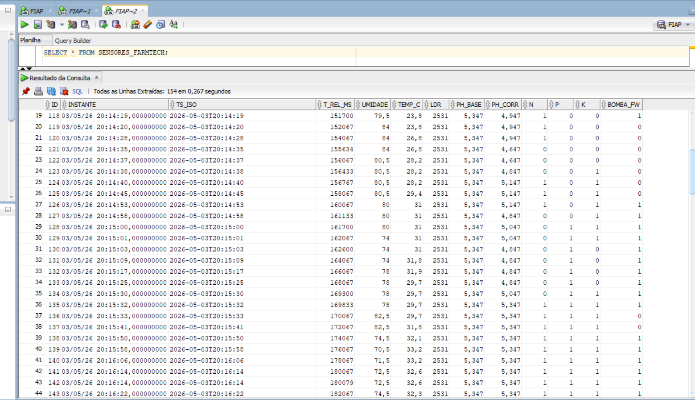
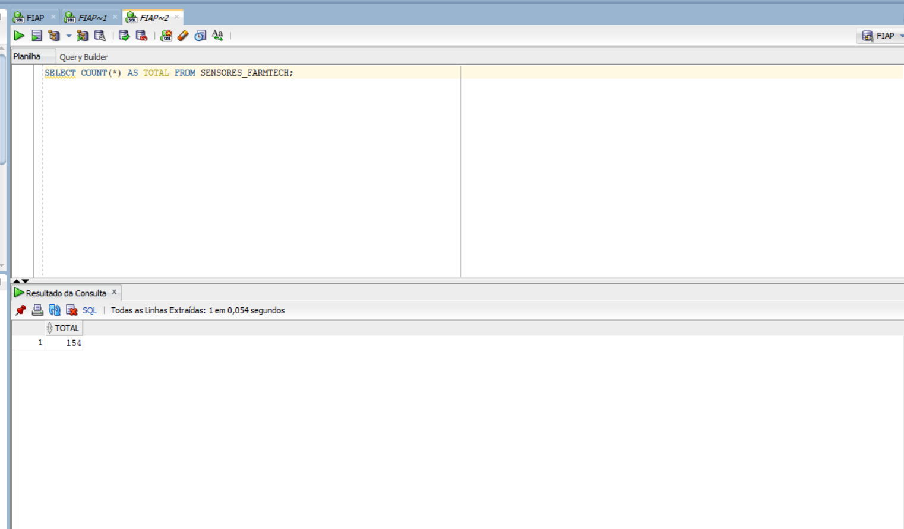

# Relatório Técnico — Importação da SENSORES_FARMTECH

## 1) Objetivo

Neste relatório eu documento como executei a importação manual dos dados IoT no Oracle e como validei o funcionamento do dashboard com a tabela `SENSORES_FARMTECH`.

---

## 2) Passo a passo que eu segui

1. Eu abri o SQL Developer e conectei no ambiente Oracle da FIAP com os dados do `.env` (`HOST`, `PORT`, `SID` e credenciais corretas).
2. Eu executei o script `src/sql/createtable.sql` para garantir a estrutura atual da `SENSORES_FARMTECH`, incluindo:
   - `ALTER SESSION SET NLS_NUMERIC_CHARACTERS = '.,';`
   - `DROP TABLE SENSORES_FARMTECH CASCADE CONSTRAINTS;`
   - `CREATE TABLE SENSORES_FARMTECH (...)`
   - trigger `TRG_SENSORES_TS` e índice `IDX_SENSORES_INSTANTE`.
3. Eu fiz a importação do arquivo `src/dados/historico_irrigacao.csv`, usado como base da Fase 2, via SQL Developer para a tabela `SENSORES_FARMTECH`.
4. Eu validei a carga com consultas de conferência:
   - `SELECT COUNT(*) AS TOTAL FROM SENSORES_FARMTECH;`
   - `SELECT * FROM SENSORES_FARMTECH;`
5. Eu subi o dashboard e confirmei a leitura Oracle no painel IoT.
6. Quando houve erro de exibição, eu revisei conexão, usuário ativo e nomes de colunas até estabilizar o fluxo.

---

## 3) Evidências visuais da importação (`assets/rel`)

As imagens abaixo sao os prints reais que eu gerei durante o processo de importacao no SQL Developer.

### Passo 1 — Seleção do arquivo para importação
Eu selecionei o arquivo de origem com os dados que seriam carregados na tabela `SENSORES_FARMTECH`.

### Passo 2 — Listagem dos dados do arquivo e início das configurações
Eu visualizei a prévia dos dados do arquivo e iniciei o assistente de configuração da importação.

### Passo 3 — Definição do método de importação
Eu defini o método de importação no SQL Developer para garantir a carga correta dos dados.

### Passo 4 — Validação do mapeamento de colunas
Eu validei o mapeamento entre as colunas do arquivo e as colunas da tabela de destino.

### Passo 5 — Definições finais de colunas
Eu revisei e confirmei as definições de tipo e correspondência das colunas antes de executar a carga.

### Passo 6 — Conclusão da importação
Eu concluí o processo de importação no assistente e finalizei a execução da carga.

### Passo 7 — Mensagem de sucesso da importação
Eu confirmei a mensagem de importação concluída com sucesso no SQL Developer.

### Passo 8 — Exibição dos dados importados na tabela
Eu consultei a `SENSORES_FARMTECH` e validei a presença dos dados importados na tabela.

---

## 4) Scripts usados no processo

### 4.1 Criacao e estrutura de banco

- Arquivo principal: `src/sql/createtable.sql`
- Referencia auxiliar registrada: `assets/rel/sql_create_in_db.md`

No modulo IoT eu mantive a tabela `SENSORES_FARMTECH` com as colunas operacionais usadas pelo dashboard: `TS_ISO`, `INSTANTE`, `UMIDADE`, `TEMP_C`, `PH_CORR`, `N`, `P`, `K`, `BOMBA_FW`.

### 4.2 Consultas de validacao

- Arquivo principal: `src/sql/consultas.sql`
- Consulta base do painel IoT: `SELECT * FROM SENSORES_FARMTECH;`
- Consulta de conferência de volume: `SELECT COUNT(*) AS TOTAL FROM SENSORES_FARMTECH;`

### Evidencias das consultas SQL

Consulta utilizada para validar os registros importados na tabela `SENSORES_FARMTECH`.

Consulta utilizada para conferir o total de registros importados.

## 5) Conclusao

Com esse procedimento, eu consegui recriar a tabela, importar os dados manualmente e validar o uso da `SENSORES_FARMTECH` no dashboard.

---

## 6) Referencias

- `assets/rel/sql_create_in_db.md`
- `src/sql/createtable.sql`
- `src/sql/consultas.sql`
- `src/frontend/pages/iot.py`

