# FIAP - Faculdade de Informática e Administração Paulista

<p align="center">
  <a href="https://www.fiap.com.br/">
    
  </a>
</p>

# FarmTech Solutions — Fase 5

## Machine Learning e Computação em Nuvem

Projeto acadêmico da Fase 5 do PBL FarmTech Solutions, organizado em duas entregas obrigatórias:
- **Link do repositório** https://github.com/jojocamdb/fiap-fase5-farmtech-ml/tree/main
- **Entrega 1:** análise exploratória, aprendizado não supervisionado e comparação de cinco modelos de regressão para previsão de rendimento agrícola.
- **Link do video etapa 1** https://youtu.be/aCmkPQsajMo?is=JB4BD_7GjqeEZ_Dy
- **Entrega 2:** estimativa e comparação de custos AWS entre as regiões de São Paulo e Virgínia do Norte.
- **Link do video etapa 2- AWS **- https://youtu.be/i1v4WAvnmBk
- **Ir além **
- **Link do vídeo ir além** https://youtu.be/IJllwjVq2BE


## Integrantes

| Nome | RM |
|---|---|
| Carlos Magnus Costa Amaral | RM573978 |
| Edemir Sufiatti | RM571375 |
| Georgia Mendes Rocha | RM573281 |
| Jocasta de Kacia Bortolacci | RM564730 |
| Marina Leme Soares | RM570461 |

**Tutora:** Nicolly Cândida Rodrigues de Souza
**Coordenador:** André Godoi Chiovato

## Entrega 1 — Machine Learning

### Objetivo

Analisar o dataset `crop_yield.csv`, explorar padrões e outliers e comparar cinco algoritmos de regressão para previsão de `Yield`.

### Dataset

Fonte da entrega: [`src/crop_yield.csv`](src/crop_yield.csv).

Fatos comprovados no notebook:

- 156 registros;
- 6 colunas;
- 4 culturas;
- 39 cenários climáticos distintos;
- sem valores ausentes;
- sem duplicatas completas.

O dataset não informa datas, períodos, anos, localização ou metadados que sustentem interpretação temporal, geográfica ou independência estatística entre os cenários.

### Algoritmos

Os cinco modelos avaliados foram:

1. Linear Regression;
2. Decision Tree Regressor;
3. Random Forest Regressor;
4. Gradient Boosting Regressor;
5. SVR com kernel RBF.

### Aprendizado Não Supervisionado

O notebook também inclui clusterização e análise exploratória de outliers/anomalias. Essas análises são tratadas como diagnósticos exploratórios, com detalhamento técnico preservado no notebook.

### Síntese Dos Resultados

Na avaliação principal, os 39 cenários climáticos são usados como grupos indivisíveis via `GroupKFold`.

- A Random Forest apresentou o melhor desempenho no Experimento A pelo protocolo `GroupKFold`.
- R² médio `GroupKFold` da Random Forest: aproximadamente `0,9884`.
- Baseline baseado somente em cultura: aproximadamente `0,9872`.
- R² OOF da Random Forest: aproximadamente `0,9883`.
- No Experimento B, usando apenas clima e transformação do alvo sem leakage, o melhor R² médio foi aproximadamente `0,0107`.
- A variável cultura domina a capacidade preditiva observada.
- Neste dataset e neste protocolo, as variáveis climáticas não demonstraram ganho preditivo robusto adicional.

Esses resultados não provam ausência de associação clima-rendimento em geral. Além disso, as métricas OOF da Random Forest usam o mesmo protocolo empregado na seleção do melhor modelo, portanto não constituem avaliação externa completamente independente após a seleção. A discussão completa está no notebook.

### Governança De Yield

O CSV original e os valores de `Yield` são preservados na modelagem. Para apresentação, o notebook aplica a transformação `/10000` em t/ha como decisão metodológica documentada diante da inconsistência entre a escala observada e a unidade declarada no enunciado. Essa escolha não presume uma unidade de origem nem proveniência externa não comprovada.

## Acesso Ao Notebook E Dataset

| Item | Caminho |
|---|---|
| Notebook principal | [`src/JocastaBortolacci_rm564730_pbl_fase4.ipynb`](src/JocastaBortolacci_rm564730_pbl_fase4.ipynb) |
| Dataset | [`src/crop_yield.csv`](src/crop_yield.csv) |
| Dependências | [`requirements.txt`](requirements.txt) |

## Como Executar

1. Clonar ou baixar este repositório.
2. Abrir um terminal na raiz do projeto.
3. Instalar as dependências:

```bash
pip install -r requirements.txt
```

4. Iniciar o Jupyter:

```bash
jupyter notebook
```

5. Abrir [`src/JocastaBortolacci_rm564730_pbl_fase4.ipynb`](src/JocastaBortolacci_rm564730_pbl_fase4.ipynb).
6. Executar `Kernel > Restart & Run All`.

## Entrega 2 — AWS

### Premissas

No cenário proposto, a estimativa considera uma instância EC2 Linux destinada a hospedar uma API para recebimento dos dados dos sensores e executar o modelo de Machine Learning. As duas regiões usam a mesma configuração técnica para permitir comparação direta.

Configuração comum:

- Amazon EC2;
- instância `t3.micro`;
- Linux;
- 2 vCPUs;
- 1 GiB de memória;
- rede até 5 Gbit;
- pagamento On-Demand;
- utilização mensal de 100%;
- EBS `gp3` de 50 GB;
- snapshots, IOPS adicionais e throughput adicional não incluídos.

### Simulação 1 — Região da Virgínia do Norte

A primeira estimativa foi realizada na AWS Pricing Calculator para a região Leste dos EUA — Norte da Virgínia. Ela usa a configuração comum definida nas premissas e serve como referência de menor custo para comparação com a região brasileira.

**Configuração comprovada:**

| Premissa | Valor registrado |
|---|---|
| Serviço | Amazon EC2 |
| Região | Leste dos EUA — Norte da Virgínia |
| Código da região | `us-east-1` |
| Sistema operacional | Linux |
| Localização | Instâncias compartilhadas |
| Quantidade | Uma instância |
| Carga de trabalho | Uso constante |
| Instância | `t3.micro` |
| Família | T3 |
| Categoria | Uso geral |
| Processamento | 2 vCPUs |
| Memória | 1 GiB |
| Desempenho de rede | Até 5 Gigabits |
| Modelo de pagamento | Sob demanda — On-Demand |
| Utilização mensal | 100% |
| Preço da instância | US$ 0,0104 por hora |
| Custo mensal da computação EC2 | US$ 7,59 |
| Armazenamento | Amazon Elastic Block Store — EBS |
| Tipo do volume | SSD de uso geral `gp3` |
| Capacidade | 50 GB |
| IOPS adicionais | Não configuradas |
| Throughput adicional | Não configurado |
| Snapshots | Não incluídos |
| Custo mensal estimado do EBS | US$ 4,00 |
| Custo mensal total | US$ 11,59 |
| Custo estimado para 12 meses | US$ 139,08 |
| Custo inicial | US$ 0,00 |

Os campos de IOPS e throughput permaneceram sem preenchimento porque não foram solicitados pelo enunciado e o volume `gp3` já possui desempenho básico incluído. Snapshots e monitoramento detalhado não foram adicionados para manter a estimativa limitada aos recursos exigidos.

| Item | Configuração |
|---|---|
| Região | Leste dos EUA — Norte da Virgínia (`us-east-1`) |
| Serviço computacional | Amazon EC2 |
| Sistema operacional | Linux |
| Instância | `t3.micro` |
| Processamento | 2 vCPUs |
| Memória | 1 GiB |
| Rede | Até 5 Gigabits |
| Modelo de pagamento | On-Demand |
| Utilização | 100% |
| Preço da EC2 por hora | US$ 0,0104 |
| Custo mensal da EC2 | US$ 7,59 |
| Armazenamento | 50 GB EBS `gp3` |
| Custo mensal do EBS | US$ 4,00 |
| Custo mensal total | **US$ 11,59** |
| Custo total de 12 meses | **US$ 139,08** |
| Custo inicial | US$ 0,00 |

#### Evidências da simulação

##### Evidência 1 — Escolha da região e do serviço

A primeira etapa seleciona a região Leste dos EUA — Norte da Virgínia e o serviço Amazon EC2 na AWS Pricing Calculator.

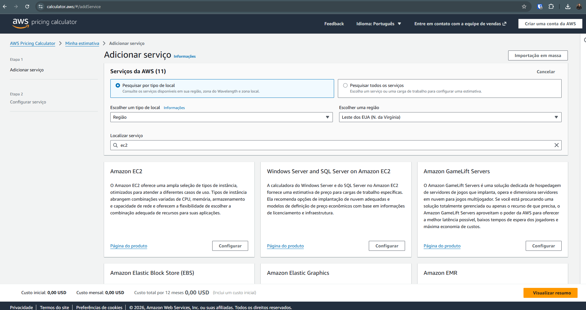

##### Evidência 2 — Configuração geral da máquina

A configuração utiliza Linux, instâncias compartilhadas, uso constante, uma instância e a região Norte da Virgínia. A instância selecionada é a `t3.micro`.

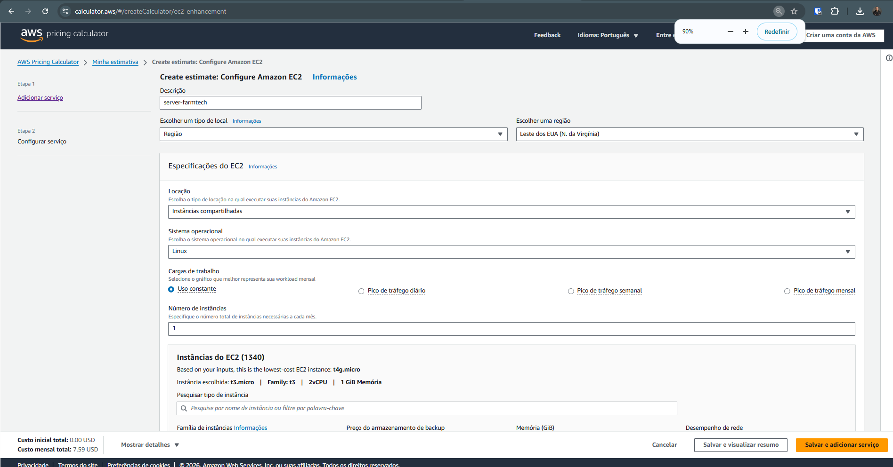

##### Evidência 3 — Recursos da instância

A instância `t3.micro` atende aos requisitos de processamento, memória e rede, oferecendo 2 vCPUs, 1 GiB de memória e desempenho de rede de até 5 Gigabits.

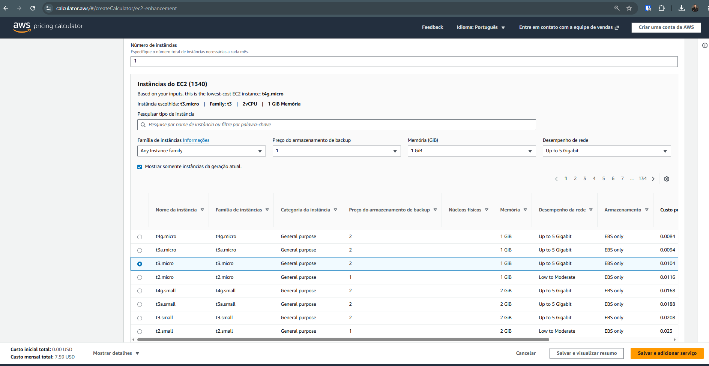

A interface em português da AWS Pricing Calculator apresenta uma tradução incorreta em uma coluna ou filtro, exibindo “Preço do armazenamento de backup” onde os valores correspondem à quantidade de vCPUs. A evidência principal é o resumo superior e a linha selecionada da `t3.micro`, que apresentam 2 vCPUs.

##### Evidência 4 — Pagamento On-Demand

Foi selecionada a modalidade Sob demanda, com utilização de 100% ao mês, conforme exigido pelo enunciado. A calculadora apresenta US$ 0,0104 por hora e US$ 7,59 mensais para a computação EC2.

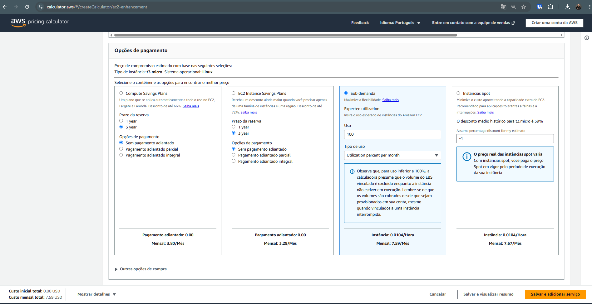

##### Evidência 5 — Armazenamento EBS de 50 GB

O armazenamento foi configurado dentro da estimativa do Amazon EC2 utilizando um volume Amazon EBS SSD de uso geral `gp3` com 50 GB. Não foram adicionadas IOPS, throughput ou snapshots além da configuração básica exigida.

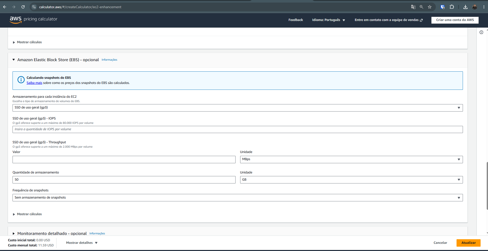

##### Evidência 6 — Resumo final da Virgínia

Após a inclusão do volume EBS de 50 GB, a estimativa final para a região da Virgínia do Norte passou a ser de US$ 11,59 por mês e US$ 139,08 para 12 meses, sem custo inicial.

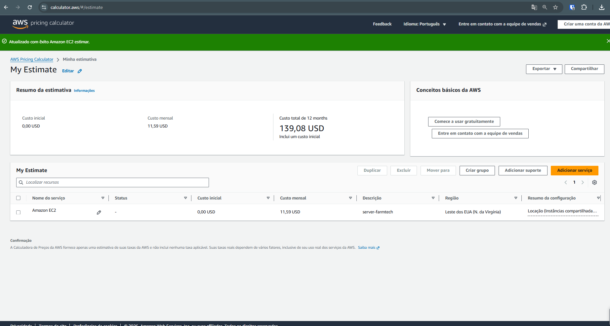

A simulação da Virgínia do Norte resulta em um custo estimado de **US$ 11,59 por mês** e **US$ 139,08 por 12 meses**, considerando uma instância EC2 `t3.micro` Linux em modalidade On-Demand, com utilização de 100% e armazenamento EBS `gp3` de 50 GB. A definição da alternativa mais econômica será realizada após a aplicação da mesma configuração na região de São Paulo.

### Simulação 2 — Região de São Paulo

A segunda estimativa repetiu exatamente a mesma configuração técnica utilizada na Virgínia do Norte, alterando somente a região. Isso garante uma comparação justa entre as duas alternativas.

**Configuração comprovada:**

| Premissa | Valor registrado |
|---|---|
| Serviço | Amazon EC2 |
| Região | América do Sul — São Paulo |
| Código da região | `sa-east-1` |
| Sistema operacional | Linux |
| Localização | Instâncias compartilhadas |
| Quantidade | Uma instância |
| Carga de trabalho | Uso constante |
| Instância | `t3.micro` |
| Família | T3 |
| Categoria | Uso geral |
| Processamento | 2 vCPUs |
| Memória | 1 GiB |
| Desempenho de rede | Até 5 Gigabits |
| Modelo de pagamento | On-Demand |
| Utilização mensal | 100% |
| Preço da instância | US$ 0,0168 por hora |
| Custo mensal da computação EC2 | US$ 12,26 |
| Armazenamento | Amazon Elastic Block Store — EBS |
| Tipo do volume | SSD de uso geral `gp3` |
| Capacidade | 50 GB |
| IOPS adicionais | Não configuradas |
| Throughput adicional | Não configurado |
| Snapshots | Não incluídos |
| Custo mensal estimado do EBS | US$ 7,60 |
| Custo mensal total | US$ 19,86 |
| Custo estimado para 12 meses | US$ 238,32 |
| Custo inicial | US$ 0,00 |

A capacidade configurada é 50 GB e o tipo do disco não veio especificado. Foi escolhido o EBS SSD de uso geral `gp3` por ser compatível com o disco principal de uma instância Linux de uso geral e por manter a estimativa aderente ao requisito de armazenamento. O mesmo tipo foi usado nas duas regiões.

| Item | Configuração em São Paulo |
|---|---|
| Região | América do Sul — São Paulo (`sa-east-1`) |
| Serviço | Amazon EC2 |
| Sistema operacional | Linux |
| Instância | `t3.micro` |
| Processamento | 2 vCPUs |
| Memória | 1 GiB |
| Rede | Até 5 Gigabits |
| Pagamento | On-Demand |
| Utilização | 100% |
| Preço da EC2 por hora | US$ 0,0168 |
| Custo mensal da EC2 | US$ 12,26 |
| Armazenamento | 50 GB EBS `gp3` |
| Custo mensal do EBS | US$ 7,60 |
| Custo mensal total | **US$ 19,86** |
| Custo total de 12 meses | **US$ 238,32** |
| Custo inicial | US$ 0,00 |

#### Evidências da simulação em São Paulo

##### Evidência SP 1 — Região e configuração geral

A imagem comprova a região América do Sul — São Paulo, o sistema operacional Linux, a localização em instância compartilhada, a carga de trabalho de uso constante, a quantidade de uma instância e a seleção da `t3.micro`.

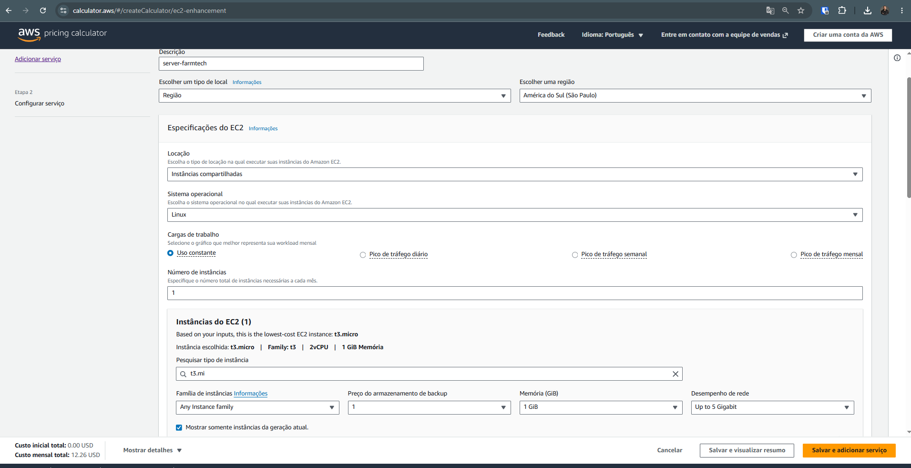

##### Evidência SP 2 — Instância e pagamento On-Demand

A imagem comprova a instância `t3.micro`, com 2 vCPUs, 1 GiB de memória, desempenho de rede de até 5 Gigabits, armazenamento baseado em EBS, modalidade On-Demand com 100% de utilização, preço de US$ 0,0168 por hora e custo mensal de US$ 12,26 para a computação EC2.

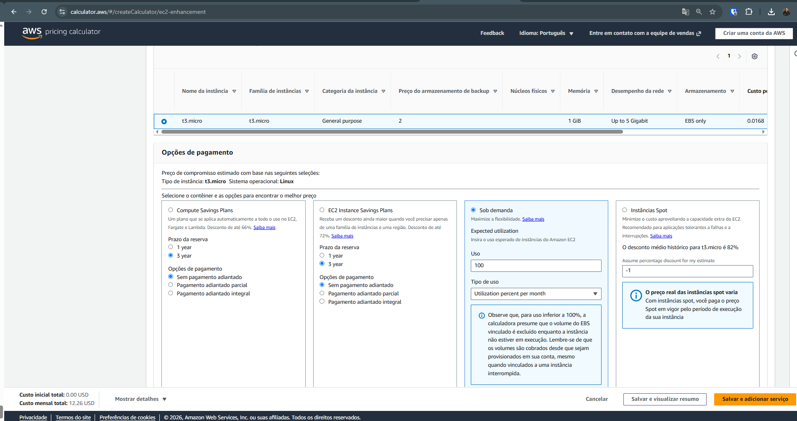

##### Evidência SP 3 — EBS de 50 GB

A imagem comprova o volume Amazon EBS SSD de uso geral `gp3` com 50 GB e a ausência de snapshots, IOPS adicionais e throughput adicional. O rodapé apresenta o total regional de US$ 19,86 por mês.

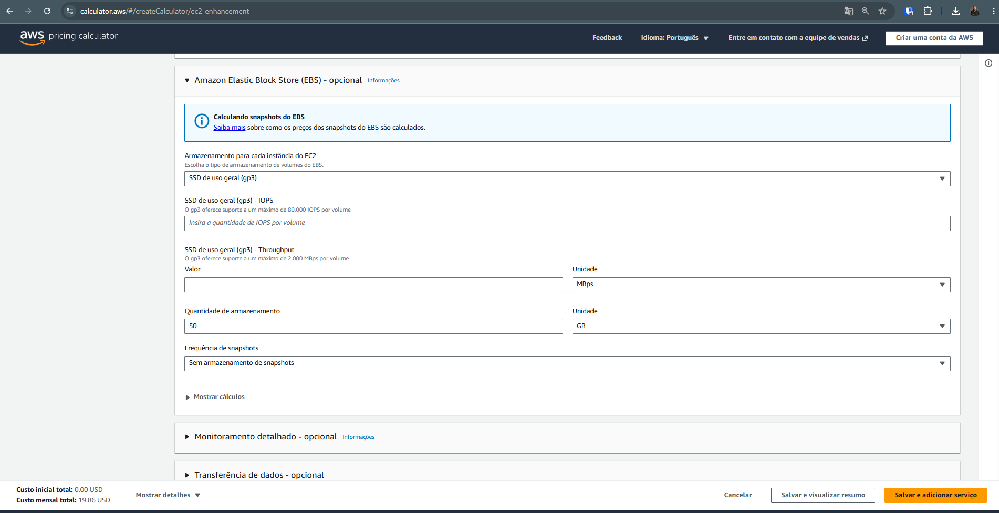

##### Evidência SP 4 — Resumo conjunto das estimativas

A imagem apresenta simultaneamente as duas alternativas mantidas na mesma estimativa da AWS Pricing Calculator para comparação: Virgínia do Norte a US$ 11,59 por mês e São Paulo a US$ 19,86 por mês. A calculadora também exibe a soma dessas duas linhas, US$ 31,45 por mês e US$ 377,40 no período de 12 meses.

US$ 31,45 e US$ 377,40 representam apenas a soma das duas alternativas colocadas lado a lado na calculadora. Esses valores não representam o custo da solução escolhida, pois somente uma região seria contratada.

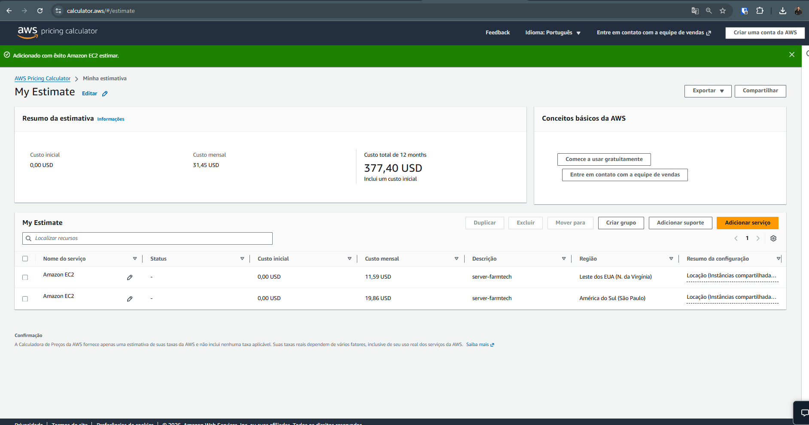

### Comparação de custos

| Região | EC2/mês | EBS 50 GB/mês | Total mensal | Total em 12 meses |
|---|---:|---:|---:|---:|
| Virgínia do Norte (`us-east-1`) | US$ 7,59 | US$ 4,00 | **US$ 11,59** | **US$ 139,08** |
| São Paulo (`sa-east-1`) | US$ 12,26 | US$ 7,60 | **US$ 19,86** | **US$ 238,32** |
| Diferença | US$ 4,67 | US$ 3,60 | **US$ 8,27** | **US$ 99,24** |

A Virgínia do Norte custa US$ 8,27 a menos por mês. A economia anual correspondente é de US$ 99,24. Calculada sobre o custo de São Paulo, essa diferença torna a Virgínia aproximadamente 41,6% mais barata:

```text
Economia percentual da Virgínia = (19,86 − 11,59) ÷ 19,86 × 100 ≈ 41,6%
```

Quando a mesma diferença é calculada sobre o custo da Virgínia, São Paulo é aproximadamente 71,4% mais cara. Não se deve afirmar que a Virgínia é “71,4% mais barata”: esse percentual descreve o acréscimo de São Paulo em relação à Virgínia, e não o desconto da Virgínia em relação a São Paulo.

O gráfico a seguir compara o custo mensal completo de cada alternativa, incluindo a computação EC2 e o armazenamento EBS de 50 GB.

<p align="center">
  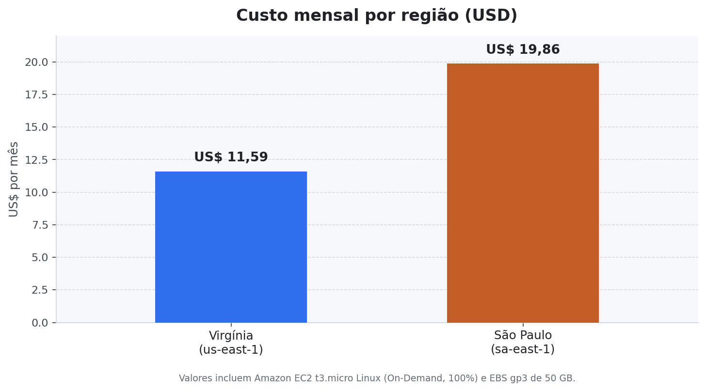
</p>


### Conclusão
As estimativas foram realizadas mantendo exatamente a mesma configuração nas duas regiões: instância Linux `t3.micro`, com 2 vCPUs, 1 GiB de memória, rede de até 5 Gigabits, utilização 100% On-Demand e armazenamento EBS `gp3` de 50 GB. Nesse cenário, a Virgínia do Norte apresenta o menor custo, totalizando US$ 11,59 por mês e US$ 139,08 por ano. Em São Paulo, o custo estimado é de US$ 19,86 por mês e US$ 238,32 por ano, uma diferença de US$ 8,27 mensais decorrente exclusivamente da região escolhida.

Embora a Virgínia do Norte seja financeiramente mais econômica, a região de São Paulo (`sa-east-1`) mostra-se mais adequada para o cenário atual da FarmTech. Como os sensores, os produtores e os demais usuários da solução estão localizados no Brasil, manter a API, o modelo de Machine Learning e o armazenamento dos dados em território nacional tende a reduzir a latência, melhorar o tempo de resposta e facilitar o atendimento aos requisitos de governança e proteção das informações definidos para o projeto.

Entretanto, caso a FarmTech evolua para um Produto Mínimo Viável (MVP), será importante testar as duas regiões em condições reais de operação. Essa validação deverá considerar não apenas o custo mensal da infraestrutura, mas também a latência observada, o desempenho da API, o tempo de processamento do modelo, a disponibilidade dos serviços, os custos de transferência de dados e a experiência percebida pelos usuários. Os resultados desses testes permitirão confirmar se os ganhos de desempenho obtidos com a implantação em São Paulo justificam seu custo adicional ou se a Virgínia do Norte oferece uma relação mais vantajosa entre custo e desempenho.

Independentemente da região selecionada, a implantação deverá observar os princípios e as obrigações da Lei Geral de Proteção de Dados Pessoais (LGPD), além das demais normas brasileiras e das legislações aplicáveis no país em que os dados forem armazenados ou processados. Isso inclui a adoção de controles de acesso, criptografia, registro de operações, políticas de retenção, backups seguros, definição de responsabilidades e mecanismos adequados para eventual transferência internacional de dados.

Portanto, para a etapa atual do projeto, recomenda-se a implantação em São Paulo, com custo anual estimado em US$ 238,32. Em uma futura evolução para MVP, essa decisão deverá ser reavaliada por meio de testes comparativos, métricas reais de desempenho e análise de conformidade legal. Dessa forma, a FarmTech poderá escolher uma infraestrutura que equilibre custo, desempenho, segurança, escalabilidade e responsabilidade no tratamento dos dados.


## Estrutura Do Repositório

```text
.
├── README.md
├── requirements.txt
├── .gitignore
├── assets/
│   ├── logo-fiap.png
│   └── report-aws/
│       ├── 1.png
│       ├── 2.png
│       ├── 3.png
│       ├── 4.png
│       ├── 5.png
│       ├── 6.png
│       ├── comparativo-custos.png
│       ├── sp1.png
│       ├── sp2.png
│       ├── sp3.png
│       └── sp4.png
├── src/
│   ├── JocastaBortolacci_rm564730_pbl_fase4.ipynb
│   └── crop_yield.csv
└── ir_alem/
    ├── .gitignore
    ├── README.md
    ├── api.py
    ├── app.py
    ├── circuito_wokwi.png
    ├── diagram.json
    ├── platformio.ini
    ├── requirements.txt
    ├── wokwi.toml
    ├── docs/
    │   └── documento_do_projeto.md
    └── src/
        ├── main.cpp
        └── secrets.example.h
```

## Ir Além — Atividade Opcional

O repositório contém uma implementação opcional relacionada a IoT/ESP32. Esse componente é complementar às entregas obrigatórias da Fase 5 e possui documentação própria no diretório [`ir_alem/`](ir_alem/).

A solução foi implementada e validada de ponta a ponta em ambiente simulado com Wokwi e serviços locais. A validação em ESP32 físico não foi realizada devido à indisponibilidade do hardware no grupo.

Arquitetura validada:

```text
ESP32 simulado no Wokwi
→ Wi-Fi virtual
→ HTTP POST
→ Flask API
→ SQLite criado localmente
→ Streamlit
```

Validações realizadas:

- firmware compilado com PlatformIO;
- simulação executada no Wokwi;
- circuito com DHT22 e LDR;
- envio HTTP POST validado;
- API Flask recebendo leituras;
- SQLite local recebendo registros;
- dashboard Streamlit exibindo dados do dispositivo `esp32-farmtech-01`.

## Histórico de evolução do projeto

As versões abaixo registram etapas sucessivas do desenvolvimento. Abordagens intermediárias podem ter sido posteriormente revisadas durante a auditoria e a governança metodológica final.

### 1.1.0 — 06/09/2026

- auditoria técnica geral da Fase 5;
- governança dos dados e revisão das interpretações;
- adoção do protocolo final de validação por cenários com GroupKFold e OOF;
- revisão de consistência entre resultados e conclusões;
- higiene e reorganização do repositório;
- evolução e validação integrada do Ir Além em Wokwi, Flask, SQLite e Streamlit;
- revisão de documentação e proteção de credenciais.

* 1.0.0 - 05/09/2026
    * Fase 5, Ir Além. Desenvolvimento de solução IoT baseada em ESP32 em ambiente simulado Wokwi, com conectividade Wi-Fi e coleta de dados ambientais via sensores (DHT22 para temperatura/umidade e LDR para luminosidade).
* 0.7.0 - 03/09/2026
    * Fase 5, Entrega 2. Estimativa de custos na AWS Pricing Calculator para uma instância EC2 `t3.micro` Linux, On-Demand, com EBS `gp3` de 50 GB nas regiões da Virgínia do Norte (`us-east-1`) e de São Paulo (`sa-east-1`). Comparação de custos, gráfico mensal e decisão nos dois cenários do enunciado: menor preço na Virgínia e recomendação arquitetural de São Paulo considerando a necessidade de acesso rápido aos dados dos sensores e as restrições legais para armazenamento no exterior.
* 0.6.0 - 31/08/2026
    * Seção 10 de previsão de rendimento da safra: previsto contra real em períodos nunca vistos, função `prever_rendimento`, teste de sensibilidade ao clima e projeção do período 39 com banda de incerteza. Decisão sobre a unidade do alvo tornada explícita. Esta abordagem corresponde a uma etapa intermediária e foi posteriormente revisada na auditoria metodológica final após a constatação de que o dataset não fornece metadados temporais.
* 0.5.0 - 30/08/2026
    * Fase 5, Entrega 1. Análise exploratória, diagnóstico estrutural, teste de correlação espúria, clusterização, detecção de anomalias por três critérios, cinco modelos de regressão com baseline explícito e validação dupla.

## Licença


<p xmlns:cc="http://creativecommons.org/ns#" xmlns:dct="http://purl.org/dc/terms/"><a property="dct:title" rel="cc:attributionURL" href="https://github.com/agodoi/template">MODELO GIT FIAP</a> por <a rel="cc:attributionURL dct:creator" property="cc:attributionName" href="https://fiap.com.br">Fiap</a> está licenciado sobre <a href="http://creativecommons.org/licenses/by/4.0/?ref=chooser-v1" target="_blank" rel="license noopener noreferrer">Attribution 4.0 International</a>.</p>
