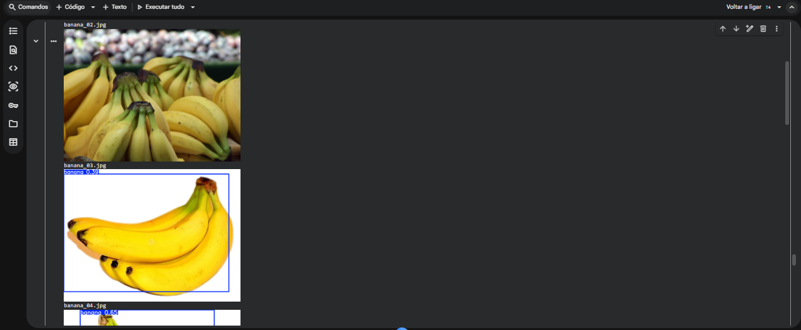
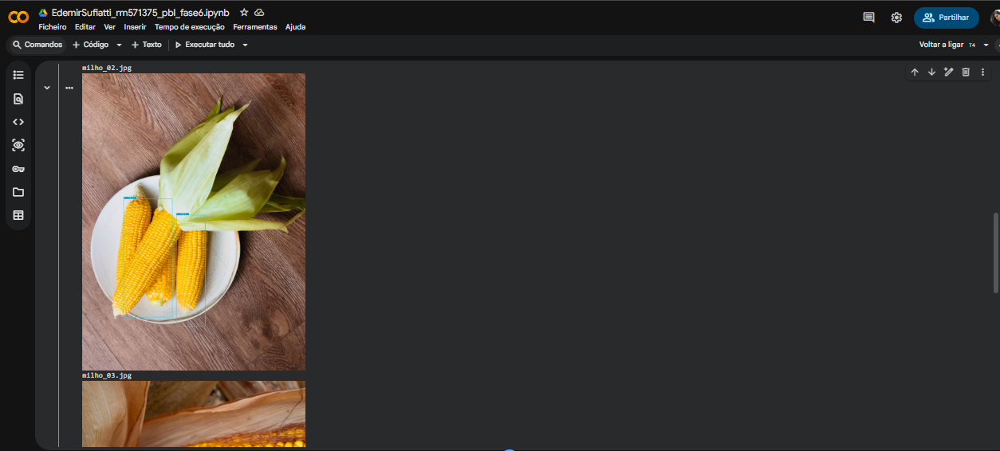
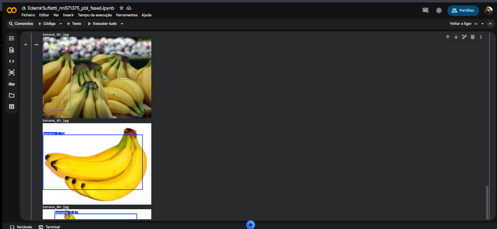
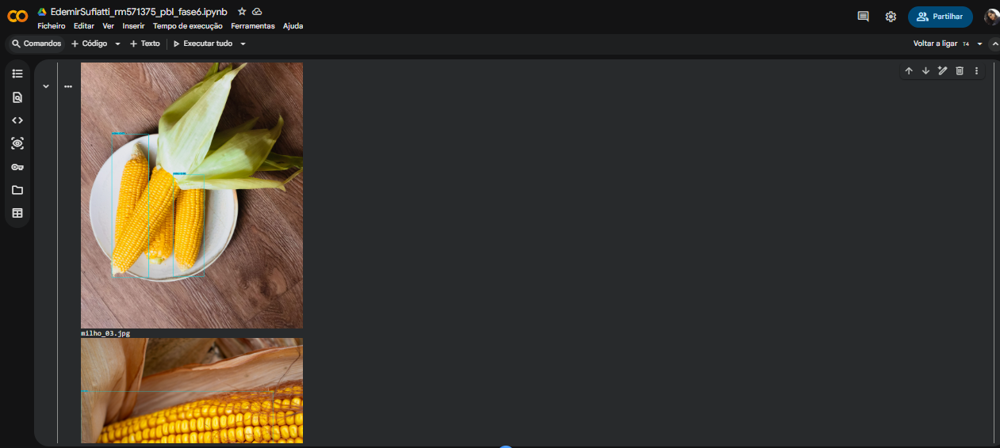

**FIAP - Faculdade de Informática e Administração Paulista**

<p align="center">
<a href="https://www.fiap.com.br/"></a>
</p>

# FarmTech Neural Vision

Componente de visão computacional da Fase 6, com experimentos de detecção de objetos e classificação de imagens de banana e milho, documentado para apoiar a integração à FarmTech na Fase 7. A organização do repositório parte do [template FIAP](https://github.com/agodoi/templateFiapVfinal).

**Repositório original — Fase 6:** [farmtech_neural_vision](https://github.com/EdeSufiatti/farmtech_neural_vision).

A Entrega 1 e o Ir Além 2 pertencem ao projeto original, já avaliado pela FIAP. A Entrega 2 foi complementada posteriormente para atender integralmente aos requisitos do enunciado. As melhorias preservam os experimentos e resultados históricos; esta documentação distingue os resultados originais dos experimentos complementares.

---

## Integrantes

- Edemir Sufiatti - RM571375
- Carlos Magnus Costa Amaral - RM573978
- Georgia Mendes Rocha - RM573281
- Marina Leme Soares - RM570461

## Professores

### Tutora

- Nicolly Cândida Rodrigues de Souza

### Coordenador

- André Godoi Chiovato

---

## Dataset e curadoria

São 40 imagens por classe, 80 no total, com correspondência imagem ↔ label pelo mesmo nome-base. Os IDs são **banana = 0** e **milho = 1**.

| Conjunto | Imagens por classe | Função |
| --- | --- | --- |
| Treino | 32 | Ajustar os pesos do modelo |
| Validação | 4 | Avaliar o modelo em imagens não usadas para ajustar os pesos |
| Teste | 4 | Avaliar os modelos em imagens reservadas: qualitativamente na Entrega 1 e quantitativamente na Entrega 2 |

### Fontes das imagens

| Classe | Fonte | Curadoria |
| --- | --- | --- |
| banana | Kaggle — [Fruits Dataset (Images)](https://www.kaggle.com/datasets/shreyapmaher/fruits-dataset-images), pasta `images/banana fruit` | Imagens obtidas de uma pasta de dataset previamente disponível, sem a mesma seleção manual imagem por imagem aplicada ao milho |
| milho | [Pixabay](https://pixabay.com/) e [Pexels](https://www.pexels.com/) | 40 imagens finais escolhidas manualmente, uma a uma |

A curadoria do milho considerou qualidade visual, posição e ângulo das espigas, iluminação, ambiente, presença ou ausência de palha, diversidade, número de espigas, distância, enquadramento e exclusão de imagens excessivamente densas ou problemáticas. As imagens foram salvas em JPEG. Os links acima identificam as plataformas de origem; os links individuais das 40 imagens finais de milho não estão preservados no repositório, portanto não há rastreabilidade individual completa dessas imagens.

A rotulagem das duas classes foi manual, com **MakeSense.ai**, tarefa **Object Detection** e exportação no formato **YOLO**. Cada objeto ocupa uma linha:

```text
class_id x_center y_center width height
```

As coordenadas e dimensões são normalizadas entre 0 e 1. Cada `.txt` tem o mesmo nome-base da imagem. A ferramenta e o formato de rotulagem foram iguais para ambas as classes; os processos de curadoria das imagens foram diferentes.

### Localização do dataset e dos registros originais

As imagens e os rótulos estão em [dataset/](dataset/), organizados em `train/`, `val/` e `test/`, cada conjunto com `images/` e `labels/` separados por classe. A [pasta compartilhada FarmTech_Neural_Vision no Google Drive](https://drive.google.com/drive/folders/18FQL7_woTacQxS92qzcNKTtFyj0Mj8NZ?usp=drive_link) é a referência utilizada pelos notebooks originais no Colab.

O notebook da Entrega 1 registra a persistência dos treinamentos em `FarmTech_Neural_Vision/runs/train/exp30/` e `exp60/`, com checkpoints em `weights/best.pt` e gráficos nas respectivas pastas. As imagens processadas no teste foram copiadas para `FarmTech_Neural_Vision/runs/detect/exp30/` e `exp60/`. Esses caminhos do Drive são registros da execução original; as saídas também estão preservadas nos notebooks e as evidências visuais da Entrega 1 estão em [assets/evidencias/](assets/evidencias/).

## Entrega 1 — Detecção de banana e milho

A Entrega 1 utiliza YOLOv5 com um dataset de 80 imagens dividido em treino, validação e teste. Foram realizadas duas simulações, de 30 e 60 épocas, com comparação dos resultados.

A implementação e a análise detalhada estão no [notebook da Entrega 1](EdemirSufiatti_rm571375_pbl_fase6.ipynb), que deve orientar a leitura técnica dos resultados.

O notebook utiliza Google Colab e transfer learning/fine-tuning com `yolov5s.pt`. Os scripts `train.py` e `detect.py` são do repositório oficial YOLOv5, não código desenvolvido pelo grupo. A revisão está fixada em `4add2aff`, correspondente ao registro original `YOLOv5 v7.0-555-g4add2aff`. As simulações usam imagem 640, 30 e 60 épocas e seed 0 explicitado; a inferência explicita `--conf-thres 0.25`. A `seed=0` aumenta a reprodutibilidade, mas não garante determinismo absoluto em GPU; novas execuções podem apresentar pequenas variações nas métricas.

### Resultados históricos

Resultados globais da validação do `best.pt` de cada simulação, correspondentes à execução final apresentada no notebook:

| Épocas | Precision | Recall | mAP50 | mAP50-95 | Tempo de treinamento |
| --- | --- | --- | --- | --- | --- |
| 30 | 0.535 | 0.407 | 0.466 | 0.220 | 796 s (aproximadamente 13 min 16 s) |
| 60 | 0.811 | 0.511 | 0.567 | 0.319 | 1404 s (aproximadamente 23 min 24 s) |

Nesta execução, 60 épocas apresentou melhores métricas globais, impulsionadas principalmente pelo milho, e o `best.pt` de `exp60` foi selecionado como modelo final. O ganho não foi uniforme: banana apresentou melhores métricas com 30 épocas, e milho com 60. O treinamento levou aproximadamente 76% mais tempo. Isso não implica que mais épocas sempre melhorem o modelo; losses menores no último epoch não são prova isolada de melhor generalização. No teste, houve alguma detecção em 4/8 imagens com 30 épocas e 7/8 com 60. Essa cobertura qualitativa não representa acurácia, não substitui Precision, Recall ou mAP e não comprova isoladamente a correção das detecções.

#### Diferenças observadas entre banana e milho

Nesta execução, milho apresentou métricas superiores às de banana no modelo de 60 épocas. Os valores por classe da validação do `best.pt` foram:

| Classe | Épocas | Precision | Recall | mAP50 | mAP50-95 |
| --- | --- | --- | --- | --- | --- |
| banana | 30 | 0.763 | 0.385 | 0.489 | 0.178 |
| milho | 30 | 0.307 | 0.429 | 0.442 | 0.263 |
| banana | 60 | 0.652 | 0.308 | 0.377 | 0.160 |
| milho | 60 | 0.970 | 0.714 | 0.757 | 0.477 |

Além das diferenças de curadoria descritas acima, banana apresenta exemplos visualmente ou semanticamente mais difíceis, como banana descascada e estruturas florais/inflorescências. Foram identificadas inconsistências de granularidade nas anotações de banana: algumas caixas representam cachos/conjuntos, outras objetos ou subconjuntos.

Apesar do mesmo número de imagens, o treino contém aproximadamente 43 instâncias anotadas de banana e 101 de milho; portanto, o modelo recebeu mais objetos anotados de milho durante o treinamento. Esses fatores podem estar associados ao comportamento observado e são hipóteses plausíveis, mas este experimento não permite estabelecer causalidade. Com apenas 4 imagens de validação por classe, as métricas também são sensíveis a poucos acertos ou erros.

### Execução no Google Colab

1. Abra o [notebook no Google Colab](https://colab.research.google.com/github/EdeSufiatti/farmtech_neural_vision/blob/main/EdemirSufiatti_rm571375_pbl_fase6.ipynb). O projeto espera uma pasta chamada exatamente `FarmTech_Neural_Vision`, acessível após a montagem do Drive em `/content/drive/MyDrive/FarmTech_Neural_Vision/`.
2. Na pasta compartilhada indicada em **Localização do dataset e dos registros originais**, use **Organizar → Adicionar atalho → Meu Drive**. O atalho deve ficar no **Meu Drive da mesma conta Google usada no Colab**, mantendo exatamente o nome `FarmTech_Neural_Vision` e a organização de `dataset/` descrita acima. Apenas abrir a pasta compartilhada não basta para disponibilizá-la no caminho esperado pelo notebook.
3. Em **Alterar o tipo de ambiente de execução**, selecione **GPUs: T4** ou equivalente antes de executar as células. Os experimentos usaram NVIDIA Tesla T4; hardware diferente pode produzir tempos diferentes. O notebook interrompe a execução se CUDA não estiver disponível.
4. Execute as células em ordem, começando pela montagem do Drive com `drive.mount('/content/drive')`, e autorize a conta que contém a pasta. A primeira validação confere a existência do dataset, as quantidades de imagens e labels (32/4/4 por classe) e a correspondência imagem–label antes do treinamento. O dataset deve estar em `/content/drive/MyDrive/FarmTech_Neural_Vision/dataset/`; o notebook **não baixa o dataset automaticamente**.
5. A seção 10 copia somente os resultados de treino para `FarmTech_Neural_Vision/runs/train` no Drive. A seção de teste copia posteriormente as imagens processadas para `FarmTech_Neural_Vision/runs/detect`.

### Limitações e registros da entrega original

O dataset é pequeno e restrito a duas classes, com diferenças de curadoria, heterogeneidade das imagens e inconsistências conhecidas nas anotações de banana. Um dataset maior e mais homogêneo é necessário para conclusões mais robustas; a análise detalhada está no notebook.

A execução funcional integral da Entrega 1 foi concluída e validada no Google Colab, incluindo dataset, GPU Tesla T4, `data.yaml`, treinamentos de 30 e 60 épocas, persistência no Drive e inferência sobre as 8 imagens de teste. Os outputs reais da execução final — treinamento, validação, inferência e gráficos — foram incorporados ao notebook principal, preservando integralmente os Markdown revisados. Esse notebook representa a versão executada e revisada. As evidências visuais foram conferidas na entrega original: 10 prints estão organizados em `assets/evidencias/`, com 4 exemplos representativos apresentados abaixo.

### Evidências dos testes

Todas as 8 imagens de teste de cada experimento permanecem preservadas nos outputs do [notebook](EdemirSufiatti_rm571375_pbl_fase6.ipynb). Os prints abaixo são evidências representativas da inferência, com bounding boxes e labels visíveis.

#### 30 épocas — exp30



*exp30 — banana: evidência qualitativa com detecção visível em banana_03.*



*exp30 — milho: evidência qualitativa com detecções visíveis em milho_02.*

#### 60 épocas — exp60



*exp60 — banana: evidência qualitativa com detecções visíveis em banana_02 e banana_03.*



*exp60 — milho: evidência qualitativa com detecções visíveis em milho_02.*

### Vídeo de demonstração

> Link do vídeo: https://youtu.be/2UIlLR9Ho_0

## Entrega 2 — Comparação de modelos de visão computacional

A Entrega 2 complementa o projeto com a comparação de três abordagens sobre o mesmo dataset de banana e milho:

1. **YOLOv5s padrão:** detector com pesos pré-treinados no COCO, sem treinamento adicional no dataset do projeto.
2. **YOLOv5s customizada:** detector que reutiliza os pesos originais do treinamento de 60 épocas da Entrega 1.
3. **CNN treinada do zero:** modelo de classificação de imagens implementado com TensorFlow/Keras.

Foram analisados precisão, tempo de treinamento, tempo de inferência e facilidade de uso e integração. A metodologia, as tabelas de métricas, os resultados individuais e as interpretações estão no [notebook da Entrega 2](entrega_2/comparacao_yolo_cnn_fase6.ipynb).

As YOLOs detectam e localizam objetos por caixas delimitadoras; a CNN classifica a imagem completa. As métricas dessas tarefas não são diretamente equivalentes. Os resultados históricos de validação da Entrega 1 permanecem distintos das avaliações complementares no conjunto de teste da Entrega 2.

### Artefatos dos modelos

| Caminho | Identificação e finalidade |
| --- | --- |
| `entrega_2/modelos/yolov5s_custom_exp60_best.pt` | Checkpoint customizado: pesos originais do melhor modelo do treinamento de 60 épocas, recuperados e renomeados para identificação; detector de banana e milho. |
| `entrega_2/modelos/cnn_do_zero_fase6.keras` | Modelo de classificação CNN treinado do zero e preservado no formato Keras. |
| `entrega_2/yolov5s.pt` | Pesos pré-treinados no COCO da YOLOv5s original, carregados pelo PyTorch Hub na comparação principal. |
| `entrega_2/yolov5su.pt` | Pesos pré-treinados da variante YOLOv5u, carregada pela biblioteca Ultralytics em experimento exploratório complementar, separado da comparação principal. |

Os modelos treinados foram preservados, assim como os resultados históricos registrados nos notebooks. As regras de versionamento e os pontos de conferência posteriores estão registrados no [CHANGELOG](CHANGELOG.md).

### Execução e reprodutibilidade

O notebook preserva os treinamentos e as avaliações históricos, com suas saídas originais. Após a revisão de 03/11/2026, as células experimentais estão protegidas para consulta; executar o notebook não reexecuta esses experimentos. A preparação atual apenas consulta dependências instaladas. O treinamento histórico, a preparação do ambiente e a avaliação independente são fluxos distintos.

As execuções históricas da YOLO padrão registram **Python 3.14.4**; CNN e carregamento complementar da YOLO customizada registram **Python 3.13.13**, em CPU. O treinamento original da YOLO ocorreu no Colab com Tesla T4 e possui registros próprios. Esses ambientes e protocolos não constituem um benchmark único.

O campo `git.commit` do checkpoint recuperado registra **`f9578796b8a64889aa9e66dc06914d19f40d338e`**. A revisão **`4add2aff`** está registrada nos logs originais e foi utilizada no carregamento complementar demonstrado. A relação entre esse metadado e os registros de execução permanece a esclarecer; a diferença não implica alteração dos pesos.

As **validações funcionais locais da CNN e da YOLO customizada** estão registradas no [CHANGELOG, em 03/11/2026](CHANGELOG.md#2026-11-03--validação-funcional-dos-modelos-preservados). Na raiz `fase6-visao`, o comando para avaliar a CNN preservada é:

```powershell
.\.venv-fase6\Scripts\python.exe -B entrega_2/avaliar_cnn.py
```

O script [avaliar_cnn.py](entrega_2/avaliar_cnn.py) carrega o `.keras` existente e lê somente o teste, sem treinamento ou salvamento. Mantém o pré-processamento e a normalização interna do modelo.

Para a futura avaliação da YOLO customizada, em outro processo, `$repoYolo` deve indicar um checkout Git local existente e limpo da revisão de carregamento `4add2aff`:

```powershell
.\.venv-fase6\Scripts\python.exe -B entrega_2/avaliar_yolo.py --abordagem customizada --yolo-repo "$repoYolo"
```

O script [avaliar_yolo.py](entrega_2/avaliar_yolo.py) verifica a revisão local e os pesos, usa uma abordagem por processo e não obtém código ou modelos. Para a YOLO padrão, exige `--abordagem padrao` e `--revisao` com SHA completo explícito. O commit exato do carregamento histórico por `master` não foi identificado; nenhuma revisão substituta foi selecionada sem validação de compatibilidade. As instruções e os limites estão na seção 8 do notebook.

As dependências selecionadas permanecem em [requirements.txt](requirements.txt). Nenhum dos procedimentos de avaliação instala pacotes, treina ou sobrescreve modelos. Novos tempos e predições deverão ser tratados como novas execuções; os resultados históricos foram preservados. A integração à Fase 7 não foi executada.

## Estrutura do repositório

```text
.
├── README.md
├── EdemirSufiatti_rm571375_pbl_fase6.ipynb
├── assets/
│   ├── logo-fiap.png
│   └── evidencias/                  # 10 prints: exp30 e exp60
├── dataset/
│   ├── train/                       # images/ e labels/, por classe
│   ├── val/                         # images/ e labels/, por classe
│   └── test/                        # images/ e labels/, por classe
├── document/
│   └── ai_project_document_fiap.md
├── entrega_2/
│   ├── comparacao_yolo_cnn_fase6.ipynb
│   ├── avaliar_cnn.py
│   ├── avaliar_yolo.py
│   ├── yolov5s.pt
│   ├── yolov5su.pt
│   └── modelos/
│       ├── yolov5s_custom_exp60_best.pt
│       └── cnn_do_zero_fase6.keras
└── ir_alem_2/
    ├── README.md
    ├── notebook/
    │   └── ir_alem_2_transfer_learning_segmentacao.ipynb
    └── assets/
```

Os notebooks concentram a implementação e as análises de cada entrega. A [documentação complementar da Entrega 1](document/ai_project_document_fiap.md) resume seu escopo e limitações. `entrega_2/` reúne a comparação e os artefatos dos modelos; `ir_alem_2/` mantém documentação, notebook e evidências próprios.

---

## Ir Além 2 — Transfer Learning, Fine Tuning e Segmentação

O desenvolvimento complementar do Ir Além 2 está documentado em:

[Acessar documentação e notebook do Ir Além 2](ir_alem_2/README.md)

Vídeo demonstrativo do Ir Além 2: https://youtu.be/fGt2GQi7MHw

## Preparação para integração à FarmTech — Fase 7

A integração deverá selecionar o artefato adequado à tarefa e preservar os pré-processamentos documentados nos notebooks. A definição da interface de entrada e saída, o empacotamento, a consolidação das dependências e a validação no ambiente integrado são atividades da próxima etapa, apoiadas pelas evidências experimentais preservadas na Fase 6.

O recall de 22,22% para banana na YOLO customizada foi observado no pequeno conjunto de teste. Essa limitação deve ser considerada antes de utilizar detecções para decisões operacionais ou alertas automatizados na Fase 7.

---

## Histórico de Lançamentos

### 02/11/2026 — Complementação técnica da Entrega 2

- Implementação e avaliação da YOLOv5s padrão, da YOLOv5s customizada e da CNN treinada do zero.
- Recuperação dos pesos originais da YOLO customizada, permitindo sua avaliação no conjunto de teste.
- Comparação crítica das três abordagens, conforme os critérios do enunciado da Fase 6.
- Consolidação da implementação, das métricas, das análises e das conclusões no notebook `entrega_2/comparacao_yolo_cnn_fase6.ipynb`.
- Desenvolvimento complementar realizado após a avaliação acadêmica original, preservando a rastreabilidade dos resultados.

### 08/10/2026 — integração do Ir Além 2

- Inclusão do Ir Além 2 em estrutura própria `ir_alem_2/`, com notebook, documentação e evidências próprios, organizados separadamente dos artefatos da Entrega 1.

### 07/10/2026 — revisão e fechamento técnico

- Execução funcional integral no Google Colab, com validação de dataset, GPU Tesla T4, `data.yaml`, treinamentos de 30 e 60 épocas e inferência.
- Incorporação dos outputs reais da execução final ao notebook principal revisado, preservando os Markdown revisados.
- Atualização da análise comparativa entre 30 e 60 épocas e documentação das diferenças observadas entre banana e milho.
- Inclusão das evidências visuais em `assets/evidencias/` e de 4 exemplos representativos no README.
- Atualização das instruções de reprodução no Colab.

### 04/10/2026

- Notebook `EdemirSufiatti_rm571375_pbl_fase6.ipynb` para treinar o YOLOv5 no Colab a partir do Google Drive, com simulações de 30 e 60 épocas.
- Remoção de imagens duplicadas em `dataset/train/images/banana`.
- Correção dos labels da classe banana no conjunto de treino, incluindo arquivos que estavam faltando.

- Nova curadoria manual das imagens de milho.
- Reorganização em 32 imagens de treino, 4 de validação e 4 de teste.
- Revisão de diversidade e duplicidade, sem duplicatas exatas entre os conjuntos de milho.
- Rotulagem manual no MakeSense.ai.
- Exportação no formato YOLO.
- 32 labels de treino, 4 labels de validação e 4 labels de teste.
- Correspondência imagem ↔ label da classe milho validada.

### 02/10/2026 — estado inicial do projeto

- Estrutura de pastas do [template FIAP](https://github.com/agodoi/templateFiapVfinal).
- 40 imagens de banana e 40 de milho.
- Divisão em treino (32), validação (4) e teste (4) para cada classe.
- Naquela data, as pastas `labels` foram criadas ainda sem anotações; a rotulagem foi realizada posteriormente.

---

## Licença

O modelo de repositório [templateFiapVfinal](https://github.com/agodoi/templateFiapVfinal), por [FIAP](https://fiap.com.br), está sob [Attribution 4.0 International](https://creativecommons.org/licenses/by/4.0/).

As imagens de banana continuam provenientes do [Fruits Dataset (Images)](https://www.kaggle.com/datasets/shreyapmaher/fruits-dataset-images), no Kaggle. As imagens de milho foram obtidas a partir de fotografias disponíveis no Pixabay e Pexels. As imagens permanecem sujeitas às condições de uso e licenciamento das respectivas plataformas.
