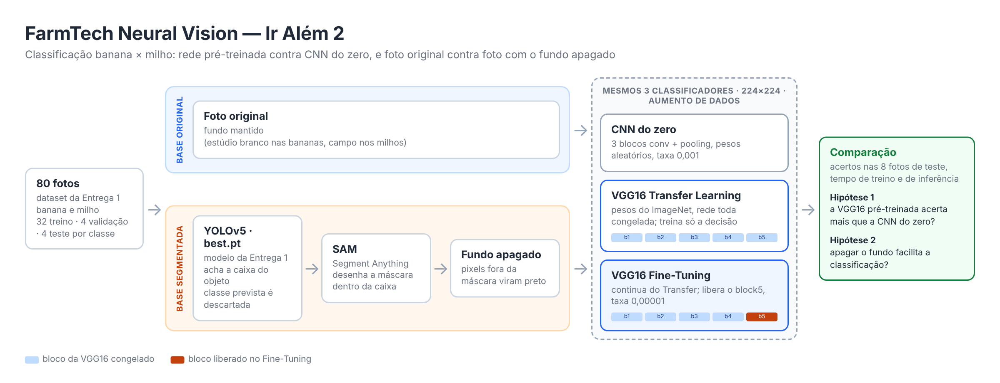
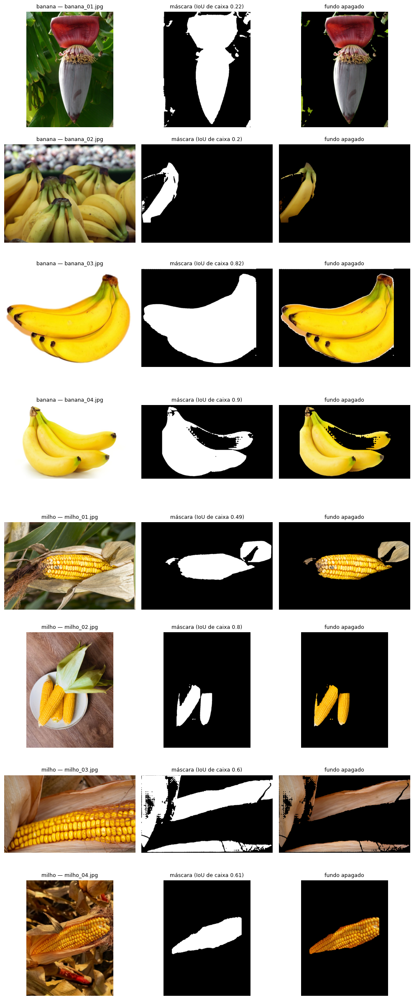
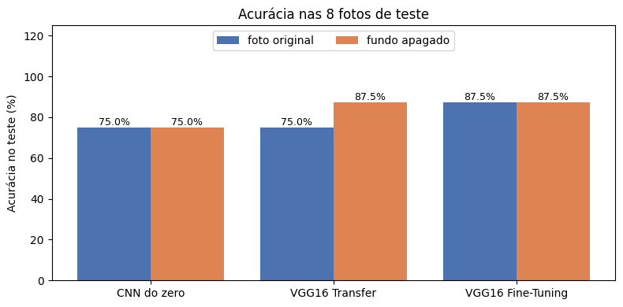

# FIAP - Faculdade de Informática e Administração Paulista

<p align="center">
<a href="https://www.fiap.com.br/"></a>
</p>

# FarmTech Neural Vision

## Ir Além 2 — Transfer Learning, Fine Tuning e Segmentação

O Ir Além 2 classifica fotos de banana e milho com três redes: uma CNN treinada do zero, a VGG16 pré-treinada no ImageNet com Transfer Learning e a mesma VGG16 com Fine Tuning. Depois, repete os treinos com as fotos sem fundo, recortadas por segmentação automática (YOLOv5 da Entrega 1 + SAM). O objetivo é responder a duas hipóteses: se a rede pré-treinada classifica melhor que a CNN do zero e se apagar o fundo facilita a classificação. É um trabalho complementar à [Entrega 1](../README.md) e usa o mesmo dataset, sem alterar imagens ou labels.

---

## Integrantes

- Edemir Sufiatti - RM571375
- Carlos Magnus Costa Amaral - RM573978
- Georgia Mendes Rocha - RM573281
- Marina Leme Soares - RM570461

## Professores

### Tutora

- Nicolly Cândida Rodrigues de Souza

### Coordenador

- André Godoi Chiovato

---

## Notebook

A implementação, as justificativas das escolhas, os resultados e as conclusões estão no notebook, que deve orientar a leitura técnica do trabalho:

- [Notebook do Ir Além 2 no GitHub](notebook/ir_alem_2_transfer_learning_segmentacao.ipynb)
- [Abrir o notebook no Google Colab](https://colab.research.google.com/github/EdeSufiatti/farmtech_neural_vision/blob/main/ir_alem_2/notebook/ir_alem_2_transfer_learning_segmentacao.ipynb)

O notebook está organizado em três partes:

| Parte | Conteúdo |
| --- | --- |
| A — Segmentação automática | Caixas do `best.pt` da Entrega 1, máscaras do SAM, correção de máscaras invertidas, conferência e exemplos de original → máscara → foto sem fundo |
| B — Classificadores | CNN do zero, VGG16 com Transfer Learning e VGG16 com Fine Tuning, treinadas com as fotos originais e com as fotos sem fundo |
| C — Comparação | Tabela, gráficos, matrizes de confusão e veredito das duas hipóteses |



## Resumo dos resultados

Acertos nas 8 fotos de teste (4 bananas e 4 milhos), na execução final apresentada no notebook:

| Modelo | Fotos originais | Fotos sem fundo |
| --- | --- | --- |
| CNN do zero | 6/8 | 6/8 |
| VGG16 Transfer Learning | 6/8 | 7/8 |
| VGG16 Fine Tuning | 7/8 | 7/8 |

**Modelo com resultado mais consistente nesta execução: VGG16 com Fine Tuning.** Acertou 7 de 8 fotos de teste nas duas versões da base e manteve 100% de acurácia na validação nas duas. A VGG16 nunca ficou atrás da CNN do zero. Porém, a vantagem sobre a CNN do zero é de apenas uma foto, o que, com 8 fotos de teste, pode ser acaso. Além disso, a CNN do zero é mais leve: treina mais rápido (10 a 14 s, contra 19 a 34 s das VGG16) e classifica cada foto em cerca de 20 ms, contra 36 a 53 ms.

**Segmentação: sinais favoráveis nesta execução, mas inconclusivos.** Nenhum modelo piorou no teste com as fotos sem fundo, e a VGG16 Transfer subiu de 6 para 7 acertos. O conjunto de teste tem apenas 8 fotos e não permite generalizar que a remoção do fundo melhora a classificação. Sem o fundo, a validação da CNN do zero caiu de 100% para 75%, resultado compatível com a hipótese de que pistas do fundo contribuíam para suas previsões, mas que não demonstra causalidade. As VGG16 se mantiveram em 100% na validação; isso, nesta execução, é compatível com a hipótese de que foram menos afetadas pela remoção do fundo, mas não demonstra que sejam menos dependentes do fundo ou que se apoiem mais em forma e textura. Porém, a segmentação depende do detector da Entrega 1, ainda falha em 2 das 8 fotos de teste (ver seção abaixo) e acrescenta duas redes (YOLOv5 e SAM) antes de cada classificação, o que deixa o processo mais pesado.

**Ressalva geral.** O grupo adotou no notebook, como heurística descritiva, uma diferença mínima de 2 fotos para evitar conclusões fortes a partir de uma diferença de apenas uma imagem; esse critério não representa um teste de significância estatística. Com esse critério, as duas hipóteses foram tratadas como inconclusivas nesta análise. As interpretações acima refletem a leitura do grupo a partir do conjunto dos sinais (teste, validação e análise dos erros). O próximo passo para confirmá-las é ampliar o conjunto de teste e repetir os treinos com outras sementes. A discussão completa está nas Conclusões do notebook.

## Problema identificado na conferência das máscaras

Na primeira execução, a inspeção visual das fotos sem fundo mostrou que, em algumas imagens, o SAM devolvia **o fundo no lugar do objeto**: a banana ou a espiga virava um buraco preto, e as folhas, a palha ou o fundo branco de estúdio ficavam. No teste, isso aconteceu em `banana_01`, `banana_03` e `milho_03`; no treino, em fotos como `banana_18` e `banana_23`. Isso acontece quando o objeto ocupa quase toda a caixa do detector e o SAM fica sem referência clara do que é objeto e do que é fundo.

A conferência automática por IoU de caixa (comparação com os rótulos do MakeSense) não detectou todos esses casos. A `banana_03`, por exemplo, teve IoU 0,89 com a máscara invertida, porque o retângulo em volta do fundo era parecido com o retângulo em volta da banana. O problema só apareceu na verificação visual das imagens geradas, e não nas métricas.

**Ajuste realizado:** foi criada uma correção automática, que não usa os rótulos. Se mais de 60% da borda da caixa fica marcada como objeto, a máscara é considerada invertida e é desinvertida dentro da caixa. Em seguida, uma limpeza morfológica remove pontos soltos e fecha furos pequenos.

**Resultado:** no teste, as fotos bem recortadas passaram de 4 para 6, de 8. Duas continuam com problema e estão documentadas como limitação: a `banana_02`, em que só parte do cacho foi recortada, e a `milho_03`, em que a espiga atravessa a caixa de ponta a ponta e a máscara continuou invertida. Os detalhes estão nas seções A3 e A4 e nas Conclusões do notebook.



## Como executar

1. Execute antes o [notebook da Entrega 1](../EdemirSufiatti_rm571375_pbl_fase6.ipynb), seguindo as instruções do [README principal](../README.md). O Ir Além usa a mesma pasta `FarmTech_Neural_Vision` no Drive e o `best.pt` do treino de 60 épocas, em `FarmTech_Neural_Vision/runs/train/exp60`.
2. Abra o [notebook do Ir Além 2 no Colab](https://colab.research.google.com/github/EdeSufiatti/farmtech_neural_vision/blob/main/ir_alem_2/notebook/ir_alem_2_transfer_learning_segmentacao.ipynb) e selecione **GPUs: T4** em **Alterar o tipo de ambiente de execução**.
3. Execute as células em ordem. O notebook fixa o YOLOv5 na mesma revisão da Entrega 1 (`4add2aff`). As fotos sem fundo, as máscaras e as figuras são gravadas no Drive, em `FarmTech_Neural_Vision/ir_alem/`; o dataset é apenas lido.

## Evidências

As figuras abaixo foram geradas pelo notebook na execução final. Todas as saídas permanecem preservadas no notebook.

- [Original, máscara e foto sem fundo das 8 fotos de teste](assets/exemplos_segmentacao.png)
- [Acurácia no teste, foto original × foto sem fundo](assets/comparacao_acuracia.png)
- [Curvas de perda na validação](assets/curvas_validacao.png)
- [Matrizes de confusão dos 6 treinos](assets/matrizes_confusao.png)



## Vídeo de demonstração

> Link do vídeo: https://youtu.be/fGt2GQi7MHw

## Estrutura da pasta

```text
ir_alem_2/
├── README.md
├── notebook/
│   └── ir_alem_2_transfer_learning_segmentacao.ipynb
└── assets/
    ├── fluxo_ir_alem.png
    ├── exemplos_segmentacao.png
    ├── comparacao_acuracia.png
    ├── curvas_validacao.png
    └── matrizes_confusao.png
```

O notebook contém a implementação e a análise; `assets/` reúne a figura do fluxo e as figuras geradas pelo notebook. O notebook principal, o dataset, as evidências e os demais artefatos técnicos da Entrega 1 foram preservados; o README principal recebeu apenas a integração documental do Ir Além 2.

---

## Histórico de Lançamentos

### 07/10/2026 — Execução final e organização no repositório

- Nova execução completa com o `best.pt` final da Entrega 1 (60 épocas); os acertos das 6 combinações se mantiveram.
- YOLOv5 fixado na revisão `4add2aff`, a mesma da Entrega 1.
- Pasta própria `ir_alem_2/`, separada dos arquivos da Entrega 1, com notebook executado, README e figuras em `assets/`.

### 06/10/2026 — Execução no Colab e correção das máscaras

- Execução completa no Google Colab (GPU T4) e conferência das saídas.
- Correção automática das máscaras em que o SAM devolvia o fundo no lugar do objeto.
- Limpeza morfológica das máscaras para remover pontos soltos e fechar pequenos furos.

### 05/10/2026 — Desenvolvimento inicial: segmentação e classificadores

- Segmentação automática com o `best.pt` da Entrega 1 e o SAM, com geração das máscaras e das fotos sem fundo.
- CNN do zero, VGG16 com Transfer Learning e VGG16 com Fine Tuning, nas fotos originais e sem fundo.
- Figura do fluxo do trabalho.

---

## Licença

O modelo de repositório [templateFiapVfinal](https://github.com/agodoi/templateFiapVfinal), por [FIAP](https://fiap.com.br), está sob [Attribution 4.0 International](https://creativecommons.org/licenses/by/4.0/).

As imagens usadas são as mesmas da Entrega 1 e permanecem sujeitas às condições de uso e licenciamento das respectivas plataformas, conforme descrito no [README principal](../README.md).
