# FIAP — FarmTech Solutions · Fase 7 · Parte 2

<p align="center">
<a href="https://www.fiap.com.br/"></a>
</p>

<br>

# Alertas AWS — serviço de notificação por e-mail (SNS + EC2)

**Branch:** `feature/alertas-aws-edemir`  
**Módulo:** `servicos/fase7-alertas-aws/`  
**Região AWS:** `sa-east-1` (América do Sul - São Paulo)  
**Conta AWS:** `906011060588`

### Integrantes

- Edemir Sufiatti - RM571375
- Carlos Magnus Costa Amaral - RM573978
- Georgia Mendes Rocha - RM573281
- Marina Leme Soares - RM570461

### Professores

**Tutora**

- Nicolly Cândida Rodrigues de Souza

**Coordenador**

- André Godoi Chiovato

Neste README eu documentoo processo completo da **Parte 2** do enunciado da Fase 7: montei o serviço de alerta na infraestrutura da Fase 5 (EC2 + SNS), liguei a previsão da Fase 2 (Open-Meteo) às regras de irrigação do tomate e enviei o e-mail ao funcionário. As imagens embutidas são as evidências reais que capturei durante a execução.

---

## Objetivo / enunciado atendido

Eu atendi o enunciado da Parte 2 com estes entregáveis:

1. Serviço na infraestrutura da Fase 5: EC2 Linux `t3.micro`, EBS `gp3` de 8 GiB, região `sa-east-1`.
2. Mensageria AWS (Amazon SNS) monitorando a previsão da Fase 2, já exposta por `farmtech_integracao.fase2.forecast` (Open-Meteo).
3. E-mail ao funcionário com o alerta e a ação corretiva (SMS fora deste corte).

Regras do tomate que eu implementei em `regras.py` (janela de 12 h; chuva tem prioridade sobre umidade):

| Condição na janela | Alerta | Ação corretiva |
|---|---|---|
| Chuva ≥ 1 mm | Chuva prevista | Manter a bomba desligada |
| Sem chuva e umidade < 45% | Umidade baixa | Ligar a irrigação do tomate |
| Sem os dois acima e umidade > 80% | Umidade alta | Manter a bomba desligada |
| Nenhum limiar cruzado | Sem aviso | Nada é publicado |

Anti-repetição: o mesmo tipo de alerta não é republicado em menos de **6 horas** (arquivo `.ultimo-alerta.json` na pasta do serviço).

---

## Arquitetura breve

```
Open-Meteo  →  farmtech_integracao.fase2.forecast  →  monitorar.py
                                                         │
                                            regras.py ───┤
                                            mensagem.py ─┤
                                                         ▼
                                              publicar_sns.py  (--enviar)
                                                         │
                                                         ▼
                              SNS Standard: farmtech-alertas-funcionarios
                                                         │
                                                         ▼
                              E-mail Confirmado: sufiattie@gmail.com
```

- **Fonte:** previsão horária da Fase 2 (não invento pH/NPK; a Open-Meteo não traz esses campos).
- **Publicação:** só com `--enviar`, na EC2, com `AWS_SNS_TOPIC_ARN` definido e role IAM com `sns:Publish`.
- **Sem `--enviar`:** o monitor só imprime o e-mail no terminal (modo seguro para desenvolvimento local).

### Recursos reais que eu provisiontei

| Recurso | Valor |
|---|---|
| Tópico SNS (Standard) | `farmtech-alertas-funcionarios` |
| ARN | `arn:aws:sns:sa-east-1:906011060588:farmtech-alertas-funcionarios` |
| Assinatura e-mail | `sufiattie@gmail.com` — **Confirmada** (id `13ab4969-ed3c-4a01-a233-ce79392bdc96`) |
| EC2 | `t3.micro` · Amazon Linux 2023 · nome `farmtech-alertas` · `i-049d8140797bf7c73` · IP público `54.20.222.166` |
| IAM role / instance profile | `farmtech-alertas` com `sns:Publish` no ARN do tópico |

---

## Pré-requisitos

| Item | Detalhe |
|---|---|
| Conta / lab AWS | AWS Academy Learner Lab (ou conta com permissão SNS + EC2 + IAM) |
| Região | **sempre** `sa-east-1` — o código recusa ARN fora de São Paulo |
| Python local | 3.11+ recomendado (o 3.11.9 da Fase 4 atende) |
| Python na EC2 | **python3.11** (o `python3` padrão do Amazon Linux 2023 é antigo e quebra em anotações `str \| None` do pacote de integração) |
| Dependência de envio | `boto3>=1.35.0` (`requirements.txt` deste módulo) |
| Acesso HTTPS | Open-Meteo, para `--cidade` |
| Chave SSH | `.pem` da key pair `farmtech-alertas` (nunca commitada) |

Arquivo de exemplo de ambiente (não versionar segredos):

```text
AWS_DEFAULT_REGION=sa-east-1
AWS_SNS_TOPIC_ARN=arn:aws:sns:sa-east-1:906011060588:farmtech-alertas-funcionarios
```

---

## Passo a passo — o que eu fiz na AWS

Todas as imagens estão em `../../assets/aws-notifications/` (relativo a este README).

### 1. Selecionei a região `sa-east-1`

Antes de criar qualquer recurso, confirmei no console a região **South America (São Paulo)**. Recurso criado em N. Virginia não serve para esta entrega.


### 2. Abri o Amazon SNS e criei o tópico Standard

Busquei **Simple Notification Service**, abri **Topics → Create topic**, tipo **Standard**, nome `farmtech-alertas-funcionarios`.


Copiei o ARN:

```text
arn:aws:sns:sa-east-1:906011060588:farmtech-alertas-funcionarios
```

### 3. Criei a assinatura por e-mail e confirmei na caixa de entrada

Protocolo **Email**, endpoint `sufiattie@gmail.com`. O status começa em *Pending confirmation*; abri o e-mail de `no-reply@sns.amazonaws.com` e cliquei em **Confirm subscription**. Depois a assinatura ficou **Confirmed** (id `13ab4969-ed3c-4a01-a233-ce79392bdc96`).


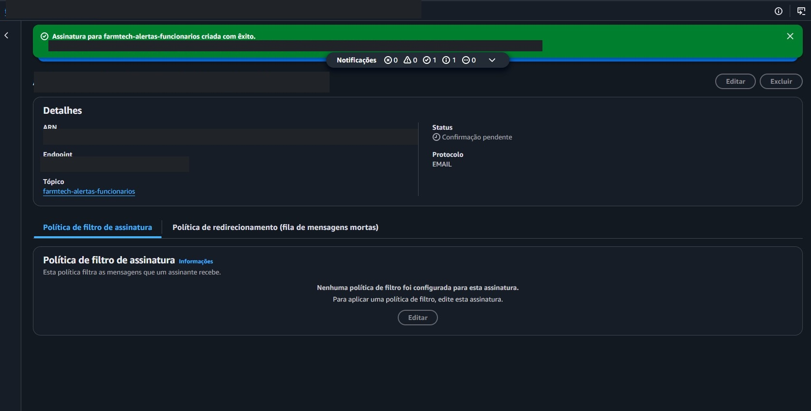

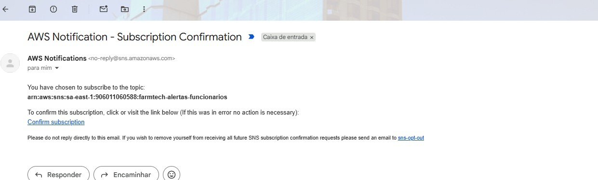

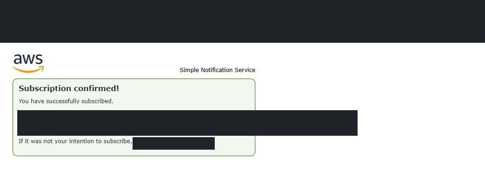

### 4. Testei a mensageria pelo portal (sem o código Python)

Publiquei uma mensagem de teste pelo console (**Publish message**) para provar o caminho SNS → e-mail antes de subir a EC2.

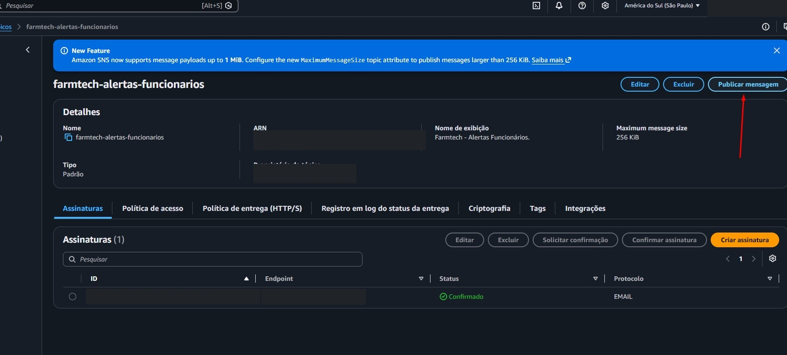

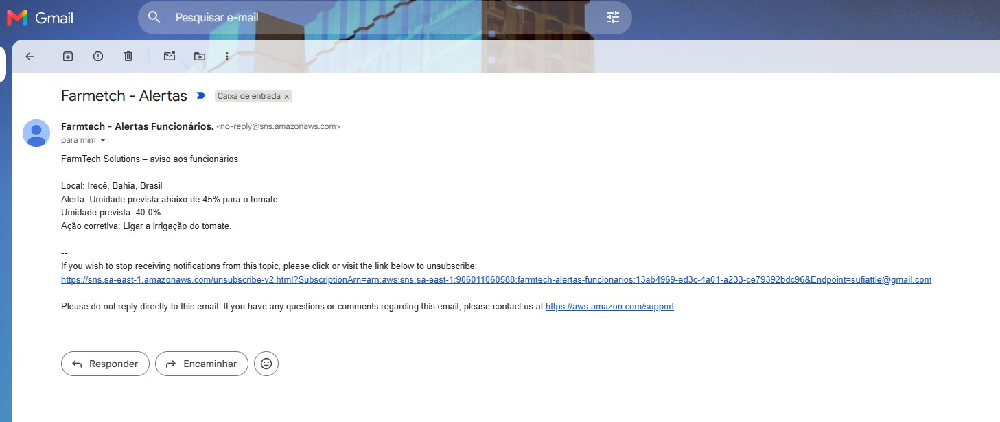

### 5. Criei a EC2 `farmtech-alertas` (padrão Fase 5)

- AMI: **Amazon Linux 2023**
- Tipo: **t3.micro**
- Nome: `farmtech-alertas`
- Key pair nova: `farmtech-alertas` (RSA, `.pem` baixado; fora do Git)
- Disco: **8 GiB gp3** (mantive o padrão da AMI nesta montagem; o enunciado da Fase 5 cita 50 GiB, mas para o monitor leve 8 GiB bastou)
- Security group: SSH apenas do meu IP


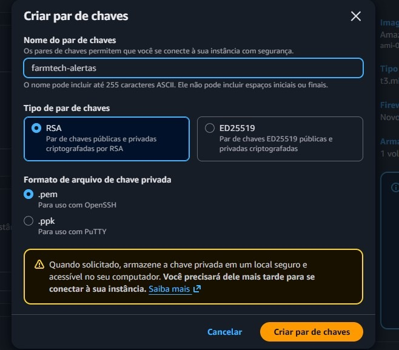

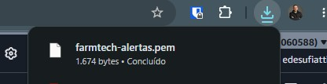


Instance id: `i-049d8140797bf7c73`.

### 6. Criei a role IAM e anexei à instância

No IAM criei o perfil/função `farmtech-alertas` com permissão mínima `sns:Publish` no ARN do tópico. Depois alterei a função IAM da EC2 para usar esse instance profile (sem gravar access key no projeto).


### 7. Conectei por SSH, instalei dependências e enviei o código

Entre na instância com a `.pem`:

```powershell
ssh -i .\farmtech-alertas.pem ec2-user@IP_PUBLICO
```

Na EC2 usei **Python 3.11** (o `python3` default quebra nas anotações `str | None` do pacote de integração). Instalei o `boto3` e fiz um deploy mínimo (código Python + pacote `farmtech_integracao` + script de previsão da F2 — **sem** `.md` auxiliares).

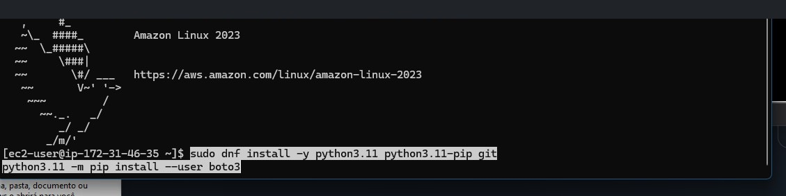


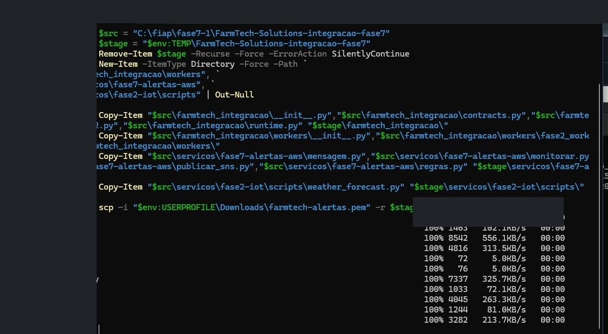

### 8. Rodei dry-run e depois `--enviar` na EC2

Exportei a região e o ARN, conferi o texto do e-mail sem publicar e, em seguida, publiquei de verdade:

```bash
export AWS_DEFAULT_REGION=sa-east-1
export AWS_SNS_TOPIC_ARN=arn:aws:sns:sa-east-1:906011060588:farmtech-alertas-funcionarios

cd /home/ec2-user/farmtech
python3.11 servicos/fase7-alertas-aws/monitorar.py --cidade "Irecê"
python3.11 servicos/fase7-alertas-aws/monitorar.py --cidade "Irecê" --enviar
```

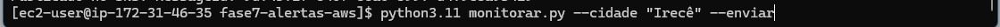


---

## Como rodar localmente

Na **raiz do repositório**, com Python 3.11+ (sem precisar de AWS):

```powershell
# Testes unitários das regras (sem rede e sem e-mail)
python -m unittest servicos/fase7-alertas-aws/test_regras.py -v

# Dry-run a partir de um JSON de exemplo
python servicos/fase7-alertas-aws/monitorar.py --arquivo servicos/fase7-alertas-aws/exemplo-previsao.json

# Dry-run consultando a Open-Meteo via Fase 2
python servicos/fase7-alertas-aws/monitorar.py --cidade "Irecê"
```

Sem `--enviar` o comando **só imprime** o assunto e o corpo. Não publica nada.

`--enviar` eu reservei para a EC2 em São Paulo, com `AWS_SNS_TOPIC_ARN` e a role IAM.

---

## Como rodar na EC2

1. SSH com a key pair `farmtech-alertas`.
2. Garantir `python3.11` e `boto3` (`pip install --user -r servicos/fase7-alertas-aws/requirements.txt`).
3. Exportar `AWS_DEFAULT_REGION` e `AWS_SNS_TOPIC_ARN`.
4. Executar a partir de `/home/ec2-user/farmtech` (raiz do projeto na instância), para o `sys.path` achar `farmtech_integracao`.

```bash
python3.11 -m unittest servicos/fase7-alertas-aws/test_regras.py -v
python3.11 servicos/fase7-alertas-aws/monitorar.py --cidade "Irecê"          # dry-run
python3.11 servicos/fase7-alertas-aws/monitorar.py --cidade "Irecê" --enviar # publica SNS
```

---

## Evidências de funcionamento

Cenário real capturado em **05/11/2026**:

| Campo | Valor observado |
|---|---|
| Local | Irecê, BA |
| Umidade prevista | **34%** (< 45%) |
| Ação | **Ligar irrigação** |
| MessageId SNS | `9d74b71f-640f-56a0-8997-d479e8a93429` |
| Remetente do e-mail | Farmtech - Alertas / `no-reply@sns.amazonaws.com` |


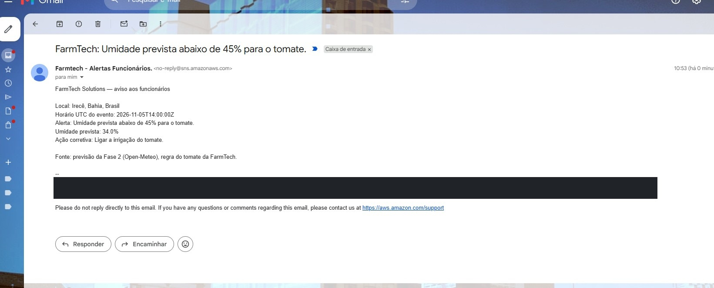

Com isso eu fechei o ciclo: previsão da Fase 2 → regra do tomate → publicação SNS → e-mail confirmado na caixa do funcionário.

---

## Estrutura de pastas / módulos

```text
servicos/fase7-alertas-aws/
├── README.md                 ← este arquivo
├── monitorar.py              ← CLI: --cidade / --arquivo / --horas / --enviar
├── regras.py                 ← limiares do tomate (chuva / umidade / janela 12 h)
├── mensagem.py               ← assunto e corpo do e-mail
├── publicar_sns.py           ← boto3 publish (só com --enviar)
├── test_regras.py            ← testes unitários das regras
├── exemplo-previsao.json     ← JSON de Result ok da Fase 2 para dry-run offline
├── requirements.txt          ← boto3>=1.35.0
├── .env.example              ← modelo de AWS_DEFAULT_REGION / AWS_SNS_TOPIC_ARN
└── .gitignore

assets/aws-notifications/     ← prints das evidências (referenciados acima)
farmtech_integracao/fase2/    ← forecast → Open-Meteo (reutilizado, não alterado na dashboard)
```

Módulos Python (resumo):

| Arquivo | Responsabilidade |
|---|---|
| `monitorar.py` | Orquestra leitura da previsão, avaliação, anti-repeat 6 h e publicação opcional |
| `regras.py` | `avaliar(hourly)` — chuva ≥ 1 mm / umidade < 45% / > 80% / janela 12 h |
| `mensagem.py` | Monta assunto (`FarmTech: …`) e corpo em português |
| `publicar_sns.py` | `boto3.client("sns").publish(...)`; exige ARN em `sa-east-1` |

Não alterei a dashboard da Fase 4. Este serviço é independente e vive nesta pasta.

---

## Observações de custo e limpeza

Os recursos desta Parte 2 são **temporários**, só para evidência acadêmica:

- **EC2 `t3.micro` + EBS 8 GiB gp3** geram custo enquanto a instância estiver *running*.
- **SNS** (e-mail) tem custo residual baixo no free tier acadêmico, mas o tópico e a assinatura também podem ser removidos após a correção.
- Após capturar as evidências, eu **paro (`Stop`) ou termino (`Terminate`)** a EC2 `farmtech-alertas` (`i-049d8140797bf7c73`) para não deixar cobrança ociosa. O tear down pode ainda estar pendente no momento da leitura deste README — conferir no console EC2/SNS em `sa-east-1`.
- A key pair `.pem` permanece só na minha máquina local; não vai para o Git.
- Arquivos auxiliares de rascunho do portal (`PORTAL-AWS-TEMPORARIO.md`) devem ser apagados antes da entrega final, conforme o próprio plano da disciplina.

Calculadora de referência da disciplina (Fase 5): [AWS Pricing Calculator](https://calculator.aws) — a estimativa histórica da EC2+EBS (~US$ 19,86/mês) **não** inclui o SNS; o e-mail entra à parte.

---

## Créditos

**FIAP — Faculdade de Informática e Administração Paulista**  
FarmTech Solutions · Integração Fase 7 · Parte 2 (Alertas AWS)  
Edemir Sufiatti · RM 571375 · branch `feature/alertas-aws-edemir`
